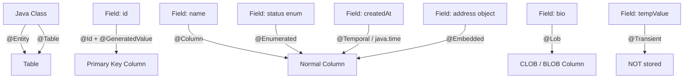
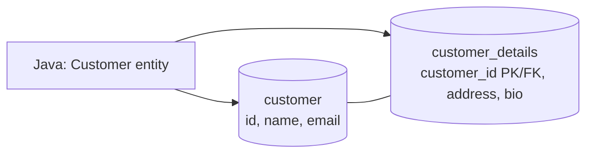
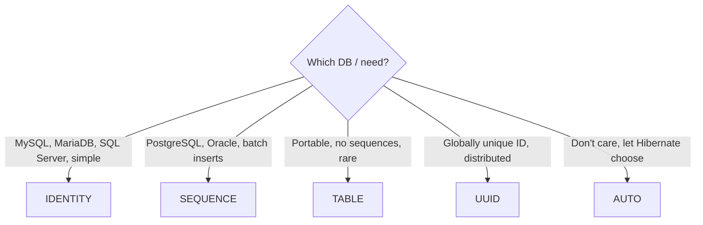
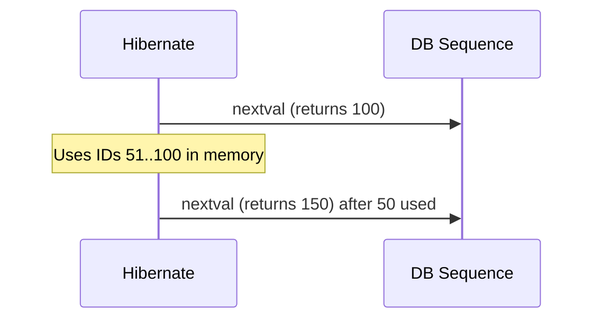
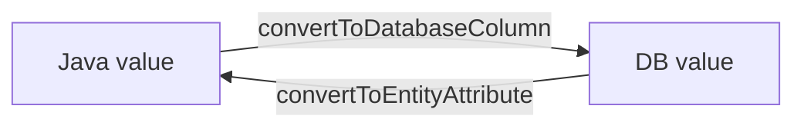
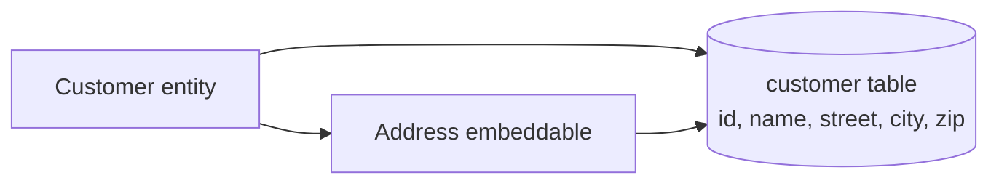

# JPA Entity & Mapping Annotations — Complete Tutorial

> Target: Spring Boot 3.x, Jakarta Persistence (JPA 3.1), Hibernate 6.
> All imports use `jakarta.persistence.*` (Spring Boot 2.x used `javax.persistence.*`).

---

## 0. The Big Picture

JPA (Jakarta Persistence API) lets you map a **Java class** to a **database table** using **annotations**. You write a normal Java class, add annotations, and the JPA provider (Hibernate) creates SQL for you.



**Annotation groups we will cover**

| Group | Annotations |
|---|---|
| Table level | `@Entity`, `@Table`, `@UniqueConstraint`, `@Index`, `@SecondaryTable` |
| Primary key | `@Id`, `@GeneratedValue`, `@SequenceGenerator`, `@TableGenerator`, UUID |
| Column level | `@Column`, `@Basic`, `@Transient`, `@Enumerated`, `@Temporal`, `@Lob`, `@Convert`, `@Access` |
| Composite / reusable | `@Embeddable`, `@Embedded`, `@AttributeOverride`, `@EmbeddedId`, `@IdClass` |
| Extras (bonus) | `@Version`, lifecycle callbacks, `@ElementCollection`, Hibernate extras |

---

## 1. `@Entity`

### Simple explanation
`@Entity` tells JPA: "This class is stored in a database table." Without it, JPA ignores the class.

### Rules for an entity class
- Must have `@Entity`.
- Must have a **public or protected no-argument constructor** (JPA uses it to create objects).
- Must **not be `final`** (Hibernate creates proxies by extending it). Fields should not be `final` either.
- Must have at least one `@Id` field.

### Attribute
| Attribute | Meaning | Default |
|---|---|---|
| `name` | The entity name used in **JPQL** queries (not the table name!) | Unqualified class name |

### Snippet
```java
import jakarta.persistence.*;

@Entity(name = "ProductEntity")        // JPQL name. Query: "select p from ProductEntity p"
public class Product {

    @Id
    private Long id;

    private String title;

    protected Product() { }            // required no-arg constructor
}
```

> **Anti-pattern:** Thinking `@Entity(name="x")` renames the *table*. It does **not**. Use `@Table(name="x")` for the table name.

---

## 2. `@Table`

### Simple explanation
`@Table` controls **which table** the entity maps to and adds table-level settings (schema, constraints, indexes). If you skip `@Table`, the table name is derived from the class name (Spring Boot's naming strategy turns `OrderItem` into `order_item`).

### All attributes
| Attribute | Meaning | Default |
|---|---|---|
| `name` | Table name | Entity name (naming strategy applied) |
| `schema` | Database schema (e.g. `sales`) | Default schema of the connection |
| `catalog` | Database catalog (in MySQL = the database; in PostgreSQL rarely used) | Default catalog |
| `uniqueConstraints` | Array of `@UniqueConstraint` (unique on one or **many** columns) | none |
| `indexes` | Array of `@Index` to create DB indexes | none |
| *(Hibernate only)* `@Check(constraints=...)` | Separate annotation for SQL CHECK constraints | none |

> **Schema vs Catalog:** A *catalog* contains *schemas*, a schema contains *tables*. `catalog.schema.table`. Most apps only use `schema`.

### 2.1 `@UniqueConstraint`
Used **inside** `@Table`. Needed when uniqueness depends on a **combination** of columns.

| Attribute | Meaning |
|---|---|
| `name` | Constraint name in DB (optional but recommended) |
| `columnNames` | Array of **column names** (not field names!) |

### 2.2 `@Index`
| Attribute | Meaning |
|---|---|
| `name` | Index name |
| `columnList` | Comma-separated columns, optional `ASC`/`DESC`: `"last_name ASC, first_name DESC"` |
| `unique` | `true` = unique index (default `false`) |

### Combined snippet (many attributes together)
```java
@Entity
@Table(
    name = "employees",                       // table name in DB
    schema = "hr",                            // hr.employees
    catalog = "company_db",                   // catalog.schema.table
    uniqueConstraints = {
        @UniqueConstraint(
            name = "uk_employee_email",
            columnNames = {"email"}),         // single-column unique
        @UniqueConstraint(
            name = "uk_employee_dept_code",
            columnNames = {"department_id", "emp_code"})  // composite unique
    },
    indexes = {
        @Index(name = "idx_emp_last_name", columnList = "last_name"),
        @Index(name = "idx_emp_name_sort", columnList = "last_name ASC, first_name DESC"),
        @Index(name = "idx_emp_phone", columnList = "phone", unique = true)
    }
)
public class Employee {

    @Id
    @GeneratedValue(strategy = GenerationType.IDENTITY)
    private Long id;

    @Column(name = "first_name") private String firstName;
    @Column(name = "last_name")  private String lastName;
    private String email;
    private String phone;
    @Column(name = "department_id") private Long departmentId;
    @Column(name = "emp_code")      private String empCode;
}
```

### Explanation of the snippet
1. `name`, `schema`, `catalog` → final SQL targets `company_db.hr.employees`.
2. `uk_employee_email` → no two employees share an email.
3. `uk_employee_dept_code` → the **pair** (department, code) is unique. The same `emp_code` is allowed in different departments.
4. `idx_emp_name_sort` → composite index used to speed up `ORDER BY last_name, first_name DESC`.
5. `idx_emp_phone` with `unique = true` → works like a unique constraint but is created as an index.

> **Note:** `columnNames` / `columnList` use **database column names**, so `"last_name"`, not `"lastName"`.

> **Anti-pattern:** Relying on `spring.jpa.hibernate.ddl-auto=update` to create indexes/constraints in production. Use Flyway/Liquibase; the annotations are most useful for dev/test schema generation and documentation.

### Spring Boot properties that affect table naming
```properties
spring.jpa.hibernate.ddl-auto=create-drop      # none | validate | update | create | create-drop
spring.jpa.show-sql=true
# keep names exactly as written (no snake_case conversion):
spring.jpa.hibernate.naming.physical-strategy=org.hibernate.boot.model.naming.PhysicalNamingStrategyStandardImpl
```

---

## 3. `@SecondaryTable` / `@SecondaryTables`

### Simple explanation
Normally 1 entity = 1 table. With `@SecondaryTable`, **one entity is stored across 2 (or more) tables**, sharing the same primary key. Useful when a legacy DB split data (e.g., basic info in one table, rarely-used big data in another).



### Attributes of `@SecondaryTable`
| Attribute | Meaning | Default |
|---|---|---|
| `name` | Name of the secondary table (**required**) | — |
| `catalog` | Catalog of the table | default |
| `schema` | Schema of the table | default |
| `pkJoinColumns` | Array of `@PrimaryKeyJoinColumn` — how the secondary table's PK links to the primary table's PK | same name as primary PK |
| `foreignKey` | `@ForeignKey` config for the join | provider default |
| `uniqueConstraints` | Unique constraints on the secondary table | none |
| `indexes` | Indexes on the secondary table | none |

### `@PrimaryKeyJoinColumn` attributes
| Attribute | Meaning |
|---|---|
| `name` | Column in the **secondary** table that holds the PK/FK |
| `referencedColumnName` | PK column in the **primary** table |
| `columnDefinition` | Raw DDL for the column |
| `foreignKey` | FK settings |

### Snippet
```java
@Entity
@Table(name = "customer")
@SecondaryTable(
    name = "customer_details",
    schema = "public",
    pkJoinColumns = @PrimaryKeyJoinColumn(
        name = "customer_id",               // column in customer_details
        referencedColumnName = "id"),       // column in customer
    uniqueConstraints = @UniqueConstraint(columnNames = "tax_number"),
    indexes = @Index(columnList = "city")
)
public class Customer {

    @Id
    @GeneratedValue(strategy = GenerationType.IDENTITY)
    private Long id;

    private String name;                                        // stored in "customer"

    @Column(table = "customer_details", name = "city")          // stored in "customer_details"
    private String city;

    @Column(table = "customer_details", name = "tax_number")
    private String taxNumber;
}
```

For **more than one** secondary table:
```java
@SecondaryTables({
    @SecondaryTable(name = "customer_details"),
    @SecondaryTable(name = "customer_audit")
})
```

### Explanation
- Fields **without** `table=` go to the primary table.
- Fields with `@Column(table = "customer_details")` go to the secondary table.
- On `save()`, Hibernate runs **two INSERTs** (one per table); on `find`, it uses a **JOIN**.

> **Anti-pattern:** Using `@SecondaryTable` for new designs. A `@OneToOne` relation or `@Embedded` object is usually cleaner. Use secondary tables mainly for legacy schemas.

---

## 4. Primary Key: `@Id`

### Simple explanation
Every entity needs a **primary key** — a value that uniquely identifies each row. `@Id` marks the field that is the primary key.

### Allowed types
`int/Integer`, `long/Long`, `short`, `byte`, `char`, `String`, `UUID`, `BigInteger`, `BigDecimal`, `java.util.Date`, `java.sql.Date`. **Prefer `Long` or `UUID`** (wrapper types can be `null` before saving, which is how JPA knows the entity is new).

```java
@Entity
public class Book {
    @Id                       // you must set the id yourself before save()
    private Long id;
}
```
`@Id` has **no attributes**. To rename the column use `@Column(name="book_id")`.

---

## 5. `@GeneratedValue`

### Simple explanation
Instead of setting IDs manually, ask JPA/DB to **generate** them automatically.

### Attributes
| Attribute | Meaning | Default |
|---|---|---|
| `strategy` | A `GenerationType` (AUTO, IDENTITY, SEQUENCE, TABLE, UUID) | `AUTO` |
| `generator` | Name of a `@SequenceGenerator` / `@TableGenerator` (or custom generator) to use | provider default |

### 5.1 `GenerationType` values



| Type | How it works | Pros | Cons |
|---|---|---|---|
| **AUTO** | Provider picks. In Hibernate 6: `UUID` fields → UUID; numeric → **SEQUENCE** (or TABLE if DB lacks sequences) | Portable, zero config | Behaviour changes between DBs/versions (Hibernate 5 vs 6!) |
| **IDENTITY** | DB auto-increment column (`AUTO_INCREMENT`, `SERIAL`, `IDENTITY`) | Simple | Hibernate must INSERT immediately to learn the ID → **disables JDBC batch inserts** |
| **SEQUENCE** | DB sequence object is queried (`nextval`) before insert | Fast, supports batching, preload IDs with `allocationSize` | Not on MySQL < 8 (MariaDB 10.3+ OK) |
| **TABLE** | A separate table holds "next id" counters | Works on any DB | Slowest (row locks); use only when nothing else works |
| **UUID** (JPA 3.1) | App generates a random 128-bit UUID | No DB round trip, globally unique, merge-friendly | 16 bytes, random → index fragmentation, hard to read |

### Snippets — one per strategy
```java
// AUTO
@Id @GeneratedValue                                      // same as strategy = AUTO
private Long id;

// IDENTITY  (MySQL / SQL Server)
@Id @GeneratedValue(strategy = GenerationType.IDENTITY)
private Long id;

// SEQUENCE  (PostgreSQL / Oracle) – uses default sequence "<entity>_seq"
@Id @GeneratedValue(strategy = GenerationType.SEQUENCE)
private Long id;

// TABLE  (portable)
@Id @GeneratedValue(strategy = GenerationType.TABLE)
private Long id;

// UUID  (JPA 3.1 / Hibernate 6)
@Id @GeneratedValue(strategy = GenerationType.UUID)
private UUID id;
```

> **Anti-pattern:** Using `IDENTITY` and then expecting `saveAll()` of 10,000 rows to be fast. Hibernate cannot batch IDENTITY inserts. Switch to SEQUENCE for bulk workloads.

---

## 6. `@SequenceGenerator`

### Simple explanation
Customizes **how a DB sequence is used**: its name, starting value and how many IDs Hibernate "reserves" per DB call.

### Attributes
| Attribute | Meaning | Default |
|---|---|---|
| `name` | **Generator name** — referenced by `@GeneratedValue(generator = "...")` (required) | — |
| `sequenceName` | Real sequence name in the DB | provider generated (`<entity>_seq`) |
| `initialValue` | First value of the sequence | `1` |
| `allocationSize` | Step size / how many IDs are cached in memory per DB call | `50` |
| `catalog` | Catalog holding the sequence | default |
| `schema` | Schema holding the sequence | default |

### How `allocationSize` works (important!)
With `allocationSize = 50`, Hibernate asks the DB for `nextval` **once**, gets e.g. `100`, and then hands out IDs `51…100` from memory without touching the DB. So the DB is hit once per 50 inserts.



> **Rule:** `allocationSize` **must equal** the sequence's `INCREMENT BY` in the database. If the DB sequence increments by 1 but allocationSize is 50, you get duplicate IDs or errors.

### Snippet
```java
@Entity
@Table(name = "orders")
public class Order {

    @Id
    @GeneratedValue(strategy = GenerationType.SEQUENCE, generator = "order_seq_gen")
    @SequenceGenerator(
        name = "order_seq_gen",        // referenced above
        sequenceName = "order_seq",    // real DB sequence
        initialValue = 1000,           // first id ≈ 1000
        allocationSize = 10,           // fetch 10 ids at a time
        schema = "sales",
        catalog = "shop_db"
    )
    private Long id;
}
```
Equivalent DB script:
```sql
CREATE SEQUENCE sales.order_seq START WITH 1000 INCREMENT BY 10;
```

> `@SequenceGenerator` can also be placed **on the class** so several entities can share it.

---

## 7. `@TableGenerator`

### Simple explanation
Stores "next ID" counters in a **normal table** (one row per generator). Works on every DB, but is slow. Use only when sequences and identity are unavailable.

### Attributes
| Attribute | Meaning | Default |
|---|---|---|
| `name` | Generator name (required) | — |
| `table` | Name of the generator table | provider default |
| `catalog` / `schema` | Where the table lives | default |
| `pkColumnName` | Column that names the counter (the "key" column) | provider default |
| `valueColumnName` | Column that stores the last/next value | provider default |
| `pkColumnValue` | The value in the key column for **this** generator (row identity) | entity name |
| `initialValue` | Starting value | `0` |
| `allocationSize` | IDs reserved per DB hit | `50` |
| `uniqueConstraints` | Constraints on the generator table | none |
| `indexes` | Indexes on the generator table | none |

### Resulting table (conceptually)
| gen_name (pkColumnName) | gen_value (valueColumnName) |
|---|---|
| `invoice_gen` (pkColumnValue) | 1050 |
| `customer_gen` | 300 |

### Snippet
```java
@Entity
public class Invoice {

    @Id
    @GeneratedValue(strategy = GenerationType.TABLE, generator = "invoice_table_gen")
    @TableGenerator(
        name = "invoice_table_gen",
        table = "id_generator",          // table holding counters
        schema = "public",
        pkColumnName = "gen_name",       // key column
        valueColumnName = "gen_value",   // value column
        pkColumnValue = "invoice_gen",   // this entity's row key
        initialValue = 1000,
        allocationSize = 20
    )
    private Long id;
}
```

---

## 8. UUID Primary Keys

### Simple explanation
A UUID (Universally Unique Identifier) looks like `123e4567-e89b-12d3-a456-426614174000`. It is generated in Java, so no DB call is needed, and IDs never clash even across databases.

### Option A — JPA 3.1 standard
```java
@Id
@GeneratedValue(strategy = GenerationType.UUID)
private UUID id;
```

### Option B — Hibernate annotation (older / more control)
```java
import org.hibernate.annotations.UuidGenerator;

@Id
@GeneratedValue
@UuidGenerator                                   // random UUID v4
// @UuidGenerator(style = UuidGenerator.Style.TIME)  // time-based, index-friendlier
private UUID id;
```

### Option C — assign manually
```java
@Id
private UUID id = UUID.randomUUID();             // set in constructor/field
```

### Column type
```java
@Id
@GeneratedValue(strategy = GenerationType.UUID)
@Column(columnDefinition = "uuid")               // PostgreSQL native uuid type
private UUID id;
```
On MySQL, Hibernate 6 stores UUID as `BINARY(16)` by default. Use `@JdbcTypeCode(SqlTypes.CHAR)` to store as readable text.

> **Anti-pattern:** Using `String id` with random UUID in a clustered-index DB (MySQL InnoDB): random inserts fragment the index. Prefer time-ordered UUIDs (`Style.TIME`) or a numeric sequence.

---

## 9. `@Column`

### Simple explanation
`@Column` customizes **one column**. It is optional — without it, JPA uses the field name and defaults.

### All attributes
| Attribute | Meaning | Default |
|---|---|---|
| `name` | Column name | field name (naming strategy applied) |
| `unique` | Adds a UNIQUE constraint to this column | `false` |
| `nullable` | `false` → `NOT NULL` | `true` |
| `insertable` | Include column in SQL `INSERT`? | `true` |
| `updatable` | Include column in SQL `UPDATE`? | `true` |
| `columnDefinition` | Raw SQL type/definition fragment, e.g. `"TEXT"`, `"VARCHAR(50) DEFAULT 'N/A'"` | provider-generated |
| `table` | Which table holds the column (for `@SecondaryTable`) | primary table |
| `length` | Max length for **String** columns (VARCHAR size) | `255` |
| `precision` | Total number of digits for **decimal** types | `0` (DB default) |
| `scale` | Digits **after** decimal point | `0` |
| `check` / `comment` / `options` (newer JPA 3.2 / Hibernate: `@Comment`) | Extras, provider/version dependent | — |

> **Precision & scale example:** `123.45` has `precision = 5`, `scale = 2`. So `DECIMAL(5,2)` stores up to `999.99`.
> `length` applies **only** to Strings; `precision/scale` apply **only** to numbers (and `precision` to time fractions in some DBs).

### Combined snippet
```java
@Entity
@Table(name = "products")
public class Product {

    @Id @GeneratedValue(strategy = GenerationType.IDENTITY)
    private Long id;

    @Column(name = "product_name", nullable = false, length = 100, unique = true)
    private String name;                              // VARCHAR(100) NOT NULL UNIQUE

    @Column(name = "price", nullable = false, precision = 10, scale = 2)
    private BigDecimal price;                         // DECIMAL(10,2) -> 99999999.99

    @Column(name = "sku_code", updatable = false)     // never changes after INSERT
    private String skuCode;

    @Column(name = "created_by", insertable = false)  // DB trigger/default fills it, JPA never inserts it
    private String createdBy;

    @Column(name = "status_text", columnDefinition = "VARCHAR(20) DEFAULT 'ACTIVE'")
    private String statusText;

    @Column(name = "description", columnDefinition = "TEXT")
    private String description;                       // exact DB type TEXT
}
```

### Explanation
- `unique = true` + `nullable = false` → good for business keys like email.
- `updatable = false` → protects immutable data (e.g., creation date). JPA drops it from `UPDATE` statements.
- `insertable = false, updatable = false` together make a **read-only** column (often used when the same column is mapped twice, e.g. FK id and relation).
- `columnDefinition` is **DB-specific** → hurts portability. Use only when needed.

> **Anti-pattern:** Forgetting `length` for long text. A 5000-char string in default `VARCHAR(255)` fails with *"value too long"*. Use `@Column(length = 5000)` or `@Lob`.

> **Note:** `@Column(nullable=false)` is only a **DDL hint** plus a Hibernate pre-insert check. For input validation use Bean Validation (`@NotNull`, `@Size`) as well.

---

## 10. `@Basic`

### Simple explanation
`@Basic` is the **default** mapping for simple types (String, int, boolean, dates…). You rarely write it; it's needed only to set `optional` or `fetch`.

### Attributes
| Attribute | Meaning | Default |
|---|---|---|
| `optional` | Can the value be `null`? (`false` → NOT NULL) | `true` |
| `fetch` | `FetchType.EAGER` (load with the entity) or `FetchType.LAZY` (load on first access) | `EAGER` |

```java
@Basic(optional = false)                      // like @Column(nullable = false)
private String username;

@Basic(fetch = FetchType.LAZY)                // lazy only works with bytecode enhancement
@Lob
private byte[] photo;
```
> **Important:** `LAZY` on a basic attribute is only a hint; Hibernate honors it **only if bytecode enhancement** is enabled (`hibernate-enhance-maven-plugin`, `enableLazyInitialization=true`). Otherwise the value is loaded eagerly. Also, primitives (`int`) can't be `null`, so they are effectively `optional=false`.

---

## 11. `@Transient`

### Simple explanation
Marks a field as **not stored** in the DB. Use it for calculated or temporary values.

```java
@Entity
public class Employee {
    @Id private Long id;
    private LocalDate birthDate;

    @Transient                                  // not a column
    private int age;                            // computed at runtime

    public int getAge() { return Period.between(birthDate, LocalDate.now()).getYears(); }
}
```
> The Java keyword `transient` also works (it excludes from Java serialization **and** from JPA). `@Transient` only affects JPA. Prefer `@Transient`.
> **Static** and **final** fields are never persisted anyway.

---

## 12. `@Enumerated`

### Simple explanation
Stores a Java `enum` in the database. You choose **how**: as a number or as text.

### Attribute
| Attribute | Meaning | Default |
|---|---|---|
| `value` | An `EnumType` | `EnumType.ORDINAL` |

### `EnumType` values
| Type | Stored as | Example for `Status.ACTIVE` | Risk |
|---|---|---|---|
| `ORDINAL` | Position index (0, 1, 2…) | `1` | **Dangerous**: if you reorder/insert enum constants, existing data silently becomes wrong |
| `STRING` | Constant name | `'ACTIVE'` | Renaming a constant breaks old rows (but safer overall) |

(Hibernate 6 adds `@JdbcTypeCode(SqlTypes.NAMED_ENUM)` for native DB enums on PostgreSQL.)

```java
public enum OrderStatus { NEW, PAID, SHIPPED, CANCELLED }

@Entity
public class Order {
    @Id @GeneratedValue private Long id;

    @Enumerated(EnumType.STRING)                  // stores 'NEW', 'PAID' ...
    @Column(nullable = false, length = 20)
    private OrderStatus status;

    @Enumerated(EnumType.ORDINAL)                 // stores 0,1,2,3 (default if omitted)
    private OrderStatus legacyStatus;
}
```
> **Anti-pattern:** Leaving `@Enumerated` off. The default is **ORDINAL**. Always write `EnumType.STRING`.

---

## 13. `@Temporal`

### Simple explanation
Databases have 3 kinds of date/time columns: **date only**, **time only**, **date + time**. For the old Java types `java.util.Date` and `java.util.Calendar`, JPA can't tell which one you want, so you tell it with `@Temporal`.

### Attribute
| Attribute | Meaning |
|---|---|
| `value` | A `TemporalType` (required) |

### `TemporalType` values
| Type | DB type | Stores | Example |
|---|---|---|---|
| `DATE` | `DATE` | year-month-day | `2026-10-28` |
| `TIME` | `TIME` | hour:minute:second | `14:30:00` |
| `TIMESTAMP` | `TIMESTAMP` | date + time | `2026-10-28 14:30:00` |

```java
@Temporal(TemporalType.DATE)
private Date birthDate;                    // only the date

@Temporal(TemporalType.TIME)
private Date openingTime;                  // only the time

@Temporal(TemporalType.TIMESTAMP)
private Calendar createdAt;                // date + time
```

### Modern way (recommended)
`@Temporal` is **not needed** (and not allowed) for `java.time` types. They map automatically:

| Java type | DB type |
|---|---|
| `LocalDate` | DATE |
| `LocalTime` | TIME |
| `LocalDateTime` | TIMESTAMP |
| `OffsetDateTime` / `ZonedDateTime` / `Instant` | TIMESTAMP WITH TIME ZONE (or UTC timestamp) |

```java
private LocalDate birthDate;
private LocalDateTime createdAt;
private Instant lastLogin;
```
> **Anti-pattern:** Using `java.util.Date` in new code. Use `java.time`.

---

## 14. `@Lob` (Large Object)

### Simple explanation
For very large data that does not fit a normal column: long text (articles) or binary data (images, PDFs).

| Java type | DB type |
|---|---|
| `String`, `char[]`, `Character[]` | **CLOB** (Character LOB) |
| `byte[]`, `Byte[]`, `Serializable` objects | **BLOB** (Binary LOB) |

`@Lob` has **no attributes**.

```java
@Entity
public class Document {
    @Id @GeneratedValue private Long id;

    @Lob
    @Column(name = "content")
    private String content;               // CLOB

    @Lob
    @Basic(fetch = FetchType.LAZY)        // avoid loading big file every time (needs enhancement)
    @Column(name = "file_data")
    private byte[] fileData;              // BLOB
}
```
> **PostgreSQL warning:** `@Lob String` becomes an `oid` (large object) type, which causes problems with `@Transactional`-less reads. Prefer `@Column(columnDefinition = "TEXT")` for text, and `bytea` for binary.
> **Design tip:** Store big files in object storage (S3) and keep only the URL in DB.

---

## 15. `@Convert` and `@Converter`

### Simple explanation
A converter translates a Java type into a DB type and back, e.g. `List<String>` ↔ `"a,b,c"`, or `boolean` ↔ `'Y'/'N'`.



### Step 1 — Create the converter
```java
@Converter(autoApply = false)                 // true = applies to ALL attributes of this Java type
public class BooleanYNConverter implements AttributeConverter<Boolean, String> {

    @Override
    public String convertToDatabaseColumn(Boolean value) {
        return (value != null && value) ? "Y" : "N";
    }

    @Override
    public Boolean convertToEntityAttribute(String dbValue) {
        return "Y".equals(dbValue);
    }
}
```

### Step 2 — Use `@Convert`
| Attribute | Meaning |
|---|---|
| `converter` | The converter class to use |
| `attributeName` | Used on **embedded/collection** fields to point to a nested attribute (e.g. `"address.city"`, `"key"`, `"value"`) |
| `disableConversion` | `true` = turn OFF an `autoApply` converter for this field |

```java
@Convert(converter = BooleanYNConverter.class)
@Column(length = 1)
private Boolean active;                       // stored as 'Y' / 'N'

@Convert(disableConversion = true)            // skip auto-applied converter
private Boolean rawFlag;

@Convert(converter = UpperCaseConverter.class, attributeName = "city")   // on embedded field
@Embedded private Address address;
```
> **Notes:** Converters can't be used on `@Id`, `@Version`, relationship fields, or `@Enumerated`/`@Temporal` fields.

---

## 16. `@Access`

### Simple explanation
Tells JPA **where to read the annotations and values from**: your **fields** or your **getters**.

| AccessType | JPA reads | When it is chosen |
|---|---|---|
| `FIELD` | Directly from fields (even private) | When `@Id` is placed on a **field** (most common) |
| `PROPERTY` | Via getter/setter methods | When `@Id` is placed on a **getter** |

The default is decided by **where you put `@Id`**.

```java
@Entity
@Access(AccessType.FIELD)                     // class-level default
public class Person {

    @Id private Long id;
    private String firstName;
    private String lastName;

    @Transient private String fullName;

    @Access(AccessType.PROPERTY)              // this one attribute uses its getter/setter
    @Column(name = "full_name")
    public String getFullName() { return firstName + " " + lastName; }
    public void setFullName(String s) { /* parse if needed */ }
}
```
> **Rule:** Never mix annotations on fields and getters without `@Access`; the result is confusing mapping errors.

---

## 17. `@Embeddable` and `@Embedded`

### Simple explanation
Group related fields (e.g., street, city, zip) into a **reusable class**. In the DB the columns are stored **inside the owner's table** — no extra table.



### Snippet
```java
@Embeddable
public class Address {
    private String street;
    private String city;

    @Column(name = "zip_code", length = 10)
    private String zip;

    protected Address() {}
    public Address(String street, String city, String zip) { /* ... */ }
}

@Entity
public class Customer {
    @Id @GeneratedValue private Long id;
    private String name;

    @Embedded
    private Address address;                  // columns: street, city, zip_code
}
```
> `@Embedded` on the field is optional if the class has `@Embeddable` — but writing both is clearer.

### 17.1 `@AttributeOverride` / `@AttributeOverrides`
Needed when you embed the **same class twice** (column names would clash), or want different column names.

| Attribute | Meaning |
|---|---|
| `name` | Field name **inside the embeddable** (`"street"`, or `"nested.field"`) |
| `column` | A `@Column` describing the new column |

```java
@Entity
public class Company {
    @Id @GeneratedValue private Long id;

    @Embedded
    @AttributeOverrides({
        @AttributeOverride(name = "street", column = @Column(name = "hq_street")),
        @AttributeOverride(name = "city",   column = @Column(name = "hq_city")),
        @AttributeOverride(name = "zip",    column = @Column(name = "hq_zip"))
    })
    private Address headOffice;

    @Embedded
    @AttributeOverrides({
        @AttributeOverride(name = "street", column = @Column(name = "br_street")),
        @AttributeOverride(name = "city",   column = @Column(name = "br_city")),
        @AttributeOverride(name = "zip",    column = @Column(name = "br_zip"))
    })
    private Address branchOffice;
}
```
Related: `@AssociationOverride` (changes join columns of relationships inside an embeddable).

---

## 18. Composite Primary Keys: `@EmbeddedId` and `@IdClass`

### Simple explanation
Sometimes **one column isn't enough** to identify a row, e.g. `(order_id, product_id)` in an order-line table. JPA has two ways.

### Rules for any composite key class
1. `public` (or protected) **no-arg constructor**
2. Implements `Serializable`
3. Overrides `equals()` and `hashCode()`

### 18.1 `@EmbeddedId` — key as one embedded object
```java
@Embeddable
public class OrderItemId implements Serializable {
    @Column(name = "order_id")   private Long orderId;
    @Column(name = "product_id") private Long productId;

    public OrderItemId() {}
    public OrderItemId(Long orderId, Long productId) { this.orderId = orderId; this.productId = productId; }

    @Override public boolean equals(Object o) {
        if (this == o) return true;
        if (!(o instanceof OrderItemId that)) return false;
        return Objects.equals(orderId, that.orderId) && Objects.equals(productId, that.productId);
    }
    @Override public int hashCode() { return Objects.hash(orderId, productId); }
}

@Entity
@Table(name = "order_items")
public class OrderItem {
    @EmbeddedId
    private OrderItemId id;                    // ONE field holds the whole key

    private int quantity;
}
```
Usage: `repo.findById(new OrderItemId(1L, 5L));`
Spring Data: `interface OrderItemRepo extends JpaRepository<OrderItem, OrderItemId> {}`
Query by part: `findById_OrderId(Long orderId)`.

### 18.2 `@IdClass` — key fields stay in the entity
```java
public class OrderItemPK implements Serializable {   // plain class, NOT @Embeddable
    private Long orderId;                            // names & types MUST match entity fields
    private Long productId;
    public OrderItemPK() {}
    // equals() and hashCode() ...
}

@Entity
@IdClass(OrderItemPK.class)
public class OrderItem {
    @Id private Long orderId;
    @Id private Long productId;
    private int quantity;
}
```
Usage: `repo.findById(new OrderItemPK(1L, 5L));`

### Comparison
| Feature | `@EmbeddedId` | `@IdClass` |
|---|---|---|
| Key fields live in | The key class (embedded) | The entity itself |
| Annotation on key class | `@Embeddable` | none |
| Access a key part in JPQL | `o.id.orderId` | `o.orderId` |
| Best when | You pass the key around as one object | Legacy code, simple field access |

### `@MapsId` (bonus)
Use with `@EmbeddedId` when a key part is also a **foreign key** to another entity:
```java
@EmbeddedId private OrderItemId id;

@ManyToOne @MapsId("orderId")    private Order order;      // fills id.orderId
@ManyToOne @MapsId("productId")  private Product product;  // fills id.productId
```

---

## 19. Things You Missed (Bonus Annotations)

### 19.1 `@Version` — optimistic locking
Prevents two users from overwriting each other's changes. Hibernate increments it on every update.
```java
@Version
private Long version;           // also int, short, Integer, Timestamp, Instant
```
If versions mismatch → `OptimisticLockException`.

### 19.2 Lifecycle callbacks
Methods run automatically at certain moments.

| Annotation | When |
|---|---|
| `@PrePersist` | before INSERT |
| `@PostPersist` | after INSERT |
| `@PreUpdate` | before UPDATE |
| `@PostUpdate` | after UPDATE |
| `@PreRemove` / `@PostRemove` | before / after DELETE |
| `@PostLoad` | after loading from DB |

```java
@PrePersist  void onCreate() { createdAt = LocalDateTime.now(); }
@PreUpdate   void onUpdate() { updatedAt = LocalDateTime.now(); }
```

### 19.3 Hibernate timestamp helpers
```java
@CreationTimestamp @Column(updatable = false) private LocalDateTime createdAt;
@UpdateTimestamp                              private LocalDateTime updatedAt;
```
Or Spring Data auditing: `@EnableJpaAuditing` + `@CreatedDate`, `@LastModifiedDate`, `@CreatedBy` with `@EntityListeners(AuditingEntityListener.class)`.

### 19.4 `@ElementCollection` + `@CollectionTable`
Store a list of simple values or embeddables in a **separate table** without making them entities.
```java
@ElementCollection
@CollectionTable(name = "user_phones", joinColumns = @JoinColumn(name = "user_id"))
@Column(name = "phone")
private List<String> phones = new ArrayList<>();
```

### 19.5 `@JoinColumn` (foreign keys, preview)
```java
@ManyToOne(fetch = FetchType.LAZY, optional = false)
@JoinColumn(name = "department_id", nullable = false, foreignKey = @ForeignKey(name = "fk_emp_dept"))
private Department department;
```

### 19.6 Other useful Hibernate annotations
| Annotation | Purpose |
|---|---|
| `@DynamicUpdate` | UPDATE only changed columns |
| `@DynamicInsert` | INSERT only non-null columns |
| `@Immutable` | Entity is read-only |
| `@NaturalId` | Business key (e.g., ISBN, email) |
| `@Formula("(select ...)")` | Read-only computed column |
| `@JdbcTypeCode(SqlTypes.JSON)` | Store Map/POJO as JSON column |
| `@Check(constraints = "price > 0")` | SQL CHECK constraint |
| `@Comment("...")` | DB column/table comment |
| `@OrderColumn`, `@OrderBy` | List ordering |

---

## 20. One Complete Example (everything together)

```java
@Entity(name = "Article")
@Table(
    name = "articles", schema = "blog",
    uniqueConstraints = @UniqueConstraint(name = "uk_article_slug", columnNames = "slug"),
    indexes = @Index(name = "idx_article_published", columnList = "published_at DESC")
)
@SecondaryTable(name = "article_stats",
    pkJoinColumns = @PrimaryKeyJoinColumn(name = "article_id"))
public class Article {

    @Id
    @GeneratedValue(strategy = GenerationType.SEQUENCE, generator = "article_gen")
    @SequenceGenerator(name = "article_gen", sequenceName = "article_seq",
                       initialValue = 1, allocationSize = 20)
    private Long id;

    @Column(nullable = false, length = 150) private String title;
    @Column(nullable = false, unique = true, length = 160) private String slug;

    @Lob @Column(nullable = false) private String body;

    @Enumerated(EnumType.STRING) @Column(length = 15) private ArticleStatus status;

    @Convert(converter = BooleanYNConverter.class) @Column(length = 1) private Boolean featured;

    @Column(name = "published_at") private LocalDateTime publishedAt;

    @Column(table = "article_stats", name = "view_count") private Long viewCount;

    @Column(precision = 3, scale = 2) private BigDecimal rating;      // up to 9.99

    @Embedded private Author author;

    @Transient private String readingTime;

    @Version private Long version;

    @CreationTimestamp @Column(updatable = false) private LocalDateTime createdAt;

    protected Article() {}
}
```
**Reading it top to bottom:** entity → table with unique slug and index → extra stats table → sequence-generated ID (batch of 20) → required title and unique slug → large body → enum saved as text → Y/N boolean → modern date type → column in the second table → decimal rating → reusable Author columns → runtime-only field → optimistic locking → auto creation time.

---

## 21. Quick Reference Tables

### Table-level
| Annotation | Key attributes |
|---|---|
| `@Entity` | `name` |
| `@Table` | `name, schema, catalog, uniqueConstraints, indexes` |
| `@UniqueConstraint` | `name, columnNames` |
| `@Index` | `name, columnList, unique` |
| `@SecondaryTable` | `name, catalog, schema, pkJoinColumns, foreignKey, uniqueConstraints, indexes` |

### ID-level
| Annotation | Key attributes |
|---|---|
| `@Id` | none |
| `@GeneratedValue` | `strategy, generator` |
| `@SequenceGenerator` | `name, sequenceName, initialValue, allocationSize, catalog, schema` |
| `@TableGenerator` | `name, table, catalog, schema, pkColumnName, valueColumnName, pkColumnValue, initialValue, allocationSize, uniqueConstraints, indexes` |
| `GenerationType` | `AUTO, IDENTITY, SEQUENCE, TABLE, UUID` |

### Field-level
| Annotation | Key attributes |
|---|---|
| `@Column` | `name, unique, nullable, insertable, updatable, columnDefinition, table, length, precision, scale` |
| `@Basic` | `optional, fetch` |
| `@Transient` | none |
| `@Enumerated` | `value` → `ORDINAL` / `STRING` |
| `@Temporal` | `value` → `DATE` / `TIME` / `TIMESTAMP` |
| `@Lob` | none |
| `@Convert` | `converter, attributeName, disableConversion` |
| `@Access` | `value` → `FIELD` / `PROPERTY` |
| `@Embedded` / `@Embeddable` | none |
| `@AttributeOverride` | `name, column` |
| `@EmbeddedId` / `@IdClass` | `@IdClass(value)` |

### Which ID strategy?
| Situation | Pick |
|---|---|
| MySQL / SQL Server, small app | `IDENTITY` |
| PostgreSQL / Oracle, bulk inserts | `SEQUENCE` |
| Distributed / public-facing IDs | `UUID` |
| Legacy DB, no sequences | `TABLE` |

---

## 22. Common Anti-Patterns (Summary)

| ❌ Don't | ✅ Do |
|---|---|
| `@Enumerated` default (ORDINAL) | `@Enumerated(EnumType.STRING)` |
| `java.util.Date` + `@Temporal` | `LocalDate` / `LocalDateTime` / `Instant` |
| `allocationSize` ≠ DB sequence increment | Keep them equal |
| `final` entity class or no no-arg constructor | Non-final class, protected no-arg constructor |
| `@Entity(name=...)` to rename table | `@Table(name=...)` |
| `@Lob` String on PostgreSQL | `columnDefinition = "TEXT"` |
| Composite key without `equals/hashCode` | Always implement both |
| `ddl-auto=update` in production | Flyway / Liquibase |
| Using entity fields `columnList` with Java names | Use **DB column names** |

---

## 23. Practice Questions

**Q1.** What is the difference between `@Entity(name = "X")` and `@Table(name = "X")`?
**A.** `@Entity(name)` sets the name used in JPQL queries; `@Table(name)` sets the database table name.

**Q2.** Why is `IDENTITY` slow for bulk inserts?
**A.** Hibernate must execute the INSERT immediately to read the generated key, so it cannot group inserts into JDBC batches.

**Q3.** A sequence in the DB has `INCREMENT BY 1` but your `@SequenceGenerator` has `allocationSize = 50`. What happens?
**A.** Hibernate assumes each `nextval` reserves 50 IDs, so IDs overlap/duplicate and inserts fail. They must match.

**Q4.** How do you store `123.456` safely in a money column?
**A.** `@Column(precision = 10, scale = 2)` on a `BigDecimal` (value rounds to 2 decimals). Never use `double` for money.

**Q5.** What does `@Column(insertable = false, updatable = false)` do?
**A.** The column is read-only for JPA — it is excluded from INSERT and UPDATE statements.

**Q6.** What is the default `EnumType`, and why is it risky?
**A.** `ORDINAL`; reordering or inserting enum constants changes what existing numbers mean.

**Q7.** When do you need `@Temporal`?
**A.** Only for `java.util.Date` and `java.util.Calendar`. Not for `java.time` types.

**Q8.** Difference between `@EmbeddedId` and `@IdClass`?
**A.** `@EmbeddedId` keeps the key in a separate `@Embeddable` object used as one field; `@IdClass` keeps individual `@Id` fields in the entity and uses a separate class only to describe the key.

**Q9.** Which type is used for `@Lob String` and `@Lob byte[]`?
**A.** CLOB and BLOB respectively.

**Q10.** How do you embed the same `@Embeddable` twice in one entity?
**A.** Use `@AttributeOverrides` so the column names differ.

**Q11.** Which `GenerationType` was added in JPA 3.1?
**A.** `UUID`.

**Q12.** What must a composite key class implement?
**A.** A no-arg constructor, `Serializable`, `equals()` and `hashCode()`.
