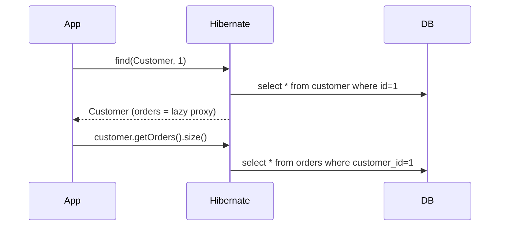
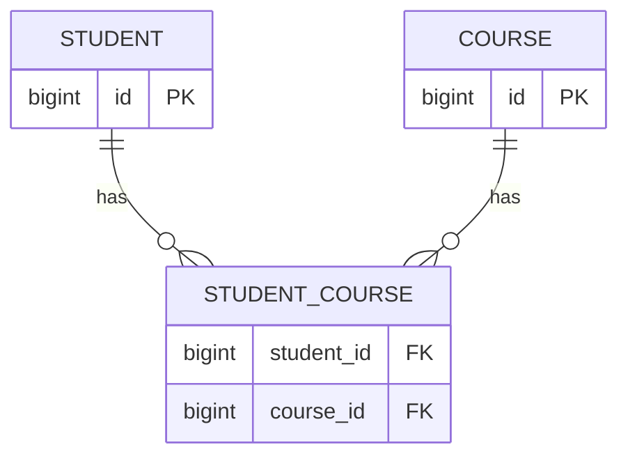
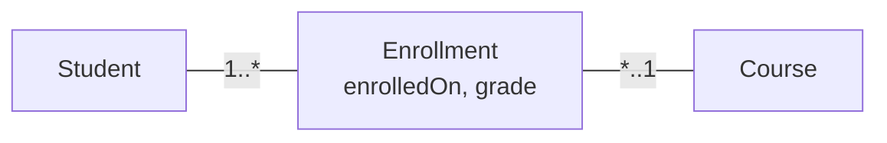
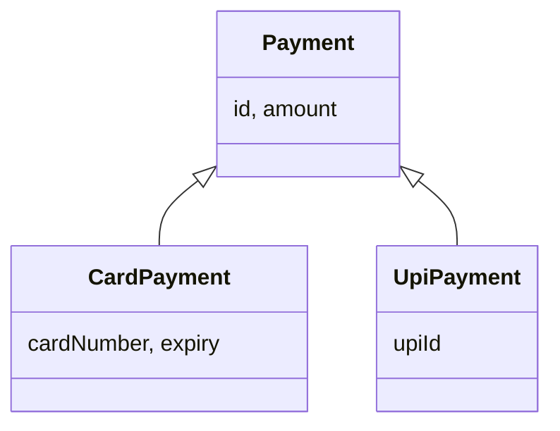

# JPA Relationship Mapping & Inheritance — Complete Tutorial

> Target: Spring Boot 3.x, Jakarta Persistence (JPA 3.1), Hibernate 6. Imports: `jakarta.persistence.*`.
> Follows the entity/column tutorial. Here we connect entities to each other.

---

## 0. The Big Picture

Real data is connected: a **Customer** has many **Orders**, an **Order** has many **Products**. In SQL you connect tables with **foreign keys (FK)**. In JPA you connect **classes** with **fields** and tell JPA how with relationship annotations.

```mermaid
flowchart LR
    A[Java: object reference<br/>order.getCustomer] -->|@ManyToOne + @JoinColumn| B[(SQL: foreign key column<br/>orders.customer_id)]
    C[Java: Set of objects<br/>customer.getOrders] -->|@OneToMany mappedBy| B
    D[Java: Set of objects<br/>student.getCourses] -->|@ManyToMany + @JoinTable| E[(SQL: join table<br/>student_course)]
```

### 0.1 Four relationship types
| Annotation | Meaning | Example |
|---|---|---|
| `@ManyToOne` | Many of **this** → one of **that** | many Orders → one Customer |
| `@OneToMany` | One of **this** → many of **that** | one Customer → many Orders |
| `@OneToOne` | One ↔ one | one User ↔ one Profile |
| `@ManyToMany` | Many ↔ many | Students ↔ Courses |

### 0.2 Direction
- **Unidirectional**: only one class has a field pointing to the other.
- **Bidirectional**: both classes have a field pointing to each other.

### 0.3 Owning side vs inverse side (MOST IMPORTANT CONCEPT)
In a database, a relationship is stored in **one place only** (an FK column or a join table). The entity that controls that place is the **owning side**. The other entity is the **inverse side** and uses `mappedBy` to say "I'm just a mirror of the field named X on the other side".

- Only the **owning side** changes the database.
- Changing only the inverse side does **nothing** in SQL.

| Relationship | Owning side (has FK) |
|---|---|
| ManyToOne / OneToMany (bidirectional) | The **ManyToOne** side (child) |
| OneToOne bidirectional | The side **without** `mappedBy` |
| ManyToMany bidirectional | The side **without** `mappedBy` |

---

## 1. Relationship Attributes (common to all four annotations)

### Simple explanation
Each relationship annotation has a few settings. Not all settings exist on every annotation.

| Attribute | What it does | `@OneToOne` | `@ManyToOne` | `@OneToMany` | `@ManyToMany` |
|---|---|:-:|:-:|:-:|:-:|
| `targetEntity` | The class on the other side | ✔ | ✔ | ✔ | ✔ |
| `cascade` | Which operations pass to the related entity | ✔ | ✔ | ✔ | ✔ |
| `fetch` | Load the related data now (EAGER) or later (LAZY) | ✔ | ✔ | ✔ | ✔ |
| `optional` | Can the relation be `null`? | ✔ | ✔ | ✘ | ✘ |
| `mappedBy` | Name of the owning-side field (marks inverse side) | ✔ | ✘ | ✔ | ✔ |
| `orphanRemoval` | Delete child when removed from parent | ✔ | ✘ | ✔ | ✘ |

### Defaults
| Annotation | `fetch` default | `optional` default |
|---|---|---|
| `@OneToOne` | **EAGER** | `true` |
| `@ManyToOne` | **EAGER** | `true` |
| `@OneToMany` | **LAZY** | — |
| `@ManyToMany` | **LAZY** | — |

### 1.1 `targetEntity`
The entity class of the other side. Normally JPA finds it from generics (`List<Order>`) or the field type, so you **rarely need it**. Use it only when you use raw types or an interface.
```java
@OneToMany(targetEntity = Order.class)
private List orders;                // raw type -> JPA can't know, so targetEntity is required
```

### 1.2 `optional`
`optional = false` means the relation is **mandatory**: the FK column becomes `NOT NULL` and Hibernate can use an INNER JOIN.
```java
@ManyToOne(optional = false)        // an order MUST have a customer
@JoinColumn(name = "customer_id")
private Customer customer;
```

### 1.3 `mappedBy`
Placed on the **inverse side**. Value = **field name** (not column name) on the owning side.
```java
// In Customer (inverse side)
@OneToMany(mappedBy = "customer")   // "customer" is the field name in Order
private List<Order> orders;
```

### 1.4 `orphanRemoval`
"Orphan" = a child that is no longer referenced by its parent. With `orphanRemoval = true`, removing the child from the parent's collection **deletes the row** from the DB.
```java
@OneToMany(mappedBy = "customer", orphanRemoval = true)
private List<Order> orders = new ArrayList<>();

customer.getOrders().remove(order);     // on commit: DELETE FROM orders WHERE id = ?
```
- Also deletes children when the **parent is deleted**.
- For `@OneToOne`, setting the field to `null` deletes the child.
- Use it only for **true "part-of" ownership** (OrderItem belongs to exactly one Order).

> **Anti-pattern:** `orphanRemoval = true` on a collection and then **replacing** it with `customer.setOrders(new ArrayList<>())`. Hibernate throws *"A collection with cascade=all-delete-orphan was no longer referenced"*. Always modify the existing collection (`clear()`, `addAll()`).

---

## 2. `CascadeType` — every value

### Simple explanation
Cascade means: "when I do operation X on the **parent**, automatically do X on the **related entities** too." Default is **no cascade**.

### All values
| CascadeType | Applies when you call | Effect on related entity |
|---|---|---|
| `PERSIST` | `em.persist()` / `repository.save()` on a **new** parent | Related new entities are also inserted |
| `MERGE` | `em.merge()` / `save()` on a **detached/existing** parent | Related entities' changes are merged too |
| `REMOVE` | `em.remove()` / `repository.delete()` | Related entities are deleted too |
| `REFRESH` | `em.refresh()` | Related entities are reloaded from DB |
| `DETACH` | `em.detach()` | Related entities are detached from the persistence context |
| `ALL` | **all** of the above (PERSIST, MERGE, REMOVE, REFRESH, DETACH) | everything |

```java
@OneToMany(mappedBy = "customer", cascade = CascadeType.ALL)
private List<Order> orders = new ArrayList<>();

@OneToMany(mappedBy = "customer", cascade = {CascadeType.PERSIST, CascadeType.MERGE})
private List<Order> safeOrders = new ArrayList<>();     // multiple types
```

### Hibernate-specific cascade
Hibernate has its own `@Cascade` annotation with extra types:
```java
import org.hibernate.annotations.Cascade;
import org.hibernate.annotations.CascadeType;   // different enum!

@Cascade({CascadeType.SAVE_UPDATE, CascadeType.LOCK, CascadeType.REPLICATE})
```
| Hibernate type | Meaning |
|---|---|
| `SAVE_UPDATE` | save or update (Hibernate-native `saveOrUpdate`) |
| `REPLICATE` | cascade `replicate()` |
| `LOCK` | cascade `lock()` |

(Hibernate 6.x deprecated some native-API cascade types; prefer the standard JPA ones.)

### DB-level cascade: `@OnDelete`
```java
@ManyToOne
@OnDelete(action = OnDeleteAction.CASCADE)     // adds ON DELETE CASCADE to FK
private Customer customer;
```
Deleting a customer is done **by the database** (fast), but Hibernate's in-memory state is not updated.

### Cascade vs orphanRemoval vs DB cascade
| | `CascadeType.REMOVE` | `orphanRemoval` | `@OnDelete` |
|---|---|---|---|
| Delete parent → delete children | ✔ | ✔ | ✔ (by DB) |
| Remove child from collection → delete child | ✘ | ✔ | ✘ |
| Done by | Hibernate (extra DELETEs) | Hibernate | Database |

> **Anti-pattern:** `cascade = CascadeType.ALL` (or `REMOVE`) on `@ManyToOne` or `@ManyToMany`. Deleting one Order would delete the **Customer** (and all their other orders), or deleting one Student could delete shared Courses. Cascade **downwards** from parent to owned children only.

---

## 3. `FetchType`

### Simple explanation
When Hibernate loads an entity, should it also load the related data **immediately**, or **only when you touch it**?

| Type | Behaviour | Use |
|---|---|---|
| `EAGER` | Loaded together with the owner (JOIN or extra SELECT) | Data you **always** need |
| `LAZY` | A **proxy / empty collection** is returned; data loaded on first access | Default choice for almost everything |



### Problems to know
| Problem | Cause | Fix |
|---|---|---|
| `LazyInitializationException` | Accessing a lazy field after the session/transaction closed | Fetch inside `@Transactional`, `JOIN FETCH`, `@EntityGraph`, or use DTOs |
| **N+1 select problem** | 1 query loads N parents, then N queries load each parent's children | `JOIN FETCH`, `@EntityGraph`, `@BatchSize`, `hibernate.default_batch_fetch_size` |
| Cartesian product | `JOIN FETCH` two collections at once | Fetch one collection per query or use `Set` + batch size |

### Solutions in code
```java
// 1. JPQL JOIN FETCH
@Query("select c from Customer c join fetch c.orders where c.id = :id")
Customer findWithOrders(@Param("id") Long id);

// 2. Spring Data @EntityGraph
@EntityGraph(attributePaths = {"orders", "orders.items"})
Optional<Customer> findById(Long id);

// 3. Batch loading (Hibernate)
@BatchSize(size = 20)
@OneToMany(mappedBy = "customer")
private List<Order> orders;
```
```properties
spring.jpa.open-in-view=false          # recommended: avoid lazy loading in the web layer
spring.jpa.properties.hibernate.default_batch_fetch_size=20
```

> **Anti-pattern:** Changing everything to `FetchType.EAGER` to "fix" LazyInitializationException. It fixes one error and creates slow, huge queries everywhere. Fix it at the **query** level instead. Also make `@ManyToOne` and `@OneToOne` **LAZY** explicitly, because their default is EAGER.

> **Note:** `LAZY` on `@OneToOne` is reliable on the **owning** side. On the **inverse** side (`mappedBy`) Hibernate must query the DB to know whether the child exists, so it loads it eagerly unless `optional = false` or bytecode enhancement is used.

---

## 4. `@JoinColumn`

### Simple explanation
`@JoinColumn` describes the **foreign key column**. It is put on the **owning side** of `@ManyToOne` / `@OneToOne` (and on `@OneToMany` for a unidirectional FK mapping). Without it, JPA invents a name: `<field>_<referenced PK column>` e.g. `customer_id`.

### All attributes
| Attribute | Meaning | Default |
|---|---|---|
| `name` | FK column name | `fieldName_referencedPkColumn` |
| `referencedColumnName` | Column in the **other** table that the FK points to | Primary key of the other table |
| `unique` | UNIQUE constraint on the FK column (makes it one-to-one in practice) | `false` |
| `nullable` | `false` → NOT NULL | `true` |
| `insertable` | Include in INSERT? | `true` |
| `updatable` | Include in UPDATE? | `true` |
| `columnDefinition` | Raw SQL for the column | generated |
| `table` | Table that holds the FK (used with `@SecondaryTable`) | primary table |
| `foreignKey` | `@ForeignKey` for FK constraint name/behavior | provider default |
| `options`, `check` | Extra DDL (JPA 3.2) | — |

### `@ForeignKey` attributes
| Attribute | Meaning |
|---|---|
| `name` | FK constraint name (e.g., `fk_order_customer`) |
| `value` | `ConstraintMode`: `CONSTRAINT` (create it), `NO_CONSTRAINT` (don't create FK constraint), `PROVIDER_DEFAULT` |
| `foreignKeyDefinition` | Raw DDL, e.g. `"FOREIGN KEY (customer_id) REFERENCES customer(id) ON DELETE SET NULL"` |

### Snippet
```java
@ManyToOne(fetch = FetchType.LAZY, optional = false)
@JoinColumn(
    name = "customer_id",                       // column in orders
    referencedColumnName = "id",                // column in customer
    nullable = false,
    updatable = false,                          // order can't be moved to another customer
    foreignKey = @ForeignKey(
        name = "fk_orders_customer",
        value = ConstraintMode.CONSTRAINT)
)
private Customer customer;
```

### Referencing a non-primary-key column
```java
@ManyToOne
@JoinColumn(name = "country_code", referencedColumnName = "iso_code")   // iso_code must be UNIQUE
private Country country;
```

### `@JoinColumns` — composite foreign keys
When the target has a composite PK.
```java
@ManyToOne
@JoinColumns({
    @JoinColumn(name = "order_id",   referencedColumnName = "order_id"),
    @JoinColumn(name = "product_id", referencedColumnName = "product_id")
})
private OrderItem orderItem;
```

### Related: `@PrimaryKeyJoinColumn`
Used when the **primary key of this table is itself the FK** (shared-primary-key one-to-one, joined inheritance). Attributes: `name`, `referencedColumnName`, `columnDefinition`, `foreignKey`.

---

## 5. `@JoinTable`

### Simple explanation
A **join table** (link table) is a separate table with 2 FK columns that connects two entities. It is **required for `@ManyToMany`** and optional for `@OneToMany` / `@OneToOne` / `@ManyToOne`.



### All attributes
| Attribute | Meaning | Default |
|---|---|---|
| `name` | Join table name | `ownerTable_inverseTable` (e.g., `student_course`) |
| `catalog` | Catalog of the table | default |
| `schema` | Schema of the table | default |
| `joinColumns` | FK column(s) pointing to the **owning** entity (the one with `@JoinTable`) | `ownerEntity_pk` |
| `inverseJoinColumns` | FK column(s) pointing to the **other** entity | `targetEntity_pk` |
| `foreignKey` | `@ForeignKey` for the `joinColumns` FK | provider default |
| `inverseForeignKey` | `@ForeignKey` for the `inverseJoinColumns` FK | provider default |
| `uniqueConstraints` | Unique constraints on the join table | none |
| `indexes` | Indexes on the join table | none |

> **Memory trick:** `joinColumns` = "**me**". `inverseJoinColumns` = "**the other one**".

### Full snippet
```java
@Entity
public class Student {
    @Id @GeneratedValue(strategy = GenerationType.IDENTITY)
    private Long id;

    @ManyToMany
    @JoinTable(
        name = "student_course",
        schema = "public",
        catalog = "school_db",
        joinColumns        = @JoinColumn(name = "student_id", referencedColumnName = "id"),
        inverseJoinColumns = @JoinColumn(name = "course_id",  referencedColumnName = "id"),
        foreignKey         = @ForeignKey(name = "fk_sc_student"),
        inverseForeignKey  = @ForeignKey(name = "fk_sc_course"),
        uniqueConstraints  = @UniqueConstraint(
                                name = "uk_student_course",
                                columnNames = {"student_id", "course_id"}),
        indexes = {
            @Index(name = "idx_sc_student", columnList = "student_id"),
            @Index(name = "idx_sc_course",  columnList = "course_id")
        }
    )
    private Set<Course> courses = new HashSet<>();
}
```
**Explanation:** table `school_db.public.student_course` is created with two FK columns; the pair is unique (a student can't enrol twice in one course); both columns are indexed; both FKs are named.

---

## 6. `@ManyToOne` (the most common mapping)

### Simple explanation
Many rows of table A point to one row of table B. The FK column lives in **A** (the "many" side). Always the **owning side**.

### 6.1 Unidirectional
```java
@Entity
public class Order {
    @Id @GeneratedValue private Long id;

    @ManyToOne(fetch = FetchType.LAZY, optional = false)
    @JoinColumn(name = "customer_id", nullable = false)
    private Customer customer;
}

@Entity
public class Customer {                  // knows nothing about orders
    @Id @GeneratedValue private Long id;
    private String name;
}
```
SQL: `orders(id, customer_id FK)`.

Usage:
```java
Customer c = customerRepo.save(new Customer("Ayan"));
Order o = new Order();
o.setCustomer(c);                        // set the FK
orderRepo.save(o);
```

---

## 7. `@OneToMany`

### 7.1 Bidirectional with `mappedBy` ⭐ (recommended)
FK is in the child table. Parent has the collection, child has `@ManyToOne`.

```mermaid
flowchart LR
    C[Customer<br/>@OneToMany mappedBy=customer] -- inverse --- O[Order<br/>@ManyToOne @JoinColumn customer_id]
```

```java
@Entity
public class Customer {
    @Id @GeneratedValue private Long id;
    private String name;

    @OneToMany(mappedBy = "customer", cascade = CascadeType.ALL, orphanRemoval = true)
    private List<Order> orders = new ArrayList<>();

    // helper methods keep BOTH sides in sync
    public void addOrder(Order o)    { orders.add(o);    o.setCustomer(this); }
    public void removeOrder(Order o) { orders.remove(o); o.setCustomer(null); }
}

@Entity
public class Order {
    @Id @GeneratedValue private Long id;

    @ManyToOne(fetch = FetchType.LAZY, optional = false)
    @JoinColumn(name = "customer_id")
    private Customer customer;
}
```
Usage:
```java
Customer c = new Customer("Ayan");
c.addOrder(new Order());
c.addOrder(new Order());
customerRepo.save(c);          // cascade PERSIST saves both orders
```
SQL: 1 insert customer + 2 inserts orders (each with `customer_id`). **No extra UPDATE.**

> **Anti-pattern:** Skipping helper methods and only doing `customer.getOrders().add(order)`. The owning side (`order.customer`) stays `null`, so `customer_id` is saved as NULL (or the insert fails with NOT NULL).

### 7.2 Unidirectional with `@JoinColumn`
Only the parent has the collection; the FK is still in the **child table**, but the **parent controls it**.
```java
@Entity
public class Customer {
    @Id @GeneratedValue private Long id;

    @OneToMany(cascade = CascadeType.ALL, orphanRemoval = true)
    @JoinColumn(name = "customer_id", nullable = false)    // FK column in orders table
    private List<Order> orders = new ArrayList<>();
}

@Entity
public class Order {                                       // no reference to Customer
    @Id @GeneratedValue private Long id;
}
```
SQL: `orders(id, customer_id)`.
> **Performance note:** Without `nullable = false`, Hibernate inserts the order first and then runs `UPDATE orders SET customer_id=?` (extra statements). Prefer 7.1 for efficiency.

### 7.3 Unidirectional with default join table
If you write `@OneToMany` **without** `mappedBy` and **without** `@JoinColumn`, JPA creates a **join table** `customer_orders`.
```java
@OneToMany(cascade = CascadeType.ALL)
private List<Order> orders = new ArrayList<>();            // table customer_orders(customer_id, orders_id)
```
Customize it:
```java
@OneToMany(cascade = CascadeType.ALL)
@JoinTable(name = "customer_order_link",
           joinColumns = @JoinColumn(name = "customer_id"),
           inverseJoinColumns = @JoinColumn(name = "order_id", unique = true))   // unique = each order has 1 customer
private List<Order> orders = new ArrayList<>();
```
> **Anti-pattern:** Forgetting that plain `@OneToMany` (no `mappedBy`) silently creates an extra join table.

### 7.4 Which `@OneToMany` style?
| Style | FK location | Extra SQL | Recommended |
|---|---|---|---|
| Bidirectional `mappedBy` | child table | none | ✅ Best |
| Unidirectional `@JoinColumn` | child table | maybe UPDATE | OK |
| Unidirectional join table | separate table | extra inserts/deletes | ❌ Avoid |

---

## 8. `@OneToOne`

### 8.1 Unidirectional with FK
FK is in the owning table, usually with a `unique` constraint.
```java
@Entity
public class User {
    @Id @GeneratedValue private Long id;
    private String username;

    @OneToOne(cascade = CascadeType.ALL, orphanRemoval = true, fetch = FetchType.LAZY)
    @JoinColumn(name = "profile_id", unique = true, foreignKey = @ForeignKey(name = "fk_user_profile"))
    private Profile profile;
}

@Entity
public class Profile {
    @Id @GeneratedValue private Long id;
    private String bio;
}
```
SQL: `users(id, username, profile_id UNIQUE FK)`.

### 8.2 Bidirectional
```java
@Entity
public class User {
    @Id @GeneratedValue private Long id;

    @OneToOne(cascade = CascadeType.ALL, fetch = FetchType.LAZY)
    @JoinColumn(name = "profile_id")           // OWNING side
    private Profile profile;

    public void setProfile(Profile p) { this.profile = p; if (p != null) p.setUser(this); }
}

@Entity
public class Profile {
    @Id @GeneratedValue private Long id;

    @OneToOne(mappedBy = "profile")            // INVERSE side
    private User user;
}
```

### 8.3 Shared primary key with `@MapsId` ⭐ (best for true one-to-one)
The child's **primary key = parent's primary key**. No extra FK column, one index less.

### `@MapsId` attribute
| Attribute | Meaning | Default |
|---|---|---|
| `value` | Name of the attribute inside an **embedded composite id** that receives the FK value. Empty when the whole `@Id` is the FK. | `""` |

```java
@Entity
public class Profile {
    @Id private Long id;                        // NOT generated: copied from user

    @OneToOne(fetch = FetchType.LAZY)
    @MapsId                                     // "use user's id as my id"
    @JoinColumn(name = "id")                    // PK column is also the FK column
    private User user;

    private String bio;
}
```
SQL: `profile(id PK FK -> users.id, bio)`.

`@MapsId` with composite key (also used in many-to-many with extra columns, see §9.4):
```java
@EmbeddedId private EnrollmentId id;
@ManyToOne @MapsId("studentId") private Student student;   // fills id.studentId
@ManyToOne @MapsId("courseId")  private Course course;     // fills id.courseId
```

### 8.4 Alternative: `@PrimaryKeyJoinColumn`
```java
@Entity
public class Profile {
    @Id private Long id;

    @OneToOne
    @PrimaryKeyJoinColumn          // PK of this table is FK to User's PK (you must set the id yourself)
    private User user;
}
```
`@MapsId` is preferred because it copies the id for you.

### 8.5 Mandatory vs optional one-to-one
```java
@OneToOne(optional = false)    // never null -> NOT NULL FK, and inverse-side LAZY works better
```

---

## 9. `@ManyToMany`

### Simple explanation
Both sides can have many of the other. Needs a **join table**. Only **one** side is the owner (has `@JoinTable`); the other uses `mappedBy`.

### 9.1 Bidirectional
```java
@Entity
public class Student {
    @Id @GeneratedValue private Long id;
    private String name;

    @ManyToMany(cascade = {CascadeType.PERSIST, CascadeType.MERGE})   // never REMOVE / ALL here
    @JoinTable(name = "student_course",
        joinColumns        = @JoinColumn(name = "student_id"),
        inverseJoinColumns = @JoinColumn(name = "course_id"))
    private Set<Course> courses = new HashSet<>();

    public void addCourse(Course c)    { courses.add(c);    c.getStudents().add(this); }
    public void removeCourse(Course c) { courses.remove(c); c.getStudents().remove(this); }
}

@Entity
public class Course {
    @Id @GeneratedValue private Long id;
    private String title;

    @ManyToMany(mappedBy = "courses")                 // inverse side
    private Set<Student> students = new HashSet<>();
}
```

### 9.2 Unidirectional
Just leave out the collection on `Course`; `Student` keeps `@ManyToMany @JoinTable`.

### 9.3 Use `Set`, not `List`
With a `List` and no order column, removing one element makes Hibernate **delete all join rows and re-insert the rest**. With a `Set` it deletes only the one row.

> **Anti-pattern:** `@ManyToMany(cascade = CascadeType.ALL)` — deleting one student can delete courses used by others.

> **Important:** Implement `equals()`/`hashCode()` (e.g., on a business key or `id` carefully) when using `Set`.

### 9.4 Many-to-many **with extra columns** → use an association entity ⭐
A join table can't hold extra data (enrolment date, grade). Replace `@ManyToMany` with **two `@ManyToOne`** and a middle entity:



```java
@Embeddable
public class EnrollmentId implements Serializable {
    private Long studentId;
    private Long courseId;
    // no-arg ctor, equals(), hashCode()
}

@Entity
public class Enrollment {
    @EmbeddedId
    private EnrollmentId id = new EnrollmentId();

    @ManyToOne(fetch = FetchType.LAZY) @MapsId("studentId")
    private Student student;

    @ManyToOne(fetch = FetchType.LAZY) @MapsId("courseId")
    private Course course;

    private LocalDate enrolledOn;
    private String grade;
}

@Entity
public class Student {
    @Id @GeneratedValue private Long id;
    @OneToMany(mappedBy = "student", cascade = CascadeType.ALL, orphanRemoval = true)
    private Set<Enrollment> enrollments = new HashSet<>();
}
```

---

## 10. Other Combinations

### 10.1 Self-referencing (tree / hierarchy)
```java
@Entity
public class Category {
    @Id @GeneratedValue private Long id;
    private String name;

    @ManyToOne(fetch = FetchType.LAZY)
    @JoinColumn(name = "parent_id")                 // null for root
    private Category parent;

    @OneToMany(mappedBy = "parent", cascade = CascadeType.ALL)
    private List<Category> children = new ArrayList<>();
}
```

### 10.2 Self many-to-many (friends)
```java
@ManyToMany
@JoinTable(name = "user_friends",
    joinColumns = @JoinColumn(name = "user_id"),
    inverseJoinColumns = @JoinColumn(name = "friend_id"))
private Set<User> friends = new HashSet<>();
```

### 10.3 Two relationships to the same entity
```java
@ManyToOne @JoinColumn(name = "sender_id")   private User sender;
@ManyToOne @JoinColumn(name = "receiver_id") private User receiver;
// on User: @OneToMany(mappedBy = "sender") and @OneToMany(mappedBy = "receiver") — names must differ
```

### 10.4 Read-only duplicate FK id (handy for queries)
```java
@Column(name = "customer_id", insertable = false, updatable = false)
private Long customerId;                         // read-only copy of the FK value

@ManyToOne(fetch = FetchType.LAZY)
@JoinColumn(name = "customer_id")
private Customer customer;
```

---

## 11. Collection Ordering & Map Mappings

### 11.1 Order
| Annotation | Meaning |
|---|---|
| `@OrderBy("name ASC, id DESC")` | `ORDER BY` when loading; uses **entity attribute names** |
| `@OrderColumn(name = "position")` | Stores the list index in a column; keeps `List` order; attributes: `name, nullable, insertable, updatable, columnDefinition, base` |

```java
@OneToMany(mappedBy = "customer") @OrderBy("createdAt DESC")
private List<Order> orders;

@OneToMany @JoinColumn(name = "quiz_id") @OrderColumn(name = "question_no")
private List<Question> questions;
```

### 11.2 Maps: `@MapKey` family
A `Map<K, V>` relationship needs to say **where the key comes from**.

| Annotation | Purpose | Attributes |
|---|---|---|
| `@MapKey` | Use an **attribute of the value entity** as the key | `name` (attribute; default = the primary key) |
| `@MapKeyColumn` | Key is stored in a **separate column** (basic type key) | `name, unique, nullable, insertable, updatable, columnDefinition, table, length, precision, scale` |
| `@MapKeyClass` | Specifies the key **class** (when raw Map) | `value` |
| `@MapKeyJoinColumn(s)` | Key is an **entity** → FK column | `name, referencedColumnName, unique, nullable, insertable, updatable, columnDefinition, table, foreignKey` |
| `@MapKeyEnumerated` | Key is an enum | `value` (ORDINAL / STRING) |
| `@MapKeyTemporal` | Key is `Date`/`Calendar` | `value` (DATE / TIME / TIMESTAMP) |

```java
// a) key = attribute of the related entity
@OneToMany(mappedBy = "department")
@MapKey(name = "employeeCode")                       // Map<String, Employee>
private Map<String, Employee> employeesByCode = new HashMap<>();

// b) key = value in separate column
@OneToMany @JoinTable(name = "dept_phone_owners")
@MapKeyColumn(name = "phone_type", length = 20)
@MapKeyEnumerated(EnumType.STRING)
private Map<PhoneType, Employee> contacts = new EnumMap<>(PhoneType.class);

// c) key = another entity
@ManyToMany
@JoinTable(name = "product_price")
@MapKeyJoinColumn(name = "currency_id")              // key is Currency entity
private Map<Currency, Price> prices = new HashMap<>();
```
`@MapKey` stores no extra column (the key already exists in the value entity). `@MapKeyColumn` **creates** one.

---

## 12. `@ElementCollection` and `@CollectionTable`

### Simple explanation
For a collection of **simple values** (String, Integer, enum) or **embeddable objects** — things that are **not entities** and have no id of their own. JPA stores them in a **separate table** linked by FK.

### `@ElementCollection` attributes
| Attribute | Meaning | Default |
|---|---|---|
| `targetClass` | Class of the elements (needed only for raw types) | from generics |
| `fetch` | `LAZY` / `EAGER` | **LAZY** |

### `@CollectionTable` attributes
| Attribute | Meaning | Default |
|---|---|---|
| `name` | Table name | `Entity_fieldName` |
| `catalog` | Catalog | default |
| `schema` | Schema | default |
| `joinColumns` | FK column(s) pointing back to the owner | `entity_pk` |
| `foreignKey` | FK constraint config | provider default |
| `uniqueConstraints` | Unique constraints | none |
| `indexes` | Indexes | none |

### 12.1 Collection of basic values
```java
@Entity
public class Employee {
    @Id @GeneratedValue private Long id;

    @ElementCollection(fetch = FetchType.LAZY)
    @CollectionTable(
        name = "employee_skills",
        schema = "public", catalog = "hr_db",
        joinColumns = @JoinColumn(name = "employee_id"),
        foreignKey = @ForeignKey(name = "fk_skill_employee"),
        uniqueConstraints = @UniqueConstraint(columnNames = {"employee_id", "skill"}),
        indexes = @Index(name = "idx_skill_emp", columnList = "employee_id")
    )
    @Column(name = "skill", length = 50)               // column for the element value
    private Set<String> skills = new HashSet<>();
}
```
Table: `employee_skills(employee_id, skill)`.

### 12.2 Collection of enums
```java
@ElementCollection(targetClass = Role.class)
@CollectionTable(name = "user_roles", joinColumns = @JoinColumn(name = "user_id"))
@Enumerated(EnumType.STRING)
@Column(name = "role")
private Set<Role> roles = new HashSet<>();
```

### 12.3 Collection of embeddables
```java
@Embeddable
public class PhoneNumber { private String type; private String number; }

@ElementCollection
@CollectionTable(name = "employee_phones", joinColumns = @JoinColumn(name = "employee_id"))
@AttributeOverride(name = "number", column = @Column(name = "phone_no"))
private List<PhoneNumber> phones = new ArrayList<>();
```

### 12.4 Map of basic values
```java
@ElementCollection
@CollectionTable(name = "employee_settings", joinColumns = @JoinColumn(name = "employee_id"))
@MapKeyColumn(name = "setting_key", length = 50)
@Column(name = "setting_value")
private Map<String, String> settings = new HashMap<>();
```

### ElementCollection vs OneToMany
| | `@ElementCollection` | `@OneToMany` |
|---|---|---|
| Elements are | values / embeddables (no id) | full entities (with id) |
| Lifecycle | fully owned by parent | independent |
| Query elements alone | ✘ (hard) | ✔ |
| Update one element | Hibernate often deletes all and re-inserts | single-row UPDATE |
| Use for | small lists: tags, phones | everything else |

> **Anti-pattern:** Large `@ElementCollection` lists — updating them rewrites the entire collection. Use `@OneToMany` with an entity instead.

---

## 13. Inheritance Mapping

### Simple explanation
Java has inheritance (`Dog extends Animal`); relational databases don't. JPA gives you strategies to store a class hierarchy in tables.

```mermaid
flowchart TD
    Q{Do parent objects<br/>need to be queried<br/>or related to?}
    Q -- No, just share fields --> M[@MappedSuperclass]
    Q -- Yes --> S{Priority?}
    S -- Speed, simple, few subclass fields --> ST[SINGLE_TABLE]
    S -- Clean schema, NOT NULL columns --> J[JOINED]
    S -- Subclasses independent, no polymorphic queries --> T[TABLE_PER_CLASS]
```

---

### 13.1 `@MappedSuperclass`

A base class whose **fields are inherited into each child table**, but the base class is **not an entity**: no table, no queries, can't be a relationship target.

```java
@MappedSuperclass
public abstract class BaseEntity {
    @Id @GeneratedValue(strategy = GenerationType.IDENTITY)
    private Long id;

    @CreationTimestamp @Column(updatable = false)
    private LocalDateTime createdAt;

    @UpdateTimestamp
    private LocalDateTime updatedAt;

    @Version
    private Long version;
}

@Entity @Table(name = "customers")
public class Customer extends BaseEntity {         // table has id, created_at, updated_at, version + name
    private String name;
}

@Entity @Table(name = "products")
public class Product extends BaseEntity {
    private String title;
}
```
Override inherited columns:
```java
@Entity
@AttributeOverride(name = "createdAt", column = @Column(name = "created_on"))
public class Invoice extends BaseEntity { }
```
(`@AttributeOverrides` / `@AssociationOverride(s)` for several.)

| | `@MappedSuperclass` | `@Entity` parent |
|---|---|---|
| Has a table | ✘ | ✔ |
| Polymorphic query (`from Base`) | ✘ | ✔ |
| Can be `@ManyToOne` target | ✘ | ✔ |
| Purpose | share code/fields | real hierarchy |

---

### 13.2 `@Inheritance`

| Attribute | Meaning | Default |
|---|---|---|
| `strategy` | `InheritanceType.SINGLE_TABLE`, `JOINED`, `TABLE_PER_CLASS` | `SINGLE_TABLE` |

Put it on the **root entity** only. Example hierarchy used below:



#### A) `SINGLE_TABLE` (default)
**One table** for the whole hierarchy. A **discriminator column** says which class each row is. Columns of other subclasses are `NULL`.

```java
@Entity
@Inheritance(strategy = InheritanceType.SINGLE_TABLE)
@DiscriminatorColumn(name = "payment_type", discriminatorType = DiscriminatorType.STRING, length = 20)
@DiscriminatorValue("PAYMENT")
public abstract class Payment {
    @Id @GeneratedValue(strategy = GenerationType.IDENTITY) private Long id;
    private BigDecimal amount;
}

@Entity @DiscriminatorValue("CARD")
public class CardPayment extends Payment {
    private String cardNumber;          // nullable column (NULL for UPI rows)
    private String expiry;
}

@Entity @DiscriminatorValue("UPI")
public class UpiPayment extends Payment {
    private String upiId;               // nullable column
}
```
Table `payment`:
| id | payment_type | amount | card_number | expiry | upi_id |
|---|---|---|---|---|---|
| 1 | CARD | 500.00 | 4111… | 12/28 | NULL |
| 2 | UPI | 200.00 | NULL | NULL | me@upi |

#### B) `JOINED`
**One table per class.** Child tables hold only their own columns and share the parent's **primary key** (which is also an FK to the parent). Loading a child **JOINs** the tables.

```java
@Entity
@Inheritance(strategy = InheritanceType.JOINED)
@DiscriminatorColumn(name = "payment_type")      // optional with JOINED in Hibernate (not needed)
public abstract class Payment {
    @Id @GeneratedValue(strategy = GenerationType.IDENTITY) private Long id;
    private BigDecimal amount;
}

@Entity @Table(name = "card_payment")
@PrimaryKeyJoinColumn(name = "payment_id")       // child PK column = FK to payment.id
public class CardPayment extends Payment {
    @Column(nullable = false) private String cardNumber;    // NOT NULL is possible!
    private String expiry;
}

@Entity @Table(name = "upi_payment")
@PrimaryKeyJoinColumn(name = "payment_id")
public class UpiPayment extends Payment { private String upiId; }
```
Tables: `payment(id, amount)`, `card_payment(payment_id PK/FK, card_number, expiry)`, `upi_payment(payment_id PK/FK, upi_id)`.

#### C) `TABLE_PER_CLASS`
**One independent table per concrete class**, each containing **all** columns (inherited + own). No parent table rows. Polymorphic queries use `UNION`.

```java
@Entity
@Inheritance(strategy = InheritanceType.TABLE_PER_CLASS)
public abstract class Payment {
    @Id @GeneratedValue(strategy = GenerationType.SEQUENCE)   // IDENTITY NOT allowed here!
    private Long id;
    private BigDecimal amount;
}

@Entity public class CardPayment extends Payment { private String cardNumber; private String expiry; }
@Entity public class UpiPayment  extends Payment { private String upiId; }
```
Tables: `card_payment(id, amount, card_number, expiry)`, `upi_payment(id, amount, upi_id)`.
> The ID must be **unique across all tables**, so `IDENTITY` is not supported (use SEQUENCE/TABLE/UUID).

#### Strategy comparison
| | SINGLE_TABLE | JOINED | TABLE_PER_CLASS |
|---|---|---|---|
| Tables | 1 | 1 per class | 1 per concrete class |
| Discriminator column | ✔ required | not needed in Hibernate | ✘ |
| Subclass columns NOT NULL | ✘ (must be nullable) | ✔ | ✔ |
| Polymorphic query speed | ✅ fastest (no join) | ⚠ JOINs | ❌ UNION |
| Normalization | ❌ many NULLs | ✅ best | ⚠ duplicated columns |
| Insert cost | 1 insert | multiple inserts | 1 insert |
| FK to parent type | ✔ | ✔ | ⚠ difficult |
| Recommended when | few subclasses, speed matters | rich hierarchy, data integrity | rarely |

---

### 13.3 `@DiscriminatorColumn`

Defines the column that says **which subclass** a row belongs to (mainly `SINGLE_TABLE`).

| Attribute | Meaning | Default |
|---|---|---|
| `name` | Column name | `DTYPE` |
| `discriminatorType` | `STRING`, `CHAR`, `INTEGER` | `STRING` |
| `columnDefinition` | Raw SQL for the column, e.g. `"VARCHAR(20) NOT NULL"` | generated |
| `length` | Length (only for `STRING`) | `31` |
| `options` / `comment` | Extra DDL (JPA 3.2) | — |

| `DiscriminatorType` | Value in `@DiscriminatorValue` | Example |
|---|---|---|
| `STRING` | any text | `"CARD"` |
| `CHAR` | a single character | `"C"` |
| `INTEGER` | a number as text | `"1"` |

```java
@DiscriminatorColumn(
    name = "kind",
    discriminatorType = DiscriminatorType.INTEGER,
    columnDefinition = "INT NOT NULL"
)
// subclasses: @DiscriminatorValue("1"), @DiscriminatorValue("2")
```

### 13.4 `@DiscriminatorValue`
The value stored for a class. Default = **entity name** (for STRING). Set `"null"` / `"not null"` as special values for the root.
```java
@DiscriminatorValue("CARD")
```
Hibernate extras: `@DiscriminatorFormula("case when card_number is not null then 'CARD' else 'UPI' end")` (compute the type from columns) and `@DiscriminatorOptions(force = true, insert = false)`.

### 13.5 Polymorphic queries
```java
// returns CardPayment + UpiPayment objects
List<Payment> all = em.createQuery("select p from Payment p", Payment.class).getResultList();

// only card payments
List<CardPayment> cards = em.createQuery("select c from CardPayment c", CardPayment.class).getResultList();

// filter by type
"select p from Payment p where type(p) = CardPayment"
```
Spring Data: `interface PaymentRepo extends JpaRepository<Payment, Long> {}` — returns the real subclass instances.

### 13.6 Inheritance + relationships
```java
@Entity
public class Order {
    @OneToMany(mappedBy = "order")
    private List<Payment> payments;          // can hold CardPayment and UpiPayment
}
```
Works with SINGLE_TABLE and JOINED. Hard with TABLE_PER_CLASS.

> **Anti-pattern:** Deep inheritance trees (4+ levels) with JOINED → queries with many JOINs. Prefer composition or `@MappedSuperclass`.
> **Anti-pattern:** Using `@MappedSuperclass` as a type in a query/relationship (`@ManyToOne BaseEntity`). It isn't an entity.

---

## 14. Extra Topics You Should Know

### 14.1 `equals()` / `hashCode()` for entities in Sets
```java
@Override public boolean equals(Object o) {
    if (this == o) return true;
    if (!(o instanceof Course other)) return false;
    return id != null && id.equals(other.getId());
}
@Override public int hashCode() { return getClass().hashCode(); }   // constant, safe before/after persist
```

### 14.2 Infinite recursion in bidirectional relations
- `toString()` / Lombok `@Data` calling the other side → `StackOverflowError`. Use `@ToString.Exclude` or write `toString` manually.
- JSON serialization loops: return **DTOs** (best), or use `@JsonManagedReference` / `@JsonBackReference`, or `@JsonIgnore` on the back side.

### 14.3 Detached vs managed `save()` of children
`repository.save(child)` for a child whose parent has `CascadeType.PERSIST` — cascade runs from the **parent**. If you save the child directly, only the child's own cascade settings apply.

### 14.4 Other Hibernate relationship annotations
| Annotation | Purpose |
|---|---|
| `@BatchSize(size=n)` | Load lazy relations in batches (reduce N+1) |
| `@Fetch(FetchMode.SUBSELECT / JOIN / SELECT)` | Hibernate fetch strategy |
| `@LazyCollection`, `@LazyToOne` | Fine-grained lazy control (legacy) |
| `@NotFound(action = IGNORE)` | Ignore dangling FKs |
| `@Where` / `@SQLRestriction("deleted = false")` | Filter related rows (soft delete) |
| `@SQLDelete`, `@SQLRestriction` | Soft delete support |
| `@OnDelete(action = CASCADE)` | DB-level `ON DELETE CASCADE` |
| `@JoinFormula` | Join using an SQL expression |
| `@NamedEntityGraph` | Define fetch plans declaratively |

```java
@Entity
@NamedEntityGraph(name = "Customer.orders", attributeNodes = @NamedAttributeNode("orders"))
public class Customer { ... }

@EntityGraph("Customer.orders")
List<Customer> findAll();
```

### 14.5 Choosing the cascade/fetch cheat sheet
| Relationship | Typical settings |
|---|---|
| Parent → owned children (`Order → OrderItem`) | `@OneToMany(mappedBy, cascade = ALL, orphanRemoval = true)` |
| Child → parent (`OrderItem → Order`) | `@ManyToOne(fetch = LAZY, optional = false)`, **no cascade** |
| Shared reference (`Order → Customer`) | `@ManyToOne(fetch = LAZY)`, no cascade |
| One-to-one owned (`User → Profile`) | `@OneToOne(cascade = ALL, orphanRemoval = true, fetch = LAZY)` |
| Many-to-many | `Set`, cascade only `PERSIST, MERGE`, helper methods |

---

## 15. Quick Reference Tables

### Relationship annotations
| Annotation | Attributes |
|---|---|
| `@OneToOne` | `targetEntity, cascade, fetch, optional, mappedBy, orphanRemoval` |
| `@ManyToOne` | `targetEntity, cascade, fetch, optional` |
| `@OneToMany` | `targetEntity, cascade, fetch, mappedBy, orphanRemoval` |
| `@ManyToMany` | `targetEntity, cascade, fetch, mappedBy` |

### Join annotations
| Annotation | Attributes |
|---|---|
| `@JoinColumn` | `name, referencedColumnName, unique, nullable, insertable, updatable, columnDefinition, table, foreignKey` |
| `@JoinTable` | `name, catalog, schema, joinColumns, inverseJoinColumns, foreignKey, inverseForeignKey, uniqueConstraints, indexes` |
| `@ForeignKey` | `name, value (ConstraintMode), foreignKeyDefinition` |
| `@MapsId` | `value` |
| `@PrimaryKeyJoinColumn` | `name, referencedColumnName, columnDefinition, foreignKey` |

### Collections
| Annotation | Attributes |
|---|---|
| `@ElementCollection` | `targetClass, fetch` |
| `@CollectionTable` | `name, catalog, schema, joinColumns, foreignKey, uniqueConstraints, indexes` |
| `@OrderBy` | `value` |
| `@OrderColumn` | `name, nullable, insertable, updatable, columnDefinition, base` |
| `@MapKey` | `name` |
| `@MapKeyColumn` | `name, unique, nullable, insertable, updatable, columnDefinition, table, length, precision, scale` |
| `@MapKeyClass` | `value` |
| `@MapKeyJoinColumn` | `name, referencedColumnName, ...` |

### Inheritance
| Annotation | Attributes |
|---|---|
| `@MappedSuperclass` | none |
| `@Inheritance` | `strategy` |
| `@DiscriminatorColumn` | `name, discriminatorType, columnDefinition, length` |
| `@DiscriminatorValue` | `value` |

### Enums
| Enum | Values |
|---|---|
| `CascadeType` | `ALL, PERSIST, MERGE, REMOVE, REFRESH, DETACH` |
| `FetchType` | `EAGER, LAZY` |
| `InheritanceType` | `SINGLE_TABLE, TABLE_PER_CLASS, JOINED` |
| `DiscriminatorType` | `STRING, CHAR, INTEGER` |
| `ConstraintMode` | `CONSTRAINT, NO_CONSTRAINT, PROVIDER_DEFAULT` |

---

## 16. Common Anti-Patterns (Summary)

| ❌ Don't | ✅ Do |
|---|---|
| Leave `@ManyToOne`/`@OneToOne` default EAGER | Set `fetch = LAZY` |
| `@OneToMany` without `mappedBy` or `@JoinColumn` | Bidirectional `mappedBy` (no accidental join table) |
| Modify only the inverse side | Use helper methods to sync both sides |
| `CascadeType.ALL` on `@ManyToOne` / `@ManyToMany` | Cascade only parent → owned children |
| `List` for `@ManyToMany` | Use `Set` |
| Replace a collection with `orphanRemoval` | `clear()` + `addAll()` |
| EAGER to fix `LazyInitializationException` | `JOIN FETCH`, `@EntityGraph`, DTO projection |
| Return entities from REST controllers | Return DTOs |
| Large `@ElementCollection` | `@OneToMany` entity |
| Lombok `@Data` on entities | `@Getter/@Setter` + manual `equals/hashCode/toString` |
| `TABLE_PER_CLASS` with IDENTITY | SEQUENCE / UUID |

---

## 17. Practice Questions

**Q1.** Which side owns a bidirectional `@OneToMany`/`@ManyToOne` relationship?
**A.** The `@ManyToOne` side (the table with the FK). The `@OneToMany` side uses `mappedBy`.

**Q2.** What does `mappedBy` contain?
**A.** The **field name** on the owning side, not a column name.

**Q3.** What is the difference between `CascadeType.REMOVE` and `orphanRemoval = true`?
**A.** REMOVE deletes children only when the parent is deleted. `orphanRemoval` also deletes a child when it is removed from the parent's collection.

**Q4.** What are the default fetch types?
**A.** `@OneToOne` and `@ManyToOne` → EAGER; `@OneToMany` and `@ManyToMany` → LAZY.

**Q5.** In `@JoinTable`, what is the difference between `joinColumns` and `inverseJoinColumns`?
**A.** `joinColumns` is the FK to the entity that declares the `@JoinTable`; `inverseJoinColumns` is the FK to the other entity.

**Q6.** How do you model a many-to-many that needs an extra column such as `grade`?
**A.** Create an association entity with two `@ManyToOne` fields (and a composite key via `@EmbeddedId` + `@MapsId`, or its own id).

**Q7.** What does `@MapsId` do on a `@OneToOne`?
**A.** Uses the parent's primary key as the child's primary key (shared PK), so no separate FK column is needed.

**Q8.** What is the N+1 problem and one fix?
**A.** One query loads N parents and then N more queries load their lazy children. Fix: `JOIN FETCH`, `@EntityGraph`, or `@BatchSize`.

**Q9.** Which inheritance strategy allows `NOT NULL` subclass columns without extra tables per class… and still keeps a parent table?
**A.** `JOINED`.

**Q10.** Which strategy doesn't allow `IDENTITY` ids?
**A.** `TABLE_PER_CLASS`.

**Q11.** What is the default discriminator column name, type and length?
**A.** `DTYPE`, `STRING`, `31`.

**Q12.** Difference between `@MappedSuperclass` and an `@Entity` base class?
**A.** A mapped superclass has no table and can't be queried or used as a relationship target; an entity base class has a table (or shared table) and supports polymorphic queries.

**Q13.** `@MapKey` vs `@MapKeyColumn`?
**A.** `@MapKey` uses an existing attribute of the value entity as the key; `@MapKeyColumn` stores the key in its own column.

**Q14.** `@ElementCollection` default fetch type?
**A.** `LAZY`.