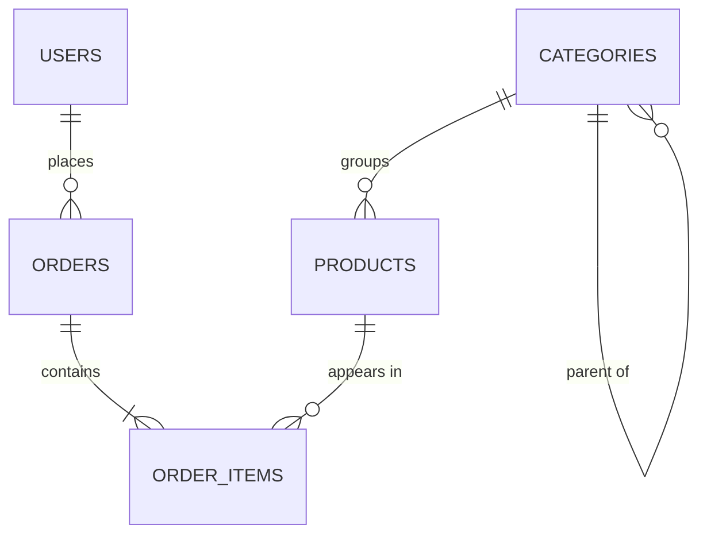
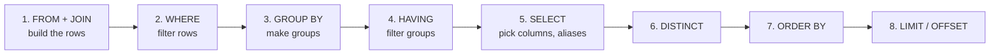
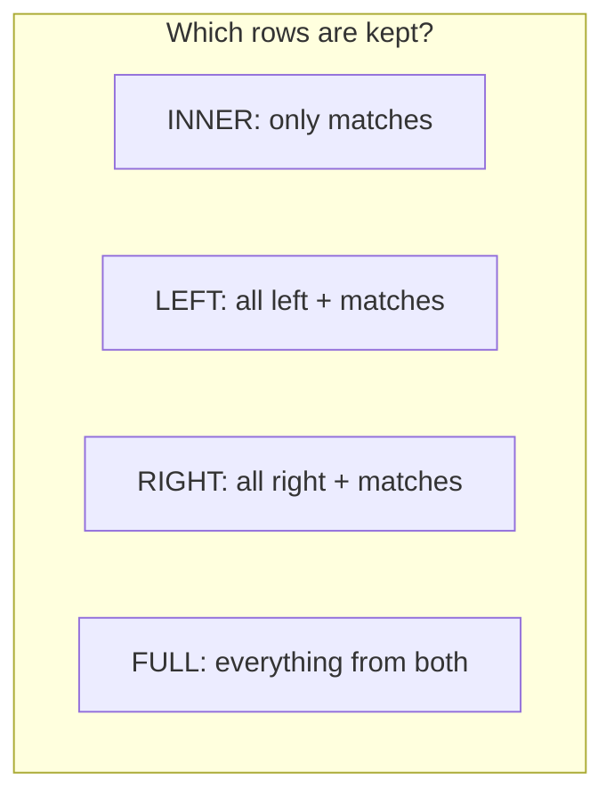
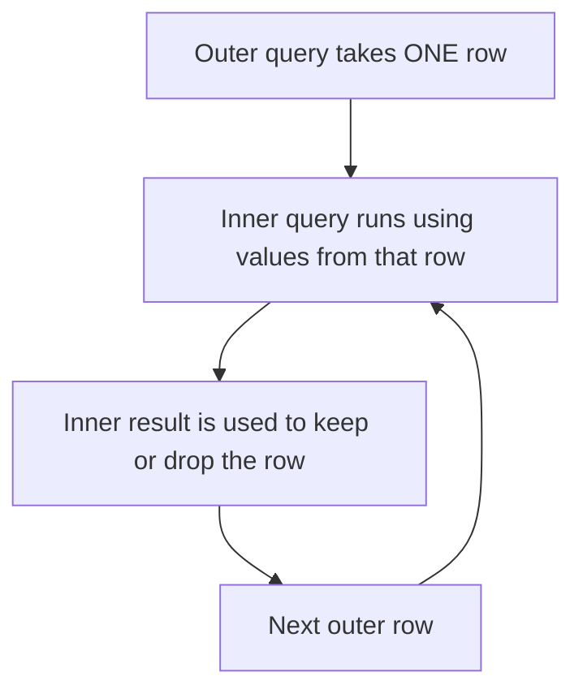
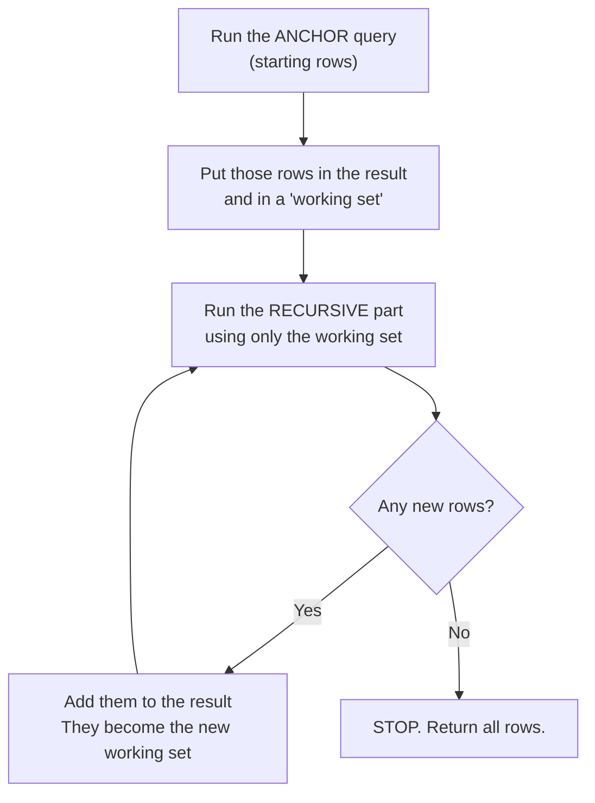
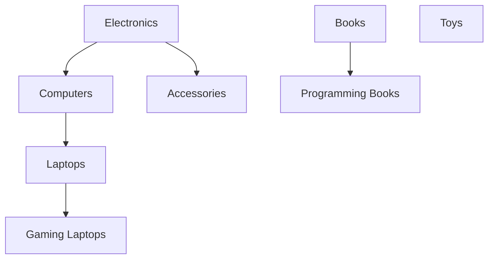
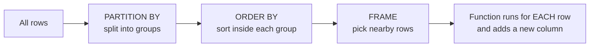
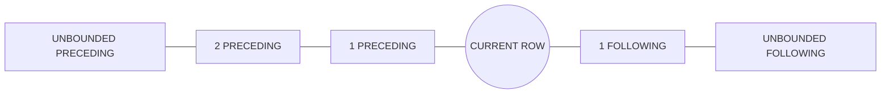
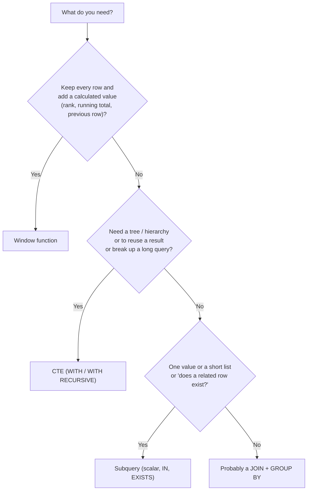

# PostgreSQL Tutorial — Phase 2: Intermediate SQL (Days 4–6)

> **Who is this for?** Anyone who finished the basics (create tables, `INSERT`, `SELECT`, `WHERE`, constraints) and now wants to combine tables, summarize data, and write smarter queries.
> **What you will build:** revenue per user, top-selling products, a category tree, running totals, and "latest order per user".
> **How to use it:** Type every example yourself. Change the numbers. Break things on purpose. That is how SQL sticks.

---

## Table of Contents

- [Practice Setup (run this first)](#practice-setup-run-this-first)
- [Day 4 — Joins and Aggregation](#day-4--joins-and-aggregation)
- [Day 5 — Subqueries and CTEs](#day-5--subqueries-and-ctes)
- [Day 6 — Window Functions and Advanced Functions](#day-6--window-functions-and-advanced-functions)
- [Key Comparison: Subquery vs CTE vs Window Function](#key-comparison-subquery-vs-cte-vs-window-function)
- [Final Cheat Sheet](#final-cheat-sheet)

---

# Practice Setup (run this first)

All examples in this tutorial use **one small shop database**. Create it once and use it for all three days.

```sql
-- Run as an admin user (for example: psql -U postgres)
CREATE DATABASE sql_practice;
\c sql_practice

CREATE SCHEMA shop;
SET search_path TO shop, public;
```

### The tables

```sql
CREATE TABLE users (
    user_id     bigint GENERATED ALWAYS AS IDENTITY PRIMARY KEY,
    full_name   text        NOT NULL,
    email       text        NOT NULL UNIQUE,
    city        text,
    created_at  timestamptz NOT NULL DEFAULT now()
);

CREATE TABLE categories (
    category_id  integer GENERATED ALWAYS AS IDENTITY PRIMARY KEY,
    name         text    NOT NULL UNIQUE,
    parent_id    integer REFERENCES categories (category_id) ON DELETE SET NULL
);

CREATE TABLE products (
    product_id   bigint GENERATED ALWAYS AS IDENTITY PRIMARY KEY,
    sku          text          NOT NULL UNIQUE,
    name         text          NOT NULL,
    category_id  integer       REFERENCES categories (category_id) ON DELETE SET NULL,
    price        numeric(10,2) NOT NULL CHECK (price >= 0),
    stock_qty    integer       NOT NULL DEFAULT 0,
    is_active    boolean       NOT NULL DEFAULT true
);

CREATE TABLE orders (
    order_id    bigint GENERATED ALWAYS AS IDENTITY PRIMARY KEY,
    user_id     bigint      NOT NULL REFERENCES users (user_id),
    status      text        NOT NULL DEFAULT 'PENDING'
                CHECK (status IN ('PENDING','PAID','SHIPPED','DELIVERED','CANCELLED')),
    ordered_at  timestamptz NOT NULL DEFAULT now()
);

CREATE TABLE order_items (
    order_id    bigint        NOT NULL REFERENCES orders (order_id) ON DELETE CASCADE,
    product_id  bigint        NOT NULL REFERENCES products (product_id),
    quantity    integer       NOT NULL CHECK (quantity > 0),
    unit_price  numeric(10,2) NOT NULL,
    PRIMARY KEY (order_id, product_id)
);

-- Two tiny helper tables used to explain joins
CREATE TABLE dept (
    dept_id    integer PRIMARY KEY,
    dept_name  text NOT NULL
);

CREATE TABLE emp (
    emp_id      integer PRIMARY KEY,
    emp_name    text NOT NULL,
    dept_id     integer,          -- can be NULL (no department)
    manager_id  integer           -- can be NULL (no manager)
);
```

### The data

```sql
INSERT INTO users (full_name, email, city) VALUES
    ('Aarav Sharma',  'aarav@example.com',  'Pune'),     -- 1
    ('Priya Das',     'priya@example.com',  'Delhi'),    -- 2
    ('Rohan Mehta',   'rohan@example.com',  'Mumbai'),   -- 3
    ('Sneha Roy',     'sneha@example.com',  'Pune'),     -- 4
    ('Vikram Singh',  'vikram@example.com', NULL),       -- 5
    ('Ananya Banerjee','ananya@example.com','Delhi'),    -- 6  (no orders)
    ('Neha Kapoor',   'neha@example.com',   'Jaipur');   -- 7  (no orders)

INSERT INTO categories (name, parent_id) VALUES
    ('Electronics',       NULL),   -- 1
    ('Computers',         1),      -- 2
    ('Laptops',           2),      -- 3
    ('Gaming Laptops',    3),      -- 4
    ('Accessories',       1),      -- 5
    ('Books',             NULL),   -- 6
    ('Programming Books', 6),      -- 7
    ('Toys',              NULL);   -- 8  (no products)

INSERT INTO products (sku, name, category_id, price, stock_qty, is_active) VALUES
    ('LAP-001', 'Pro Laptop 14',           3,  55999.00, 10,  true),   -- 1
    ('LAP-002', 'Gaming Beast 17',         4,  99999.00,  5,  true),   -- 2
    ('ACC-001', 'Wireless Mouse',          5,    499.50, 100, true),   -- 3
    ('ACC-002', 'USB-C Cable',             5,    199.00, 250, true),   -- 4
    ('ACC-003', 'Mechanical Keyboard',     5,   3499.00, 40,  true),   -- 5
    ('BOK-001', 'SQL Handbook',            7,    650.00, 40,  true),   -- 6
    ('BOK-002', 'Java Mastery',            7,    899.00, 30,  true),   -- 7
    ('BOK-003', 'Spring Boot in Action',   7,    799.00, 25,  true),   -- 8
    ('ACC-004', 'Noise-Cancel Headphones', 5,   7999.00, 15,  true),   -- 9
    ('ACC-005', 'Laptop Stand',            5,   1299.00, 60,  true),   -- 10
    ('MIS-001', 'Mystery Gadget',          NULL, 999.00,  8,  true),   -- 11 (no category)
    ('ACC-006', 'Old Webcam',              5,   1499.00,  0,  false);  -- 12 (never sold)

INSERT INTO orders (user_id, status, ordered_at) VALUES
    (1, 'PAID',      '2026-01-10 10:00:00+00'),   -- 1
    (1, 'DELIVERED', '2026-02-15 10:00:00+00'),   -- 2
    (2, 'PAID',      '2026-02-20 10:00:00+00'),   -- 3
    (3, 'CANCELLED', '2026-03-05 10:00:00+00'),   -- 4
    (2, 'DELIVERED', '2026-03-18 10:00:00+00'),   -- 5
    (4, 'PAID',      '2026-04-02 10:00:00+00'),   -- 6
    (1, 'SHIPPED',   '2026-04-25 10:00:00+00'),   -- 7
    (5, 'PAID',      '2026-05-11 10:00:00+00'),   -- 8
    (3, 'DELIVERED', '2026-05-30 10:00:00+00'),   -- 9
    (2, 'PENDING',   '2026-06-14 10:00:00+00');   -- 10

INSERT INTO order_items (order_id, product_id, quantity, unit_price) VALUES
    (1, 1, 1, 55999.00), (1, 3, 2, 499.50),
    (2, 6, 1,   650.00), (2, 7, 1, 899.00),
    (3, 5, 1,  3499.00), (3, 4, 3, 199.00),
    (4, 2, 1, 99999.00),
    (5, 9, 1,  7999.00), (5, 3, 1, 499.50),
    (6, 8, 2,   799.00), (6, 6, 1, 650.00),
    (7, 1, 1, 55999.00), (7, 10, 1, 1299.00), (7, 3, 1, 499.50),
    (8, 4, 5,   199.00), (8, 7, 1, 899.00),
    (9, 5, 1,  3499.00), (9, 9, 1, 7999.00),
    (10, 3, 4,  499.50);

INSERT INTO dept (dept_id, dept_name) VALUES
    (1, 'Engineering'), (2, 'Sales'), (3, 'Legal');          -- Legal has no employees

INSERT INTO emp (emp_id, emp_name, dept_id, manager_id) VALUES
    (1, 'Aarav', 1, NULL),    -- the boss
    (2, 'Priya', 1, 1),
    (3, 'Rohan', 2, 1),
    (4, 'Tara',  NULL, 3);    -- no department
```

### How the tables connect



> **Reset any time:** run `DROP SCHEMA shop CASCADE;` and then run the setup again.
> **Remember** to run `SET search_path TO shop, public;` in every new psql session.

---

# Day 4 — Joins and Aggregation

## 4.0 The order PostgreSQL really runs a query

You **write** `SELECT` first, but PostgreSQL **runs** the parts in this order. This explains many errors you will see today.



**What this means for you:**

| Fact | Result |
|------|--------|
| `WHERE` runs **before** `GROUP BY` | You cannot use `COUNT(*)` or `SUM()` in `WHERE`. Use `HAVING`. |
| `SELECT` runs **after** `WHERE` | You cannot use a column alias in `WHERE`. |
| `ORDER BY` runs **after** `SELECT` | You **can** use a column alias in `ORDER BY`. |

---

## 4.1 Why do we need joins?

Good databases split data into **many tables** so the same data is not repeated. For example:

- `users` stores each person once.
- `orders` stores each order once and only keeps the `user_id`.

When you want "the order **and** the name of the person who made it", you must **join** the tables back together.

```text
orders.user_id  ───────►  users.user_id
(foreign key)             (primary key)
```

A **join** puts rows from two tables side by side when a **condition** matches (usually "foreign key = primary key").

---

## 4.2 The tiny tables used to explain joins

Look at these two tables carefully. You will see them many times today.

**`dept`**

| dept_id | dept_name |
|---------|-----------|
| 1 | Engineering |
| 2 | Sales |
| 3 | Legal |

**`emp`**

| emp_id | emp_name | dept_id | manager_id |
|--------|----------|---------|------------|
| 1 | Aarav | 1 | NULL |
| 2 | Priya | 1 | 1 |
| 3 | Rohan | 2 | 1 |
| 4 | Tara | **NULL** | 3 |

Notice two special cases:
- **Legal** has **no employees**.
- **Tara** has **no department**.

Different join types treat these two cases in different ways. That is the whole point.

---

## 4.3 INNER JOIN

**Meaning:** Return only rows that **match on both sides**. Rows without a match are thrown away.

**Syntax:**

```sql
SELECT columns
FROM table_a
INNER JOIN table_b ON table_a.column = table_b.column;
```

(`INNER` is optional. `JOIN` alone means `INNER JOIN`.)

```sql
SELECT e.emp_name, d.dept_name
FROM emp e
INNER JOIN dept d ON d.dept_id = e.dept_id;
```

**Result (3 rows):**

| emp_name | dept_name |
|----------|-----------|
| Aarav | Engineering |
| Priya | Engineering |
| Rohan | Sales |

- Tara is **missing** (her `dept_id` is NULL, so nothing matches).
- Legal is **missing** (no employee points to it).

**When to use:** When you only want data that exists on **both** sides. This is the most common join. For example: "orders with their users".

### Table aliases

`emp e` gives the table a short name `e`. It makes queries shorter and is **required** when you join a table to itself.

### A real example with the shop data

```sql
SELECT o.order_id, u.full_name, o.status, o.ordered_at
FROM orders o
JOIN users u ON u.user_id = o.user_id
ORDER BY o.order_id;
```

### Joining three or more tables

You can chain joins. Each `JOIN` adds one more table.

```sql
SELECT o.order_id,
       u.full_name,
       p.name       AS product,
       i.quantity,
       i.unit_price
FROM orders o
JOIN users       u ON u.user_id    = o.user_id
JOIN order_items i ON i.order_id   = o.order_id
JOIN products    p ON p.product_id = i.product_id
ORDER BY o.order_id, p.name;
```


---

## 4.4 LEFT JOIN (LEFT OUTER JOIN)

**Meaning:** Return **all rows from the left table**. If there is a match on the right, show it. If there is no match, the right-side columns are **NULL**.

**Syntax:**

```sql
SELECT columns
FROM left_table
LEFT JOIN right_table ON left_table.column = right_table.column;
```

```sql
SELECT e.emp_name, d.dept_name
FROM emp e
LEFT JOIN dept d ON d.dept_id = e.dept_id;
```

**Result (4 rows):**

| emp_name | dept_name |
|----------|-----------|
| Aarav | Engineering |
| Priya | Engineering |
| Rohan | Sales |
| Tara | **NULL** |

Tara is kept. The right side is NULL because there was no match.

**When to use:** "Show me **everyone**, and add extra info if it exists." For example: all users, with their orders if they have any.

### Find rows that have NO match (the "anti-join")

A very common trick: `LEFT JOIN` + `WHERE right_side IS NULL`.

```sql
-- Users who never placed an order
SELECT u.user_id, u.full_name
FROM users u
LEFT JOIN orders o ON o.user_id = u.user_id
WHERE o.order_id IS NULL;
```

**Result:** Ananya Banerjee, Neha Kapoor.

> Always test for NULL on a column that can **never** be NULL in a real match, like the primary key (`o.order_id`).

### Count with LEFT JOIN (include zeros)

```sql
SELECT u.full_name, COUNT(o.order_id) AS order_count
FROM users u
LEFT JOIN orders o ON o.user_id = u.user_id
GROUP BY u.user_id, u.full_name
ORDER BY order_count DESC, u.full_name;
```

Users with no orders show `0`. (`COUNT(o.order_id)` does not count NULLs. If you wrote `COUNT(*)`, those users would wrongly show `1`.)

### The big trap: `ON` vs `WHERE` in a LEFT JOIN

```sql
-- Version A: condition in ON  -> keeps ALL users
SELECT u.full_name, o.order_id
FROM users u
LEFT JOIN orders o ON o.user_id = u.user_id AND o.status = 'PAID';

-- Version B: condition in WHERE -> removes users with no PAID order
SELECT u.full_name, o.order_id
FROM users u
LEFT JOIN orders o ON o.user_id = u.user_id
WHERE o.status = 'PAID';
```

| | Where the filter is | Users with no PAID order |
|---|---------------------|--------------------------|
| A | In `ON` | **Kept** (with NULL order) |
| B | In `WHERE` | **Removed** (the NULL row fails the filter, so it behaves like an INNER JOIN) |

> **Rule:** For the **right** table in a `LEFT JOIN`, put its filters in `ON`. Put filters about the **left** table in `WHERE`.

---

## 4.5 RIGHT JOIN (RIGHT OUTER JOIN)

**Meaning:** The mirror image of `LEFT JOIN`. Return **all rows from the right table**, with NULL on the left when there is no match.

```sql
SELECT e.emp_name, d.dept_name
FROM emp e
RIGHT JOIN dept d ON d.dept_id = e.dept_id;
```

**Result (4 rows):**

| emp_name | dept_name |
|----------|-----------|
| Aarav | Engineering |
| Priya | Engineering |
| Rohan | Sales |
| **NULL** | Legal |

Legal is kept (no employees). Tara is not shown (she has no department, and `dept` is the "keep all" side).

> **Tip:** Most developers use only `LEFT JOIN`. A `RIGHT JOIN` is the same as swapping the table order in a `LEFT JOIN`. This is easier to read, because you always read from left to right.
>
> ```sql
> -- Same result as the RIGHT JOIN above
> SELECT e.emp_name, d.dept_name
> FROM dept d
> LEFT JOIN emp e ON e.dept_id = d.dept_id;
> ```

---

## 4.6 FULL JOIN (FULL OUTER JOIN)

**Meaning:** Return **all rows from both sides**. Where there is no match, the missing side is NULL.

```sql
SELECT e.emp_name, d.dept_name
FROM emp e
FULL JOIN dept d ON d.dept_id = e.dept_id;
```

**Result (5 rows):**

| emp_name | dept_name |
|----------|-----------|
| Aarav | Engineering |
| Priya | Engineering |
| Rohan | Sales |
| Tara | **NULL** |
| **NULL** | Legal |

**When to use:** Comparing two lists to find what is missing on either side (data checks, reconciliation). Example: "Which categories have no products **and** which products have no category?"

```sql
SELECT c.name AS category, p.name AS product
FROM categories c
FULL JOIN products p ON p.category_id = c.category_id
WHERE c.category_id IS NULL OR p.product_id IS NULL;
```

Shows categories with no products (Electronics, Computers, Books, Toys) and the product with no category (Mystery Gadget).

---

## 4.7 Join types at a glance



| Join | Left-only rows | Matching rows | Right-only rows |
|------|----------------|---------------|-----------------|
| `INNER JOIN` | No | **Yes** | No |
| `LEFT JOIN` | **Yes** | **Yes** | No |
| `RIGHT JOIN` | No | **Yes** | **Yes** |
| `FULL JOIN` | **Yes** | **Yes** | **Yes** |

On our tiny tables:

| Join | Rows returned |
|------|---------------|
| INNER | 3 |
| LEFT (emp → dept) | 4 |
| RIGHT (emp → dept) | 4 |
| FULL | 5 |

---

## 4.8 CROSS JOIN

**Meaning:** Every row of A paired with **every** row of B (all combinations). No `ON` condition. If A has 4 rows and B has 3 rows, you get 12 rows.

```sql
SELECT e.emp_name, d.dept_name
FROM emp e
CROSS JOIN dept d;      -- 12 rows
```

**When to use:** Making combinations (sizes × colors), calendars, test data.

```sql
SELECT s.size, c.color
FROM (VALUES ('S'), ('M'), ('L')) AS s(size)
CROSS JOIN (VALUES ('Red'), ('Blue')) AS c(color);       -- 6 rows
```

> **Warning:** A forgotten `ON` condition in an old-style join (`FROM a, b`) silently makes a cross join. On big tables this can create billions of rows. Always write `JOIN ... ON`.

---

## 4.9 SELF JOIN

**Meaning:** Join a table to **itself**. You must use two different aliases.

**Use case:** Hierarchies in one table. In `emp`, `manager_id` points to another row in `emp`.

```sql
-- Employee and their manager
SELECT e.emp_name AS employee,
       m.emp_name AS manager
FROM emp e
LEFT JOIN emp m ON m.emp_id = e.manager_id
ORDER BY e.emp_id;
```

**Result:**

| employee | manager |
|----------|---------|
| Aarav | NULL |
| Priya | Aarav |
| Rohan | Aarav |
| Tara | Rohan |

Use `LEFT JOIN` so the boss (no manager) is not lost.

---

## 4.10 `ON` vs `USING` vs `NATURAL JOIN`

| Style | Example | Notes |
|-------|---------|-------|
| `ON` | `JOIN dept d ON d.dept_id = e.dept_id` | **Most flexible.** Works with any condition. |
| `USING` | `JOIN dept USING (dept_id)` | Short. Works only when both tables have a column with the **same name**. The column appears once in `SELECT *`. |
| `NATURAL JOIN` | `emp NATURAL JOIN dept` | Joins on **all** same-named columns automatically. **Avoid**: adding a column later can silently change the result. |

```sql
SELECT emp_name, dept_name
FROM emp
JOIN dept USING (dept_id);
```

**Joins are not only for equals.** You can join on any condition:

```sql
-- Non-equi join: products and "price bands"
SELECT p.name, b.band
FROM products p
JOIN (VALUES ('Budget', 0, 999.99),
             ('Mid', 1000, 9999.99),
             ('Premium', 10000, 999999)) AS b(band, low, high)
  ON p.price BETWEEN b.low AND b.high;
```

### NULL never matches NULL in a join

Tara's `dept_id` is NULL. A `NULL` is never equal to anything, even another NULL. So she never matches in an `INNER JOIN`. (To match NULLs, use `IS NOT DISTINCT FROM` in the `ON` condition.)

---

## 4.11 Common join mistakes

| Problem | Cause | Fix |
|---------|-------|-----|
| `column reference "user_id" is ambiguous` | Both tables have a column with that name | Write `u.user_id` (use the table alias) |
| Too many rows (rows are repeated) | One-to-many join "fans out" rows | See the fan-out trap below |
| Missing rows | `INNER JOIN` where you needed `LEFT JOIN`, or a `WHERE` on the right table | Use `LEFT JOIN`, and move the filter into `ON` |
| Very slow join | No index on the foreign key column | Index the join columns |

### The fan-out trap (double counting)

```sql
-- Order 1 has 2 item rows. Joining items repeats the order row twice.
SELECT o.order_id, o.status, i.product_id
FROM orders o
JOIN order_items i ON i.order_id = o.order_id
WHERE o.order_id = 1;
```

If you now count orders, you will get a wrong number:

```sql
SELECT COUNT(*)                  AS wrong_count,   -- counts item rows
       COUNT(DISTINCT o.order_id) AS right_count   -- counts orders
FROM orders o
JOIN order_items i ON i.order_id = o.order_id;
```

> **Rule:** When you join a "one" table to a "many" table, every "one" row is repeated for each "many" row. Be careful with `COUNT`, and especially with `SUM` of columns from the "one" side.

---

## 4.12 Aggregate functions

An **aggregate function** takes **many rows** and returns **one value**.

| Function | What it returns | Example |
|----------|-----------------|---------|
| `COUNT(*)` | Number of rows | `COUNT(*)` |
| `COUNT(column)` | Number of rows where the column is **not NULL** | `COUNT(phone)` |
| `COUNT(DISTINCT column)` | Number of different non-NULL values | `COUNT(DISTINCT city)` |
| `SUM(column)` | Total | `SUM(price)` |
| `AVG(column)` | Average | `AVG(price)` |
| `MIN(column)` | Smallest | `MIN(price)` |
| `MAX(column)` | Largest | `MAX(price)` |
| `string_agg(col, sep)` | Join values into one text | `string_agg(name, ', ')` |
| `array_agg(col)` | Collect values into an array | `array_agg(name)` |
| `bool_and`, `bool_or` | True if all / any are true | `bool_or(is_active)` |

```sql
SELECT COUNT(*)            AS total_products,
       MIN(price)          AS cheapest,
       MAX(price)          AS most_expensive,
       ROUND(AVG(price),2) AS average_price,
       SUM(stock_qty)      AS total_stock
FROM products;
```

Here `cheapest` is `199.00` and `most_expensive` is `99999.00`.

### Aggregates and NULL

| Rule | Example |
|------|---------|
| Aggregates **skip NULLs** (except `COUNT(*)`) | `AVG(salary)` ignores rows with NULL salary |
| `COUNT(*)` counts every row | |
| On an **empty set**, `COUNT` gives `0`, but `SUM`, `AVG`, `MIN`, `MAX` give `NULL` | Use `COALESCE(SUM(x), 0)` |

```sql
SELECT COUNT(*) AS all_users, COUNT(city) AS users_with_city, COUNT(DISTINCT city) AS different_cities
FROM users;
-- 7, 6, 4  (Pune, Delhi, Mumbai, Jaipur)
```

### Be careful with `AVG` of integers

`AVG(integer_column)` returns a `numeric` (so decimals are kept). But dividing two integers by yourself drops the decimals:

```sql
SELECT 7 / 2;               -- 3
SELECT 7 / 2.0;             -- 3.5000000000000000
SELECT SUM(quantity)::numeric / COUNT(*) FROM order_items;   -- cast one side
```

### `string_agg` and `array_agg`

```sql
SELECT category_id,
       string_agg(name, ', ' ORDER BY name) AS product_names
FROM products
WHERE category_id = 7
GROUP BY category_id;
-- Java Mastery, Spring Boot in Action, SQL Handbook

SELECT array_agg(DISTINCT city ORDER BY city) FROM users WHERE city IS NOT NULL;
-- {Delhi,Jaipur,Mumbai,Pune}
```

### The `FILTER` clause (count only some rows)

**Syntax:** `aggregate(...) FILTER (WHERE condition)`

```sql
SELECT COUNT(*)                                   AS all_orders,
       COUNT(*) FILTER (WHERE status = 'PAID')    AS paid_orders,
       COUNT(*) FILTER (WHERE status = 'CANCELLED') AS cancelled_orders
FROM orders;
-- 10, 4, 1
```

This is cleaner than `SUM(CASE WHEN ... THEN 1 ELSE 0 END)`.

---

## 4.13 GROUP BY

`GROUP BY` puts rows into **groups** that share the same value, then runs the aggregate **once per group**.

**Syntax:**

```sql
SELECT group_column, aggregate_function(column)
FROM table
[ WHERE condition ]
GROUP BY group_column
[ HAVING condition ]
[ ORDER BY ... ];
```

```sql
-- Number of orders per status
SELECT status, COUNT(*) AS order_count
FROM orders
GROUP BY status
ORDER BY order_count DESC;
```

**Result:**

| status | order_count |
|--------|-------------|
| PAID | 4 |
| DELIVERED | 3 |
| CANCELLED | 1 |
| PENDING | 1 |
| SHIPPED | 1 |

(The order of rows with the same count is not guaranteed.)

### The golden rule of GROUP BY

> Every column in `SELECT` must be **either** in `GROUP BY` **or** inside an aggregate function.

```sql
SELECT status, user_id, COUNT(*) FROM orders GROUP BY status;
-- ERROR: column "orders.user_id" must appear in the GROUP BY clause or be used in an aggregate function
```

**Fix:** add it to `GROUP BY`, or aggregate it.

```sql
SELECT status, user_id, COUNT(*) FROM orders GROUP BY status, user_id;
```

> **PostgreSQL shortcut:** If you group by a table's **primary key**, you can select the other columns of that same table without listing them. `GROUP BY u.user_id` lets you select `u.full_name`. (This works because the primary key decides all other columns.) Listing them is still fine and works everywhere.

### Group by many columns

```sql
SELECT user_id, status, COUNT(*) AS orders
FROM orders
GROUP BY user_id, status
ORDER BY user_id, status;
```

One group is made for each **unique combination** of `user_id` and `status`.

### Group by an expression

```sql
-- Orders per month
SELECT date_trunc('month', ordered_at) AS month, COUNT(*) AS orders
FROM orders
GROUP BY date_trunc('month', ordered_at)
ORDER BY month;

-- You may also group by position or alias:
SELECT date_trunc('month', ordered_at) AS month, COUNT(*) FROM orders GROUP BY 1 ORDER BY 1;
```

### Group and join together

```sql
-- Products sold per category (using a LEFT JOIN to keep empty categories)
SELECT c.name AS category, COUNT(p.product_id) AS products
FROM categories c
LEFT JOIN products p ON p.category_id = c.category_id
GROUP BY c.category_id, c.name
ORDER BY c.category_id;
```

**Result:**

| category | products |
|----------|----------|
| Electronics | 0 |
| Computers | 0 |
| Laptops | 1 |
| Gaming Laptops | 1 |
| Accessories | 6 |
| Books | 0 |
| Programming Books | 3 |
| Toys | 0 |

### `GROUP BY` and `DISTINCT`

`SELECT DISTINCT a, b FROM t` gives the same rows as `SELECT a, b FROM t GROUP BY a, b`. Use `DISTINCT` when you only need unique values. Use `GROUP BY` when you need aggregates.

---

## 4.14 HAVING — filter the groups

- `WHERE` filters **rows** **before** grouping.
- `HAVING` filters **groups** **after** grouping, so it can use aggregates.

| | `WHERE` | `HAVING` |
|---|---------|----------|
| Runs | Before `GROUP BY` | After `GROUP BY` |
| Filters | Rows | Groups |
| Can use `COUNT`, `SUM`, ... | **No** | **Yes** |

```sql
-- Users with more than 1 order
SELECT user_id, COUNT(*) AS orders
FROM orders
GROUP BY user_id
HAVING COUNT(*) > 1;
-- user 1 (3 orders), user 2 (3 orders)
```

```sql
-- WHERE and HAVING together:
-- Count only non-cancelled orders, then keep users with at least 2
SELECT user_id, COUNT(*) AS orders
FROM orders
WHERE status <> 'CANCELLED'      -- row filter (first)
GROUP BY user_id
HAVING COUNT(*) >= 2;            -- group filter (after)
```

> **Performance tip:** Put every condition you can in `WHERE`, not `HAVING`. Filtering rows early means less work to group.

```sql
SELECT user_id, COUNT(*) FROM orders GROUP BY user_id WHERE COUNT(*) > 1;
-- ERROR: syntax error (WHERE cannot come after GROUP BY)
SELECT user_id FROM orders WHERE COUNT(*) > 1 GROUP BY user_id;
-- ERROR: aggregate functions are not allowed in WHERE
```

---

## 4.15 Extra: ROLLUP, CUBE, GROUPING SETS (subtotals)

You can get **subtotals and grand totals** in one query.

```sql
SELECT status, COUNT(*) AS orders
FROM orders
GROUP BY ROLLUP (status)
ORDER BY status NULLS LAST;
```

**Result:**

| status | orders |
|--------|--------|
| CANCELLED | 1 |
| DELIVERED | 3 |
| PAID | 4 |
| PENDING | 1 |
| SHIPPED | 1 |
| **NULL** | **10** (grand total) |

| Option | Meaning |
|--------|---------|
| `ROLLUP (a, b)` | Groups by (a, b), then (a), then grand total |
| `CUBE (a, b)` | All combinations: (a, b), (a), (b), () |
| `GROUPING SETS ((a), (b), ())` | You choose the exact groupings |

Use `GROUPING(col)` to tell "real NULL" from "total row":

```sql
SELECT COALESCE(status, 'ALL STATUSES') AS status, COUNT(*) AS orders
FROM orders
GROUP BY ROLLUP (status);
```

---

## 4.16 DISTINCT (and `DISTINCT ON`)

```sql
SELECT DISTINCT city FROM users;                    -- unique cities (NULL counts as one value)
SELECT DISTINCT city, status
FROM users u JOIN orders o USING (user_id);         -- unique pairs
SELECT COUNT(DISTINCT user_id) FROM orders;         -- how many different users ordered: 5
```

**`DISTINCT ON`** (PostgreSQL only): keep the **first row** for each value. The `ORDER BY` decides which row is "first".

```sql
-- The most recent order of each user
SELECT DISTINCT ON (user_id) user_id, order_id, ordered_at
FROM orders
ORDER BY user_id, ordered_at DESC;
```

> The `ORDER BY` must start with the same columns as `DISTINCT ON`.

---

## 4.17 Hands-on: revenue per user

**Goal:** For each user, show the number of orders and the total money spent. Ignore cancelled orders. Show users with no orders too.

**Step 1 — Revenue of one order line is `quantity × unit_price`:**

```sql
SELECT order_id, product_id, quantity * unit_price AS line_total
FROM order_items
ORDER BY order_id;
```

**Step 2 — Join users, orders, and items, then group:**

```sql
SELECT u.user_id,
       u.full_name,
       COUNT(DISTINCT o.order_id)                  AS orders,
       COALESCE(SUM(i.quantity * i.unit_price), 0) AS revenue
FROM users u
LEFT JOIN orders o       ON o.user_id  = u.user_id AND o.status <> 'CANCELLED'
LEFT JOIN order_items i  ON i.order_id = o.order_id
GROUP BY u.user_id, u.full_name
ORDER BY revenue DESC;
```

**Result:**

| user_id | full_name | orders | revenue |
|---------|-----------|--------|---------|
| 1 | Aarav Sharma | 3 | 116344.50 |
| 2 | Priya Das | 3 | 14592.50 |
| 3 | Rohan Mehta | 1 | 11498.00 |
| 4 | Sneha Roy | 1 | 2248.00 |
| 5 | Vikram Singh | 1 | 1894.00 |
| 6 | Ananya Banerjee | 0 | 0 |
| 7 | Neha Kapoor | 0 | 0 |

**Why it is written this way:**

| Part | Reason |
|------|--------|
| `LEFT JOIN` for both joins | Keep users with no orders. |
| `o.status <> 'CANCELLED'` inside `ON` | Remove cancelled orders without removing the user (see the ON vs WHERE rule). |
| `COUNT(DISTINCT o.order_id)` | Items repeat each order row (fan-out), so count distinct orders. |
| `COALESCE(SUM(...), 0)` | Users with no orders have a `NULL` sum. Show `0`. |

**Add a `HAVING` filter:** only users who spent more than 10,000:

```sql
SELECT u.full_name, SUM(i.quantity * i.unit_price) AS revenue
FROM users u
JOIN orders o      ON o.user_id  = u.user_id
JOIN order_items i ON i.order_id = o.order_id
WHERE o.status <> 'CANCELLED'
GROUP BY u.user_id, u.full_name
HAVING SUM(i.quantity * i.unit_price) > 10000
ORDER BY revenue DESC;
-- Aarav Sharma, Priya Das, Rohan Mehta
```

---

## 4.18 Hands-on: top 10 products

**Goal:** The best-selling products by money earned. Ignore cancelled orders.

```sql
SELECT p.product_id,
       p.name,
       SUM(i.quantity)                AS units_sold,
       SUM(i.quantity * i.unit_price) AS revenue
FROM products p
JOIN order_items i ON i.product_id = p.product_id
JOIN orders o      ON o.order_id   = i.order_id
WHERE o.status <> 'CANCELLED'
GROUP BY p.product_id, p.name
ORDER BY revenue DESC
LIMIT 10;
```

**Result:**

| product_id | name | units_sold | revenue |
|------------|------|------------|---------|
| 1 | Pro Laptop 14 | 2 | 111998.00 |
| 9 | Noise-Cancel Headphones | 2 | 15998.00 |
| 5 | Mechanical Keyboard | 2 | 6998.00 |
| 3 | Wireless Mouse | 8 | 3996.00 |
| 7 | Java Mastery | 2 | 1798.00 |
| 8 | Spring Boot in Action | 2 | 1598.00 |
| 4 | USB-C Cable | 8 | 1592.00 |
| 6 | SQL Handbook | 2 | 1300.00 |
| 10 | Laptop Stand | 1 | 1299.00 |

Only 9 rows appear, because only 9 products were sold in non-cancelled orders. `Gaming Beast 17` is missing because its only order was cancelled.

**Best sellers by units** (a different ranking):

```sql
SELECT p.name, SUM(i.quantity) AS units_sold
FROM products p
JOIN order_items i ON i.product_id = p.product_id
JOIN orders o ON o.order_id = i.order_id
WHERE o.status <> 'CANCELLED'
GROUP BY p.product_id, p.name
ORDER BY units_sold DESC, p.name
LIMIT 10;
```

**Products that never sold** (anti-join):

```sql
SELECT p.product_id, p.name
FROM products p
LEFT JOIN order_items i ON i.product_id = p.product_id
WHERE i.product_id IS NULL;
```

**Result:** `Mystery Gadget` and `Old Webcam`. (`Gaming Beast 17` is not listed, because it has an item row, even though that order was cancelled.)

**Revenue per category:**

```sql
SELECT COALESCE(c.name, 'No category') AS category,
       SUM(i.quantity * i.unit_price)  AS revenue
FROM order_items i
JOIN orders o        ON o.order_id   = i.order_id
JOIN products p      ON p.product_id = i.product_id
LEFT JOIN categories c ON c.category_id = p.category_id
WHERE o.status <> 'CANCELLED'
GROUP BY c.name
ORDER BY revenue DESC;
```

---

## 4.19 Anti-patterns, quick reference, practice Q&A

### Anti-pattern callouts

> **Anti-pattern 1 — Old-style joins: `FROM a, b WHERE a.id = b.a_id`.**
> It is easy to forget the condition and get a cross join. Use `JOIN ... ON`.
>
> **Anti-pattern 2 — Filtering the right table in `WHERE` after a `LEFT JOIN`.**
> It turns the join into an `INNER JOIN`. Put the filter in `ON`.
>
> **Anti-pattern 3 — `COUNT(*)` after a one-to-many join.**
> It counts the repeated rows. Use `COUNT(DISTINCT id)`.
>
> **Anti-pattern 4 — Using `HAVING` for conditions that do not need aggregates.**
> Use `WHERE`. It is faster.
>
> **Anti-pattern 5 — `NATURAL JOIN`.**
> It joins on every same-named column, and a new column can break your query silently.
>
> **Anti-pattern 6 — `SELECT *` in joins.**
> You get duplicate column names (`id`, `id`) and extra data. List the columns you need.
>
> **Anti-pattern 7 — `SUM` of a "one-side" column after joining the "many" side.**
> The value is added once per child row, so the total is too large. Aggregate before joining (see Day 5) or sum only the many-side values.

### Quick reference

| Task | Syntax |
|------|--------|
| Matching rows only | `FROM a JOIN b ON a.id = b.a_id` |
| Keep all of A | `FROM a LEFT JOIN b ON ...` |
| Rows of A with no match | `LEFT JOIN b ON ... WHERE b.id IS NULL` |
| Keep all of both | `FROM a FULL JOIN b ON ...` |
| All combinations | `FROM a CROSS JOIN b` |
| Join table to itself | `FROM emp e LEFT JOIN emp m ON m.emp_id = e.manager_id` |
| Count rows / non-null / distinct | `COUNT(*)` / `COUNT(col)` / `COUNT(DISTINCT col)` |
| Count some rows | `COUNT(*) FILTER (WHERE cond)` |
| Group | `GROUP BY col1, col2` |
| Filter groups | `HAVING SUM(x) > 100` |
| Subtotals | `GROUP BY ROLLUP (a, b)` |
| Join text | `string_agg(col, ', ' ORDER BY col)` |
| Latest row per group | `DISTINCT ON (g) ... ORDER BY g, ts DESC` |

### Practice Q&A

**Q1. What is the difference between `INNER JOIN` and `LEFT JOIN`?**
`INNER JOIN` returns only matching rows. `LEFT JOIN` also returns every row from the left table, filling the right side with NULL when nothing matches.

**Q2. How do you find users who have never placed an order?**
`LEFT JOIN orders` and then `WHERE orders.order_id IS NULL`. (Or use `NOT EXISTS`, covered on Day 5.)

**Q3. What is the difference between `COUNT(*)` and `COUNT(column)`?**
`COUNT(*)` counts all rows. `COUNT(column)` counts only rows where that column is not NULL.

**Q4. Why can't you write `WHERE COUNT(*) > 1`?**
`WHERE` runs before grouping, so the count does not exist yet. Use `HAVING COUNT(*) > 1`.

**Q5. A `LEFT JOIN` returns fewer rows than expected. Why might that be?**
A condition on the right table is in `WHERE`. NULL rows fail it, so they are removed. Move it to `ON`.

**Q6. What does a self join do?**
It joins a table to itself using two aliases, for example employees and their managers.

**Q7. What does `CROSS JOIN` return when A has 5 rows and B has 4 rows?**
20 rows (5 × 4).

**Q8. Why do we write `COALESCE(SUM(x), 0)`?**
`SUM` of no rows (or only NULLs) is NULL. `COALESCE` turns it into 0.

**Q9. What is the "fan-out" problem?**
Joining a "one" row to many "child" rows repeats the "one" row. Counts and sums can then be too big.

**Q10. How is `DISTINCT ON` different from `DISTINCT`?**
`DISTINCT` removes fully duplicate rows. `DISTINCT ON (col)` keeps only the first row for each value of `col`, based on `ORDER BY`.

---

# Day 5 — Subqueries and CTEs

## 5.0 What is a subquery?

A **subquery** is a `SELECT` written **inside** another query, in brackets `( ... )`.

Think of it as asking a question inside a question:

> "Show me the products that cost **more than the average price**."
> To answer, you first need the average (inner question), then you compare (outer question).

```sql
SELECT name, price
FROM products
WHERE price > (SELECT AVG(price) FROM products);    -- inner query in brackets
```

### Where can a subquery appear?

| Place | Name | Returns | Example use |
|-------|------|---------|-------------|
| In `WHERE` / `HAVING` | Filter subquery | One value, or a list | `WHERE price > (SELECT AVG(price) ...)` |
| In `SELECT` list | Scalar subquery | **Exactly one value** | `(SELECT COUNT(*) ...) AS order_count` |
| In `FROM` | Derived table | A table (needs an alias) | `FROM (SELECT ...) AS t` |

### Subquery kinds by what they return

| Kind | Returns | Used with |
|------|---------|-----------|
| **Scalar** | 1 row, 1 column | `=`, `>`, `<`, in `SELECT` |
| **Column (list)** | Many rows, 1 column | `IN`, `NOT IN`, `ANY`, `ALL` |
| **Table** | Many rows, many columns | `FROM (...) alias`, `EXISTS` |
| **Correlated** | Depends on the outer row | Any of the above |

---

## 5.1 Scalar subquery (one value)

**Rule:** It must return **at most one row and one column**. If it returns more rows, PostgreSQL stops with an error: `more than one row returned by a subquery used as an expression`.

```sql
-- Products that cost more than the average
SELECT name, price
FROM products
WHERE price > (SELECT AVG(price) FROM products)
ORDER BY price DESC;
```

The average price is about `14528.29`. **Result:** Gaming Beast 17 (99999.00) and Pro Laptop 14 (55999.00).

```sql
-- The newest order
SELECT * FROM orders
WHERE ordered_at = (SELECT MAX(ordered_at) FROM orders);

-- Compare each product with the cheapest and most expensive
SELECT name,
       price,
       price - (SELECT MIN(price) FROM products) AS above_cheapest
FROM products
ORDER BY price;
```

**When to use:** When you need one calculated number (average, max, count) to compare against.

> **If the subquery may return no rows,** the scalar value is `NULL`, and the comparison is not true. No rows match. This is safe, but be aware of it.

---

## 5.2 Subquery with IN and NOT IN (a list)

**Syntax:**

```sql
WHERE column IN (SELECT column FROM ...)
WHERE column NOT IN (SELECT column FROM ...)
```

```sql
-- Users who have placed at least one order
SELECT user_id, full_name
FROM users
WHERE user_id IN (SELECT user_id FROM orders);
-- users 1 to 5
```

```sql
-- Products that appear in at least one order item
SELECT name FROM products
WHERE product_id IN (SELECT product_id FROM order_items);
```

```sql
-- Products in the "Programming Books" category, found by name
SELECT name FROM products
WHERE category_id IN (SELECT category_id FROM categories WHERE name = 'Programming Books');
```

> **The NOT IN trap:** If the subquery returns **even one NULL**, `NOT IN` returns **no rows at all**. See section 5.7. Prefer `NOT EXISTS`.

---

## 5.3 Subquery in FROM (derived table)

A subquery in `FROM` acts like a temporary table. **It must have an alias.**

```sql
SELECT ut.user_id, ut.spend
FROM (
    SELECT o.user_id, SUM(i.quantity * i.unit_price) AS spend
    FROM orders o
    JOIN order_items i ON i.order_id = o.order_id
    WHERE o.status <> 'CANCELLED'
    GROUP BY o.user_id
) AS ut                                  -- alias is required
WHERE ut.spend > 10000;
```

**Why this is useful:** You can use the result of an aggregate in a normal `WHERE` (not `HAVING`), join it to other tables, or aggregate an aggregate.

```sql
-- Users who spent more than the average user (average of the per-user totals)
SELECT u.full_name, ut.spend
FROM (
    SELECT o.user_id, SUM(i.quantity * i.unit_price) AS spend
    FROM orders o
    JOIN order_items i ON i.order_id = o.order_id
    WHERE o.status <> 'CANCELLED'
    GROUP BY o.user_id
) ut
JOIN users u ON u.user_id = ut.user_id
WHERE ut.spend > (SELECT AVG(spend) FROM (
        SELECT SUM(i.quantity * i.unit_price) AS spend
        FROM orders o JOIN order_items i ON i.order_id = o.order_id
        WHERE o.status <> 'CANCELLED'
        GROUP BY o.user_id) x);
-- The average is 29315.40, so only Aarav Sharma (116344.50) is above it.
```

This query repeats the same inner query twice. That is hard to read. **CTEs (section 5.8) fix this.**

**Fixing the fan-out trap with a derived table (aggregate first, join later):**

```sql
SELECT u.full_name, COUNT(*) AS orders, SUM(ot.total) AS spend
FROM users u
JOIN (
    SELECT o.order_id, o.user_id, SUM(i.quantity * i.unit_price) AS total
    FROM orders o JOIN order_items i ON i.order_id = o.order_id
    GROUP BY o.order_id, o.user_id
) ot ON ot.user_id = u.user_id
GROUP BY u.user_id, u.full_name;
```

---

## 5.4 Subquery in the SELECT list

```sql
SELECT u.full_name,
       (SELECT COUNT(*) FROM orders o WHERE o.user_id = u.user_id) AS order_count
FROM users u
ORDER BY order_count DESC;
```

- It runs for each user (it is **correlated**, see next).
- It must return **one value**.

**Alternative:** A `LEFT JOIN` + `GROUP BY` often gives the same answer and is easier for PostgreSQL to optimize on large tables. Use the subquery style when it is more readable and the table is small, or when you need only one extra value.

---

## 5.5 ANY and ALL

| Operator | Meaning |
|----------|---------|
| `= ANY (subquery)` | Same as `IN` |
| `> ANY (subquery)` | Greater than **at least one** value (greater than the minimum) |
| `> ALL (subquery)` | Greater than **every** value (greater than the maximum) |
| `<> ALL (subquery)` | Same as `NOT IN` |

```sql
-- Products more expensive than at least one programming book (price > 650)
SELECT name, price FROM products
WHERE price > ANY (SELECT price FROM products WHERE category_id = 7);

-- Products more expensive than ALL programming books (price > 899)
SELECT name, price FROM products
WHERE price > ALL (SELECT price FROM products WHERE category_id = 7);
```

`ANY` and `ALL` also work with **arrays**: `WHERE city = ANY (ARRAY['Pune','Delhi'])` is a neat way to write a list filter, and it works nicely with a single parameter in Java (`= ANY (?)`).

---

## 5.6 Correlated subqueries

A **correlated subquery** uses a column from the **outer** query. So it cannot run alone. Conceptually, it runs **once for each outer row**.



**Example 1 — Products that cost more than the average of their own category:**

```sql
SELECT p.name, p.price, p.category_id
FROM products p
WHERE p.price > (
    SELECT AVG(p2.price)
    FROM products p2
    WHERE p2.category_id = p.category_id      -- links inner to outer
);
```

**Result:** Mechanical Keyboard, Noise-Cancel Headphones (above the Accessories average), Java Mastery, Spring Boot in Action (above the Programming Books average).

`Mystery Gadget` has no category. `p2.category_id = NULL` is never true, so the average is `NULL`, and it is not returned.

**Example 2 — Latest order of each user:**

```sql
SELECT o.order_id, o.user_id, o.ordered_at
FROM orders o
WHERE o.ordered_at = (
    SELECT MAX(o2.ordered_at)
    FROM orders o2
    WHERE o2.user_id = o.user_id
);
```

**When to use:** "Compare each row to something calculated from related rows."

**Performance note:** A correlated subquery can be slow on large tables, but PostgreSQL often rewrites `EXISTS` / `IN` forms into efficient joins. For "compare with the group", **window functions (Day 6)** are usually faster and clearer.

---

## 5.7 EXISTS vs IN

### EXISTS

**Syntax:**

```sql
WHERE EXISTS (SELECT 1 FROM other WHERE other.col = outer.col)
WHERE NOT EXISTS (SELECT 1 FROM other WHERE other.col = outer.col)
```

`EXISTS` returns **TRUE if the subquery returns at least one row**, FALSE if none. It does not care what columns are selected (so people write `SELECT 1`). It stops at the first match, so it is quick.

```sql
-- Users who placed at least one order
SELECT u.full_name
FROM users u
WHERE EXISTS (SELECT 1 FROM orders o WHERE o.user_id = u.user_id);

-- Users with NO orders
SELECT u.full_name
FROM users u
WHERE NOT EXISTS (SELECT 1 FROM orders o WHERE o.user_id = u.user_id);
-- Ananya Banerjee, Neha Kapoor

-- Users who bought a product from the "Programming Books" category
SELECT u.full_name
FROM users u
WHERE EXISTS (
    SELECT 1
    FROM orders o
    JOIN order_items i ON i.order_id = o.order_id
    JOIN products p    ON p.product_id = i.product_id
    WHERE o.user_id = u.user_id AND p.category_id = 7
);
```

### The NOT IN + NULL trap (very important)

Employees who do **not** manage anyone. `emp.manager_id` contains a `NULL` (Aarav has no manager).

```sql
-- WRONG: returns 0 rows!
SELECT emp_name FROM emp
WHERE emp_id NOT IN (SELECT manager_id FROM emp);

-- RIGHT:
SELECT e.emp_name FROM emp e
WHERE NOT EXISTS (SELECT 1 FROM emp x WHERE x.manager_id = e.emp_id);
-- Priya, Tara
```

**Why `NOT IN` fails:** `emp_id NOT IN (NULL, 1, 1, 3)` means `emp_id <> NULL AND emp_id <> 1 AND ...`. The part `emp_id <> NULL` is *unknown*, so the whole condition is never true.

### Comparison table

| Point | `IN` | `EXISTS` |
|-------|------|----------|
| Subquery returns | A list of values | Rows (values do not matter) |
| NULL in the list | Fine for `IN`, **breaks `NOT IN`** | Safe |
| Can check several columns | Awkward | Easy (any condition inside) |
| Readability | Short and clear for simple lists | Better for "is there a related row?" |
| Speed | Modern PostgreSQL optimizes both well | Same, usually |
| Negative form | `NOT IN` is **risky** | `NOT EXISTS` is **safe** |

> **Rule of thumb:** Use `IN` for a short, simple list or a non-NULL column. Use `EXISTS` / `NOT EXISTS` for "has related rows / has no related rows". **Always prefer `NOT EXISTS` over `NOT IN`.**

### EXISTS vs JOIN vs IN for "users with orders"

```sql
-- 1) EXISTS: each user appears once
SELECT u.full_name FROM users u WHERE EXISTS (SELECT 1 FROM orders o WHERE o.user_id = u.user_id);

-- 2) IN: each user appears once
SELECT u.full_name FROM users u WHERE u.user_id IN (SELECT user_id FROM orders);

-- 3) JOIN: users appear once PER ORDER (repeated!) unless you use DISTINCT
SELECT DISTINCT u.full_name FROM users u JOIN orders o ON o.user_id = u.user_id;
```

---

## 5.8 CTEs — the WITH clause

A **CTE** (Common Table Expression) is a **named temporary result** you define at the top of a query with `WITH`. You can then use the name like a table.

**Syntax:**

```sql
WITH cte_name AS (
    SELECT ...
)
SELECT ...
FROM cte_name;
```

**Why use CTEs?**

| Benefit | Explanation |
|---------|-------------|
| Readable | Break a big query into small named steps, top to bottom. |
| Reusable | Use the same CTE many times in the same query. |
| Needed for recursion | Only CTEs can be recursive. |
| Needed for window filters | Window functions cannot go in `WHERE`, so you wrap them in a CTE (Day 6). |

### Example: revenue per user using a CTE

```sql
WITH order_totals AS (
    SELECT o.order_id, o.user_id, o.status, o.ordered_at,
           SUM(i.quantity * i.unit_price) AS total
    FROM orders o
    JOIN order_items i ON i.order_id = o.order_id
    GROUP BY o.order_id
)
SELECT u.full_name,
       COUNT(*)      AS orders,
       SUM(ot.total) AS spend
FROM order_totals ot
JOIN users u ON u.user_id = ot.user_id
WHERE ot.status <> 'CANCELLED'
GROUP BY u.user_id, u.full_name
ORDER BY spend DESC;
```

The `order_totals` result (one row per order) looks like this:

| order_id | total |
|----------|-------|
| 1 | 56998.00 |
| 2 | 1549.00 |
| 3 | 4096.00 |
| 4 | 99999.00 |
| 5 | 8498.50 |
| 6 | 2248.00 |
| 7 | 57797.50 |
| 8 | 1894.00 |
| 9 | 11498.00 |
| 10 | 1998.00 |

### Many CTEs in one query

Separate them with commas. Later CTEs can use earlier ones.

```sql
WITH order_totals AS (
    SELECT o.order_id, o.user_id, o.status,
           SUM(i.quantity * i.unit_price) AS total
    FROM orders o JOIN order_items i ON i.order_id = o.order_id
    GROUP BY o.order_id
),
user_totals AS (
    SELECT user_id, SUM(total) AS spend
    FROM order_totals
    WHERE status <> 'CANCELLED'
    GROUP BY user_id
),
average_spend AS (
    SELECT AVG(spend) AS avg_spend FROM user_totals
)
SELECT u.full_name, ut.spend, ROUND(a.avg_spend, 2) AS average_spend
FROM user_totals ut
JOIN users u ON u.user_id = ut.user_id
CROSS JOIN average_spend a
WHERE ut.spend > a.avg_spend;
-- Aarav Sharma | 116344.50 | 29315.40
```

Compare this with the version in section 5.3. Same result, much easier to read.

### CTE vs derived table (subquery in FROM)

| | CTE (`WITH`) | Derived table |
|---|--------------|---------------|
| Named and at the top | Yes | No (inline) |
| Used more than once in the query | **Yes** | No (copy the text) |
| Recursive | **Yes** | No |
| Readability for long queries | **Better** | Gets messy |

### Are CTEs slow? (MATERIALIZED / NOT MATERIALIZED)

- In PostgreSQL **12 and newer**, a simple CTE used **once** is "inlined" like a subquery, so it is not slower.
- A CTE used **more than once** is calculated **once** and stored (materialized).
- You can control this:

```sql
WITH big AS MATERIALIZED     (SELECT ...)   -- force: compute once and store
WITH big AS NOT MATERIALIZED (SELECT ...)   -- force: inline into the main query
```

### Data-modifying CTEs (extra)

You can use `INSERT`, `UPDATE`, or `DELETE ... RETURNING` inside a CTE. This moves rows in **one atomic statement**.

```sql
CREATE TABLE orders_archive (LIKE orders INCLUDING ALL);

WITH moved AS (
    DELETE FROM orders
    WHERE status = 'CANCELLED'
    RETURNING *
)
INSERT INTO orders_archive
OVERRIDING SYSTEM VALUE
SELECT * FROM moved;
```

> `orders_archive` copies the identity rule of `orders`, and we copy the old IDs too, so we need `OVERRIDING SYSTEM VALUE`. Run this only if you are happy to move the cancelled order out of `orders`. The items of that order are also removed, because of `ON DELETE CASCADE`.

---

## 5.9 Recursive CTEs

A **recursive CTE** is a CTE that **calls itself**. It is the way to walk through **tree or graph data**: categories and sub-categories, employees and managers, folders, comments with replies.

### The syntax

```sql
WITH RECURSIVE name AS (
    -- 1) ANCHOR: the starting rows (runs once)
    SELECT ...

    UNION ALL

    -- 2) RECURSIVE PART: uses "name" itself (runs again and again)
    SELECT ...
    FROM some_table
    JOIN name ON ...
)
SELECT * FROM name;
```

### How it runs (step by step)



### Example 1 — The simplest one: count 1 to 5

```sql
WITH RECURSIVE numbers AS (
    SELECT 1 AS n                       -- anchor
    UNION ALL
    SELECT n + 1 FROM numbers WHERE n < 5     -- recursive part, with a stop condition
)
SELECT n FROM numbers;
-- 1, 2, 3, 4, 5
```

| Round | Working set | New rows |
|-------|-------------|----------|
| Anchor | | 1 |
| 1 | 1 | 2 |
| 2 | 2 | 3 |
| 3 | 3 | 4 |
| 4 | 4 | 5 |
| 5 | 5 | none (`n < 5` is false) → stop |

> **Always have a stop condition.** Without `WHERE n < 5`, the query loops forever.

### Example 2 — Employee org chart

```sql
WITH RECURSIVE org AS (
    SELECT emp_id, emp_name, manager_id, 0 AS level, emp_name::text AS chain
    FROM emp
    WHERE manager_id IS NULL                       -- anchor: the boss

    UNION ALL

    SELECT e.emp_id, e.emp_name, e.manager_id, o.level + 1, o.chain || ' > ' || e.emp_name
    FROM emp e
    JOIN org o ON e.manager_id = o.emp_id          -- people who report to the previous level
)
SELECT level, emp_name, chain FROM org ORDER BY chain;
```

**Result:**

| level | emp_name | chain |
|-------|----------|-------|
| 0 | Aarav | Aarav |
| 1 | Priya | Aarav > Priya |
| 1 | Rohan | Aarav > Rohan |
| 2 | Tara | Aarav > Rohan > Tara |

### Example 3 — Going UP a tree (breadcrumb)

Find "Gaming Laptops" and all of its parents:

```sql
WITH RECURSIVE ancestors AS (
    SELECT category_id, name, parent_id, 0 AS steps_up
    FROM categories
    WHERE name = 'Gaming Laptops'                  -- anchor: start at the leaf

    UNION ALL

    SELECT c.category_id, c.name, c.parent_id, a.steps_up + 1
    FROM categories c
    JOIN ancestors a ON c.category_id = a.parent_id     -- go to the parent
)
SELECT name, steps_up FROM ancestors ORDER BY steps_up DESC;
```

**Result:** Electronics (3), Computers (2), Laptops (1), Gaming Laptops (0).

### UNION vs UNION ALL in a recursive CTE

| | `UNION ALL` | `UNION` |
|---|-------------|---------|
| Removes duplicate rows | No | Yes (extra work) |
| Speed | **Faster** | Slower |
| Helps against loops | No | Sometimes (if rows repeat exactly) |

Use `UNION ALL` normally. Use a **cycle guard** (below) for safety.

### Protecting against cycles (endless loops)

If your data has a loop (A → B → A), a recursive CTE runs forever. Two protections:

**1) Track the path in an array (works in all versions):**

```sql
WITH RECURSIVE walk AS (
    SELECT category_id, parent_id, ARRAY[category_id] AS path
    FROM categories WHERE parent_id IS NULL
    UNION ALL
    SELECT c.category_id, c.parent_id, w.path || c.category_id
    FROM categories c
    JOIN walk w ON c.parent_id = w.category_id
    WHERE NOT c.category_id = ANY (w.path)          -- stop if we have been here before
)
SELECT * FROM walk;
```

**2) The `CYCLE` clause (PostgreSQL 14 and newer):**

```sql
WITH RECURSIVE walk AS (
    SELECT category_id, parent_id FROM categories WHERE parent_id IS NULL
    UNION ALL
    SELECT c.category_id, c.parent_id FROM categories c JOIN walk w ON c.parent_id = w.category_id
) CYCLE category_id SET is_cycle USING cycle_path
SELECT * FROM walk;
```

It adds two columns: `is_cycle` (true when a loop is found) and `cycle_path`.

Also useful: `SEARCH DEPTH FIRST BY name SET ordering` or `SEARCH BREADTH FIRST BY ...` to order the output.

### Common recursive CTE errors

| Error | Reason | Fix |
|-------|--------|-----|
| `recursive query "x" column 4 has type ... in non-recursive term but type ... overall` | The anchor and recursive parts give different types (often text lengths) | Cast the anchor: `name::text` |
| Query runs forever | No stop condition, or data has a cycle | Add `WHERE level < N` or a cycle guard |
| `recursive reference to query "x" must not appear within its non-recursive term` | The recursive name is used in the anchor | The anchor must not use itself |

---

## 5.10 Hands-on: build a category tree with a recursive CTE

**Our data:**

| category_id | name | parent_id |
|-------------|------|-----------|
| 1 | Electronics | NULL |
| 2 | Computers | 1 |
| 3 | Laptops | 2 |
| 4 | Gaming Laptops | 3 |
| 5 | Accessories | 1 |
| 6 | Books | NULL |
| 7 | Programming Books | 6 |
| 8 | Toys | NULL |



### Step 1 — Tree with depth and path

```sql
WITH RECURSIVE category_tree AS (
    -- anchor: top-level categories (no parent)
    SELECT category_id,
           name,
           parent_id,
           0            AS depth,
           name::text   AS path
    FROM categories
    WHERE parent_id IS NULL

    UNION ALL

    -- recursive: children of the rows found so far
    SELECT c.category_id,
           c.name,
           c.parent_id,
           ct.depth + 1,
           ct.path || ' > ' || c.name
    FROM categories c
    JOIN category_tree ct ON c.parent_id = ct.category_id
)
SELECT repeat('    ', depth) || name AS tree,
       depth,
       path
FROM category_tree
ORDER BY path;
```

**Result:**

| tree | depth | path |
|------|-------|------|
| Books | 0 | Books |
| &nbsp;&nbsp;&nbsp;&nbsp;Programming Books | 1 | Books > Programming Books |
| Electronics | 0 | Electronics |
| &nbsp;&nbsp;&nbsp;&nbsp;Accessories | 1 | Electronics > Accessories |
| &nbsp;&nbsp;&nbsp;&nbsp;Computers | 1 | Electronics > Computers |
| &nbsp;&nbsp;&nbsp;&nbsp;&nbsp;&nbsp;&nbsp;&nbsp;Laptops | 2 | Electronics > Computers > Laptops |
| &nbsp;&nbsp;&nbsp;&nbsp;&nbsp;&nbsp;&nbsp;&nbsp;&nbsp;&nbsp;&nbsp;&nbsp;Gaming Laptops | 3 | Electronics > Computers > Laptops > Gaming Laptops |
| Toys | 0 | Toys |

**How each part works:**

| Part | Job |
|------|-----|
| Anchor (`parent_id IS NULL`) | Starts with the 3 roots: Electronics, Books, Toys. |
| `depth` | Starts at 0 and adds 1 at each level. |
| `path` | Builds the text "Parent > Child". |
| Recursive join `c.parent_id = ct.category_id` | Finds the children of the rows found in the last round. |
| `ORDER BY path` | Puts every child right after its parent. |
| `repeat('    ', depth)` | Indents each name by its depth. |

### Step 2 — Limit the depth

```sql
-- inside the recursive part add:  WHERE ct.depth < 2
```

### Step 3 — Count products under each top-level category (including all sub-categories)

```sql
WITH RECURSIVE tree AS (
    SELECT category_id, category_id AS root_id, name AS root_name
    FROM categories
    WHERE parent_id IS NULL

    UNION ALL

    SELECT c.category_id, t.root_id, t.root_name
    FROM categories c
    JOIN tree t ON c.parent_id = t.category_id
)
SELECT t.root_name,
       COUNT(p.product_id) AS products
FROM tree t
LEFT JOIN products p ON p.category_id = t.category_id
GROUP BY t.root_id, t.root_name
ORDER BY t.root_name;
```

**Result:**

| root_name | products |
|-----------|----------|
| Books | 3 |
| Electronics | 8 |
| Toys | 0 |

Here every row keeps the `root_id` of its top-level ancestor, so one `GROUP BY` rolls everything up. (The product `Mystery Gadget` has no category, so it is not counted.)

### Step 4 — Get all products inside "Electronics" and below

```sql
WITH RECURSIVE sub AS (
    SELECT category_id FROM categories WHERE name = 'Electronics'
    UNION ALL
    SELECT c.category_id FROM categories c JOIN sub s ON c.parent_id = s.category_id
)
SELECT p.name, p.price
FROM products p
WHERE p.category_id IN (SELECT category_id FROM sub)
ORDER BY p.name;
```

### Tree design options (good to know)

| Design | How | Good for | Weak at |
|--------|-----|----------|---------|
| **Adjacency list** (what we use: `parent_id`) | Each row points to its parent | Simple, easy inserts and moves, works with recursive CTE | Needs recursion to read a subtree |
| Materialized path | Store `'1/2/3'` as text | Fast subtree search | Moving a branch updates many rows |
| `ltree` extension | Special PostgreSQL path type | Fast tree queries | Extra extension to learn |
| Nested sets | Left/right numbers | Fast reads | Hard writes |

---

## 5.11 Set operations: UNION, INTERSECT, EXCEPT

Set operations combine the results of **two queries** (one on top of the other).

**Rules:**
1. Both queries must return the **same number of columns**.
2. The column **types** must be compatible, matched **by position** (not by name).
3. Column names come from the **first** query.
4. `ORDER BY` goes at the **end** and applies to the whole result.

**Syntax:**

```sql
query1
UNION [ALL] | INTERSECT [ALL] | EXCEPT [ALL]
query2
[ORDER BY ...];
```

### The three operations

| Operation | Returns | Think of it as |
|-----------|---------|----------------|
| `UNION` | Rows from either query, **duplicates removed** | A or B |
| `UNION ALL` | Rows from either query, **duplicates kept** | A + B |
| `INTERSECT` | Rows in **both** | A and B |
| `EXCEPT` | Rows in the first but **not** in the second | A minus B |

Our example sets:
- **A** = users who have a `PAID` order → {1, 2, 4, 5}
- **B** = users who have a `DELIVERED` order → {1, 2, 3}

```sql
-- UNION: users with PAID or DELIVERED orders
SELECT user_id FROM orders WHERE status = 'PAID'
UNION
SELECT user_id FROM orders WHERE status = 'DELIVERED'
ORDER BY user_id;
-- 1, 2, 3, 4, 5

-- INTERSECT: users with BOTH
SELECT user_id FROM orders WHERE status = 'PAID'
INTERSECT
SELECT user_id FROM orders WHERE status = 'DELIVERED'
ORDER BY user_id;
-- 1, 2

-- EXCEPT: users with PAID but never DELIVERED
SELECT user_id FROM orders WHERE status = 'PAID'
EXCEPT
SELECT user_id FROM orders WHERE status = 'DELIVERED'
ORDER BY user_id;
-- 4, 5
```

> `EXCEPT` is **not symmetric**. `B EXCEPT A` gives {3}, which is different from `A EXCEPT B`.

### UNION vs UNION ALL

```sql
SELECT user_id FROM orders WHERE status = 'PAID'
UNION ALL
SELECT user_id FROM orders WHERE status = 'DELIVERED';
-- 7 rows: duplicates kept (users 1 and 2 appear twice)
```

| | `UNION` | `UNION ALL` |
|---|---------|-------------|
| Removes duplicates | Yes | No |
| Speed | Slower (needs a sort or hash) | **Faster** |
| Use when | You need unique rows | You know there are no duplicates, or you want them |

> **Rule:** Use `UNION ALL` by default. Use `UNION` only when you really need to remove duplicates.

### Combining different tables

```sql
-- One list of "names" from different tables, with a label
SELECT full_name AS name, 'user'     AS kind FROM users
UNION ALL
SELECT name,              'product'  AS kind FROM products
UNION ALL
SELECT name,              'category' AS kind FROM categories
ORDER BY kind, name;
```

### `ALL` versions with INTERSECT and EXCEPT

`INTERSECT ALL` and `EXCEPT ALL` respect how many times a row appears. Normal `INTERSECT` and `EXCEPT` remove duplicates first. You will rarely need the `ALL` versions.

### Set operations vs joins

| Goal | Set operation | Join / subquery version |
|------|---------------|-------------------------|
| Rows in both | `INTERSECT` | `INNER JOIN` or `WHERE ... IN` |
| Rows in A but not B | `EXCEPT` | `LEFT JOIN ... IS NULL` or `NOT EXISTS` |
| Stack results | `UNION [ALL]` | (no join equivalent) |

**Important difference:** Set operations compare **entire rows**, and they treat `NULL` as equal to `NULL`. (A normal `=` does not.)

---

## 5.12 Extra: LATERAL join (a subquery that can see the row on its left)

Normally a subquery in `FROM` cannot use columns from tables listed before it. `LATERAL` allows it. It is perfect for **"top N per group"**.

```sql
-- The latest 2 orders of each user
SELECT u.full_name, lo.order_id, lo.ordered_at
FROM users u
CROSS JOIN LATERAL (
    SELECT o.order_id, o.ordered_at
    FROM orders o
    WHERE o.user_id = u.user_id          -- uses u from the left side
    ORDER BY o.ordered_at DESC
    LIMIT 2
) AS lo
ORDER BY u.user_id, lo.ordered_at DESC;
```

- `CROSS JOIN LATERAL` drops users with no orders.
- `LEFT JOIN LATERAL (...) AS lo ON true` keeps them (with NULL).

Use `LATERAL` when you need "the top N related rows for each row". It runs fast with an index on `(user_id, ordered_at)`.

---

## 5.13 Anti-patterns, quick reference, practice Q&A

### Anti-pattern callouts

> **Anti-pattern 1 — `NOT IN` with a subquery that may return NULL.**
> It returns no rows. Use `NOT EXISTS`.
>
> **Anti-pattern 2 — Scalar subquery that can return many rows.**
> It crashes with "more than one row returned". Use `LIMIT 1`, an aggregate, or a join.
>
> **Anti-pattern 3 — Copy-pasting the same subquery many times.**
> Use a CTE with a name.
>
> **Anti-pattern 4 — Using `UNION` when `UNION ALL` is enough.**
> `UNION` does extra work to remove duplicates.
>
> **Anti-pattern 5 — Recursive CTE without a stop condition or cycle guard.**
> It can run forever and eat memory. Add a depth limit or a path check.
>
> **Anti-pattern 6 — Using a CTE only to make a query "look nice" when you need performance control.**
> Remember that CTEs used many times are computed once, and check `EXPLAIN` on large data.
>
> **Anti-pattern 7 — Correlated subquery in `SELECT` over a huge table.**
> It runs per row. Use a join with `GROUP BY`, or a window function.
>
> **Anti-pattern 8 — Forgetting the alias on a derived table.**
> `FROM (SELECT ...)` without `AS name` is an error.

### Quick reference

| Task | Syntax |
|------|--------|
| Compare with one value | `WHERE x > (SELECT AVG(x) FROM t)` |
| Match a list | `WHERE x IN (SELECT x FROM t2)` |
| Has related rows | `WHERE EXISTS (SELECT 1 FROM t2 WHERE t2.k = t.k)` |
| Has no related rows | `WHERE NOT EXISTS (SELECT 1 FROM t2 WHERE t2.k = t.k)` |
| Greater than all | `WHERE x > ALL (SELECT ...)` |
| Derived table | `FROM (SELECT ...) AS alias` |
| CTE | `WITH name AS (SELECT ...) SELECT * FROM name` |
| Many CTEs | `WITH a AS (...), b AS (...) SELECT ...` |
| Recursive CTE | `WITH RECURSIVE r AS (anchor UNION ALL recursive) SELECT * FROM r` |
| Combine, remove duplicates | `q1 UNION q2` |
| Combine, keep duplicates | `q1 UNION ALL q2` |
| Rows in both | `q1 INTERSECT q2` |
| Rows only in first | `q1 EXCEPT q2` |
| Top N per group | `CROSS JOIN LATERAL (... ORDER BY ... LIMIT n)` |

### Practice Q&A

**Q1. What is a correlated subquery?**
A subquery that uses a column from the outer query, so it depends on the outer row and conceptually runs once for each outer row.

**Q2. Why is `NOT EXISTS` safer than `NOT IN`?**
If the list in `NOT IN` contains a NULL, the result is unknown for every row and nothing is returned. `NOT EXISTS` does not have this problem.

**Q3. What is the difference between a CTE and a subquery in `FROM`?**
A CTE has a name, is written at the top, can be used many times in the query, and can be recursive. A derived table is inline and used once.

**Q4. What are the two parts of a recursive CTE?**
The **anchor** (the starting rows) and the **recursive part** (which refers to the CTE itself and runs until it returns no new rows), joined with `UNION` or `UNION ALL`.

**Q5. How do you stop a recursive CTE from running forever?**
Add a stop condition (like `WHERE n < 5` or a depth limit), track the visited path in an array, or use the `CYCLE` clause (PostgreSQL 14+).

**Q6. What do `UNION`, `INTERSECT`, and `EXCEPT` do?**
`UNION` combines rows and removes duplicates, `INTERSECT` keeps rows found in both queries, and `EXCEPT` keeps rows from the first query that are not in the second.

**Q7. Do the column names of the second query matter in a `UNION`?**
No. Columns are matched by position, and the result takes the names from the first query. The types must be compatible.

**Q8. Which is faster, `UNION` or `UNION ALL`?**
`UNION ALL`, because it does not need to remove duplicates.

**Q9. What error do you get if a scalar subquery returns two rows?**
`more than one row returned by a subquery used as an expression`.

**Q10. When would you use `LATERAL`?**
When a subquery in `FROM` needs to use values from a table on its left, for example "the latest 2 orders for each user".

---

# Day 6 — Window Functions and Advanced Functions

## 6.0 What is a window function?

A **window function** does a calculation across a set of rows that are related to the current row, **but it does not collapse the rows**. Every row stays in the result, and each row gets an extra calculated value.

Compare with `GROUP BY`:

| | `GROUP BY` + aggregate | Window function |
|---|------------------------|-----------------|
| Rows in the result | **One row per group** (rows are collapsed) | **Same number of rows** as the input |
| Can show detail columns next to the total | No (only grouped columns) | **Yes** |
| Example question | "What is the average price per category?" | "Show each product **and** the average price of its category." |

### A picture

```text
GROUP BY category:                     WINDOW AVG() OVER (PARTITION BY category):

category   avg_price                   name        category   price   avg_in_category
--------   ---------                   ---------   --------   -----   ---------------
Books         782.67                   SQL Book    Books        650        782.67
                                       Java Book   Books        899        782.67
(3 rows became 1 row)                  Spring Book Books        799        782.67
                                       (3 rows stay 3 rows)
```

### The syntax

```sql
function_name(arguments) OVER (
    [ PARTITION BY column1, column2 ... ]
    [ ORDER BY column3 [ASC|DESC] ... ]
    [ frame_clause ]
)
```

| Part | Meaning | If you skip it |
|------|---------|----------------|
| `OVER (...)` | **Required.** This is what makes it a window function. | It becomes a normal aggregate or an error. |
| `PARTITION BY` | Splits rows into separate groups (windows). The calculation restarts for each group. | The whole result is one group. |
| `ORDER BY` | The order of rows inside each group. Needed for ranking, running totals, `LAG`/`LEAD`. | No order. |
| frame clause | Which rows around the current row to include (Section 6.8). | A default frame is used. |



### Where windows run in a query

Window functions run **after** `WHERE`, `GROUP BY`, and `HAVING`, but **before** `ORDER BY` and `LIMIT`.

> **Consequence:** You **cannot** use a window function in `WHERE`, `GROUP BY` or `HAVING`. If you try, you get `window functions are not allowed in WHERE`. **Fix:** put the window query in a CTE (or a subquery), and filter in the outer query.

---

## 6.1 Aggregates as window functions

Any aggregate (`SUM`, `AVG`, `COUNT`, `MIN`, `MAX`) becomes a window function when you add `OVER (...)`.

```sql
-- Each product, its price, and the average price of its category
SELECT name,
       category_id,
       price,
       ROUND(AVG(price) OVER (PARTITION BY category_id), 2) AS category_avg,
       price - ROUND(AVG(price) OVER (PARTITION BY category_id), 2) AS diff_from_avg
FROM products
ORDER BY category_id, price;
```

```sql
-- Share of the grand total (empty OVER () means "all rows")
SELECT name,
       price,
       ROUND(100 * price / SUM(price) OVER (), 2) AS percent_of_all
FROM products
ORDER BY price DESC;
```

| `OVER` form | Meaning |
|-------------|---------|
| `OVER ()` | One window of **all** rows |
| `OVER (PARTITION BY c)` | One window per value of `c` |
| `OVER (ORDER BY d)` | All rows, with a running calculation by `d` |
| `OVER (PARTITION BY c ORDER BY d)` | Running calculation inside each `c` group |

---

## 6.2 Ranking functions: ROW_NUMBER, RANK, DENSE_RANK, NTILE

These need `ORDER BY` inside `OVER`.

| Function | What it does | Ties |
|----------|--------------|------|
| `ROW_NUMBER()` | 1, 2, 3, 4 ... a unique number per row | Ties get different numbers (the order between tied rows is random unless you add more sort columns) |
| `RANK()` | Rank with **gaps** after ties | Same rank for ties, then skips numbers |
| `DENSE_RANK()` | Rank with **no gaps** | Same rank for ties, next number is +1 |
| `NTILE(n)` | Splits rows into `n` buckets of nearly equal size | — |
| `PERCENT_RANK()` | Relative rank from 0 to 1 | — |
| `CUME_DIST()` | Share of rows up to this row (0 to 1) | — |

### The three ranking functions side by side

```sql
SELECT name, score,
       ROW_NUMBER() OVER (ORDER BY score DESC) AS row_num,
       RANK()       OVER (ORDER BY score DESC) AS rank,
       DENSE_RANK() OVER (ORDER BY score DESC) AS dense_rank
FROM (VALUES ('Aarav', 90), ('Priya', 90), ('Rohan', 80), ('Sneha', 70)) AS t(name, score);
```

**Result:**

| name | score | row_num | rank | dense_rank |
|------|-------|---------|------|------------|
| Aarav | 90 | 1 | 1 | 1 |
| Priya | 90 | 2 | 1 | 1 |
| Rohan | 80 | 3 | **3** | **2** |
| Sneha | 70 | 4 | **4** | **3** |

- `ROW_NUMBER` never repeats.
- `RANK` gives both 90s rank 1, then **skips** rank 2 (Rohan is 3rd).
- `DENSE_RANK` gives both 90s rank 1, then continues with 2 (no skipping).

**Which to use?**

| Need | Use |
|------|-----|
| Exactly one row per group (latest, first, top 1) | `ROW_NUMBER` |
| "Top 3 including ties" | `RANK` or `DENSE_RANK` |
| Leaderboard like sports (1, 1, 3) | `RANK` |
| Levels without gaps (1, 1, 2) | `DENSE_RANK` |

### ROW_NUMBER with PARTITION BY

```sql
-- Rank the products by price inside each category
SELECT name, category_id, price,
       ROW_NUMBER() OVER (PARTITION BY category_id ORDER BY price DESC) AS rn
FROM products;
```

The number restarts at 1 for each category. Products with `NULL` category are grouped together as one partition.

### Top N per group

Because you cannot filter on a window function directly, wrap it:

```sql
-- The 2 most expensive products in each category
WITH ranked AS (
    SELECT name, category_id, price,
           ROW_NUMBER() OVER (PARTITION BY category_id ORDER BY price DESC) AS rn
    FROM products
)
SELECT category_id, name, price
FROM ranked
WHERE rn <= 2
ORDER BY category_id, price DESC;
```

**Result (shortened):** Laptops: Pro Laptop 14. Gaming Laptops: Gaming Beast 17. Accessories: Noise-Cancel Headphones, Mechanical Keyboard. Programming Books: Java Mastery, Spring Boot in Action. (Plus Mystery Gadget in the "no category" group.)

### NTILE: split into buckets

```sql
-- Split spenders into 2 groups: high and low
WITH spend AS (
    SELECT o.user_id, SUM(i.quantity * i.unit_price) AS total
    FROM orders o JOIN order_items i ON i.order_id = o.order_id
    WHERE o.status <> 'CANCELLED'
    GROUP BY o.user_id
)
SELECT user_id, total, NTILE(2) OVER (ORDER BY total DESC) AS bucket
FROM spend;
```

With 5 users and 2 buckets, bucket 1 gets 3 rows (users 1, 2, 3) and bucket 2 gets 2 rows (users 4, 5). Extra rows go to the first buckets.

---

## 6.3 Value functions: LAG, LEAD, FIRST_VALUE, LAST_VALUE, NTH_VALUE

| Function | Returns |
|----------|---------|
| `LAG(col [, offset [, default]])` | The value from **n rows before** the current row (default offset 1) |
| `LEAD(col [, offset [, default]])` | The value from **n rows after** the current row |
| `FIRST_VALUE(col)` | The first value in the window frame |
| `LAST_VALUE(col)` | The last value in the window frame |
| `NTH_VALUE(col, n)` | The n-th value in the window frame |

### LAG and LEAD

If there is no previous (or next) row, the result is `NULL` (or your `default`).

```sql
-- Days between each order and the user's previous order
SELECT order_id,
       user_id,
       ordered_at::date AS order_date,
       ordered_at::date - LAG(ordered_at::date) OVER (PARTITION BY user_id ORDER BY ordered_at) AS days_since_previous
FROM orders
ORDER BY user_id, ordered_at;
```

**Result:**

| order_id | user_id | order_date | days_since_previous |
|----------|---------|------------|---------------------|
| 1 | 1 | 2026-01-10 | NULL |
| 2 | 1 | 2026-02-15 | 36 |
| 7 | 1 | 2026-04-25 | 69 |
| 3 | 2 | 2026-02-20 | NULL |
| 5 | 2 | 2026-03-18 | 26 |
| 10 | 2 | 2026-06-14 | 88 |
| 4 | 3 | 2026-03-05 | NULL |
| 9 | 3 | 2026-05-30 | 86 |
| 6 | 4 | 2026-04-02 | NULL |
| 8 | 5 | 2026-05-11 | NULL |

```sql
-- Use a default instead of NULL, and look 2 rows back
SELECT order_id, LAG(order_id, 2, 0) OVER (ORDER BY ordered_at) AS two_orders_ago FROM orders;

-- LEAD: the next order of the same user
SELECT order_id, user_id, LEAD(order_id) OVER (PARTITION BY user_id ORDER BY ordered_at) AS next_order FROM orders;
```

**When to use:** Change from the previous period (month over month), time between events, "before and after" comparisons.

### FIRST_VALUE, LAST_VALUE, NTH_VALUE

```sql
-- For each product show the cheapest and the most expensive in its category
SELECT name, category_id, price,
       FIRST_VALUE(name) OVER w AS cheapest_in_category,
       LAST_VALUE(name)  OVER (PARTITION BY category_id ORDER BY price
                               ROWS BETWEEN UNBOUNDED PRECEDING AND UNBOUNDED FOLLOWING) AS priciest_in_category
FROM products
WHERE category_id IS NOT NULL
WINDOW w AS (PARTITION BY category_id ORDER BY price)
ORDER BY category_id, price;
```

> **The `LAST_VALUE` trap:** With `ORDER BY`, the default frame ends at the **current row**, so `LAST_VALUE` just returns the current row's own value. To get the real last value, set the frame to `ROWS BETWEEN UNBOUNDED PRECEDING AND UNBOUNDED FOLLOWING` (as above), or use `FIRST_VALUE` with the opposite sort order.

---

## 6.4 Running totals, moving averages, and share of total

### Running total

```sql
-- Running total of each user's order values
WITH order_totals AS (
    SELECT o.order_id, o.user_id, o.status, o.ordered_at,
           SUM(i.quantity * i.unit_price) AS total
    FROM orders o JOIN order_items i ON i.order_id = o.order_id
    GROUP BY o.order_id
)
SELECT user_id, order_id, ordered_at::date AS order_date, total,
       SUM(total) OVER (PARTITION BY user_id ORDER BY ordered_at) AS running_total
FROM order_totals
WHERE status <> 'CANCELLED'
ORDER BY user_id, ordered_at;
```

For user 1 (Aarav) the running totals are `56998.00`, `58547.00`, and `116344.50`.

### Monthly revenue with a running total and month-over-month change

This is the main hands-on query for today (see Section 6.12).

### Moving average (last 3 rows)

```sql
SELECT month, revenue,
       ROUND(AVG(revenue) OVER (ORDER BY month ROWS BETWEEN 2 PRECEDING AND CURRENT ROW), 2) AS moving_avg_3
FROM monthly;      -- "monthly" is the CTE from Section 6.12
```

---

## 6.5 Window frames (which rows are in the window?)

The **frame** says which rows around the current row are used by the function.

**Syntax:**

```sql
{ ROWS | RANGE | GROUPS } BETWEEN frame_start AND frame_end
```

| Frame boundary | Meaning |
|----------------|---------|
| `UNBOUNDED PRECEDING` | From the first row of the partition |
| `n PRECEDING` | n rows before the current row |
| `CURRENT ROW` | The current row |
| `n FOLLOWING` | n rows after |
| `UNBOUNDED FOLLOWING` | To the last row of the partition |



### Default frame (important)

| You write | Frame used |
|-----------|-----------|
| `OVER ()` or `OVER (PARTITION BY x)` (no `ORDER BY`) | **All rows** in the partition |
| `OVER (ORDER BY y)` (with `ORDER BY`) | `RANGE BETWEEN UNBOUNDED PRECEDING AND CURRENT ROW` (everything from the start up to the current row, **including rows with the same `ORDER BY` value**) |

This is why `SUM(x) OVER (ORDER BY d)` is a **running total**, and `SUM(x) OVER ()` is the **grand total**.

### ROWS vs RANGE

| | `ROWS` | `RANGE` |
|---|--------|---------|
| Counts | Physical rows | Rows with equal sort values together ("peers") |
| Ties | Each tied row is separate | All tied rows are treated as one step |
| Use when | You want an exact number of rows (moving average of 3 rows) | You want ties to share the same running total |

**Tip:** For running totals where the order column can have ties, use `ROWS BETWEEN UNBOUNDED PRECEDING AND CURRENT ROW`, so each row gets its own total.

### Named windows

If you repeat the same `OVER (...)`, give it a name with `WINDOW`:

```sql
SELECT name, category_id, price,
       ROW_NUMBER() OVER w AS rn,
       RANK()       OVER w AS rnk,
       SUM(price)   OVER w AS running_price
FROM products
WINDOW w AS (PARTITION BY category_id ORDER BY price DESC)
ORDER BY category_id, price DESC;
```

---

## 6.6 CASE expressions

`CASE` is `if / else if / else` for SQL. It returns **one value** for each row.

### Searched CASE (most useful)

**Syntax:**

```sql
CASE
    WHEN condition1 THEN result1
    WHEN condition2 THEN result2
    ELSE default_result          -- optional; without it, no match gives NULL
END
```

```sql
-- Price bands
SELECT name, price,
       CASE
           WHEN price < 500   THEN 'Budget'
           WHEN price < 5000  THEN 'Mid'
           ELSE 'Premium'
       END AS price_band
FROM products
ORDER BY price;
```

The conditions are checked from top to bottom. The **first** true one wins. So the second line only runs for `price >= 500`.

### Simple CASE (compare one value to many)

```sql
SELECT order_id, status,
       CASE status
           WHEN 'PENDING'   THEN 'Waiting for payment'
           WHEN 'PAID'      THEN 'Preparing'
           WHEN 'SHIPPED'   THEN 'On the way'
           WHEN 'DELIVERED' THEN 'Done'
           ELSE 'Cancelled'
       END AS status_text
FROM orders;
```

### CASE inside aggregates (count by category, "pivot")

```sql
-- How many products are in each price band? (one row, three columns)
SELECT COUNT(*) FILTER (WHERE price < 500)                 AS budget,
       COUNT(*) FILTER (WHERE price >= 500 AND price < 5000) AS mid,
       COUNT(*) FILTER (WHERE price >= 5000)               AS premium
FROM products;
-- 2, 7, 3

-- Same idea with CASE
SELECT SUM(CASE WHEN price < 500 THEN 1 ELSE 0 END) AS budget,
       SUM(CASE WHEN price >= 500 AND price < 5000 THEN 1 ELSE 0 END) AS mid,
       SUM(CASE WHEN price >= 5000 THEN 1 ELSE 0 END) AS premium
FROM products;
```

```sql
-- Orders per user, split by status (a simple pivot)
SELECT user_id,
       COUNT(*) FILTER (WHERE status = 'PAID')      AS paid,
       COUNT(*) FILTER (WHERE status = 'DELIVERED') AS delivered,
       COUNT(*) FILTER (WHERE status = 'CANCELLED') AS cancelled
FROM orders
GROUP BY user_id
ORDER BY user_id;
```

### CASE in ORDER BY and UPDATE

```sql
-- Custom sort order: PENDING first, then PAID, then the rest
SELECT order_id, status FROM orders
ORDER BY CASE status WHEN 'PENDING' THEN 1 WHEN 'PAID' THEN 2 ELSE 3 END, order_id;

-- Update with CASE
UPDATE products
SET stock_qty = CASE WHEN stock_qty < 10 THEN stock_qty + 50 ELSE stock_qty END;
```

> **Rules for CASE:** All `THEN`/`ELSE` results must have **compatible types**. Always add an `ELSE` unless you want NULL.

---

## 6.7 COALESCE, NULLIF, and friends

| Function | What it does | Example |
|----------|--------------|---------|
| `COALESCE(a, b, c ...)` | The **first non-NULL** value | `COALESCE(city, 'Unknown')` |
| `NULLIF(a, b)` | NULL if `a = b`, else `a` | `NULLIF(qty, 0)` |
| `GREATEST(a, b, ...)` | Largest value (ignores NULLs) | `GREATEST(price, 100)` |
| `LEAST(a, b, ...)` | Smallest value (ignores NULLs) | `LEAST(stock_qty, 5)` |

```sql
-- Friendly labels for NULL
SELECT full_name, COALESCE(city, 'City not given') AS city FROM users;

-- Avoid division by zero
SELECT 100 / NULLIF(0, 0);         -- NULL, instead of an error

-- Safe average per item: units / orders (0 orders -> NULL, not an error)
SELECT u.full_name,
       SUM(i.quantity) / NULLIF(COUNT(DISTINCT o.order_id), 0) AS items_per_order
FROM users u
LEFT JOIN orders o ON o.user_id = u.user_id
LEFT JOIN order_items i ON i.order_id = o.order_id
GROUP BY u.user_id, u.full_name;

-- Never go below zero, never above 100
SELECT GREATEST(0, LEAST(100, 130));    -- 100
```

`COALESCE` is also great for filling in a missing value from a different column: `COALESCE(nickname, first_name, 'Guest')`.

---

## 6.8 String functions

### The most useful ones

| Function | What it does | Example | Result |
|----------|--------------|---------|--------|
| `a \|\| b` | Join text (NULL makes the whole result NULL) | `'Post' \|\| 'gres'` | `Postgres` |
| `concat(a, b, ...)` | Join text, **ignores NULL** | `concat('a', NULL, 'b')` | `ab` |
| `concat_ws(sep, a, b ...)` | Join with a separator, ignores NULL | `concat_ws(', ', 'Pune', NULL, 'IN')` | `Pune, IN` |
| `length(s)` | Number of characters | `length('PostgreSQL')` | `10` |
| `upper(s)` / `lower(s)` | Change case | `upper('abc')` | `ABC` |
| `initcap(s)` | First letter of each word in capitals | `initcap('hello world')` | `Hello World` |
| `trim(s)` | Remove spaces at both ends | `trim('  hi  ')` | `hi` |
| `ltrim(s)` / `rtrim(s)` | Remove spaces at one end | `ltrim('  hi')` | `hi` |
| `trim(BOTH 'x' FROM s)` | Remove a chosen character | `trim(BOTH 'x' FROM 'xxhixx')` | `hi` |
| `left(s, n)` / `right(s, n)` | First / last n characters | `left('PostgreSQL', 4)` | `Post` |
| `substring(s FROM a FOR n)` | Part of a text (1-based) | `substring('PostgreSQL' FROM 5 FOR 3)` | `gre` |
| `position(sub IN s)` or `strpos(s, sub)` | Where the text starts (0 if none) | `position('SQL' IN 'PostgreSQL')` | `8` |
| `replace(s, from, to)` | Replace all matches | `replace('a-b-c', '-', '/')` | `a/b/c` |
| `split_part(s, sep, n)` | Take the n-th piece | `split_part('a,b,c', ',', 2)` | `b` |
| `lpad(s, n, fill)` / `rpad` | Pad to a length | `lpad('7', 3, '0')` | `007` |
| `repeat(s, n)` | Repeat | `repeat('ab', 3)` | `ababab` |
| `reverse(s)` | Reverse | `reverse('abc')` | `cba` |
| `starts_with(s, prefix)` | True/false | `starts_with('Pune', 'Pu')` | `true` |
| `regexp_replace(s, pattern, to)` | Replace with a regular expression | `regexp_replace('abc123', '[0-9]+', '#')` | `abc#` |
| `regexp_match(s, pattern)` | Get regex groups as an array | `regexp_match('ab12', '([a-z]+)([0-9]+)')` | `{ab,12}` |
| `format(fmt, ...)` | Build text with `%s` placeholders | `format('%s has %s items', 'Cart', 3)` | `Cart has 3 items` |
| `to_char(number, fmt)` | Format numbers | `to_char(1234567.8, 'FM9,999,999.00')` | `1,234,567.80` |

> **Important:** `||` with a NULL gives NULL. Use `concat()` or `COALESCE` when a value can be NULL.

```sql
-- Build a display label
SELECT initcap(full_name)                           AS name,
       lower(email)                                 AS email,
       split_part(email, '@', 2)                    AS email_domain,
       left(full_name, 1)                           AS initial,
       concat_ws(' - ', full_name, city)            AS name_and_city
FROM users;

-- Mask an email: aarav@example.com -> aa***@example.com
SELECT left(email, 2) || '***@' || split_part(email, '@', 2) AS masked FROM users;

-- Make a product code: LAP-001 -> prefix 'LAP', number 1
SELECT sku,
       split_part(sku, '-', 1)           AS prefix,
       split_part(sku, '-', 2)::int      AS number
FROM products;
```

### Text aggregates (a reminder)

```sql
SELECT user_id, string_agg(DISTINCT status, ', ' ORDER BY status) AS statuses
FROM orders
GROUP BY user_id;
```

### Searching text (a reminder)

`LIKE`, `ILIKE`, `~` (regex), and `similar to` all work. For fast text search on big tables, PostgreSQL has full-text search and the `pg_trgm` extension (advanced topics).

---

## 6.9 Date and time functions

| Function / expression | What it does | Example | Result |
|-----------------------|--------------|---------|--------|
| `now()` / `current_timestamp` | Current date and time (`timestamptz`) | `SELECT now();` | now |
| `current_date` | Today's date | `SELECT current_date;` | today |
| `date + integer` | Add days to a date | `date '2026-10-30' + 7` | `2026-11-06` |
| `date - date` | Number of days between | `date '2026-12-25' - date '2026-10-30'` | `56` |
| `timestamp + interval` | Add time | `now() + interval '2 hours'` | later |
| `age(a, b)` | Years-months-days difference | `age('2026-10-30', '2020-01-15')` | `6 years 9 mons 15 days` |
| `extract(part FROM x)` | Get one part | `extract(year FROM date '2026-10-30')` | `2026` |
| `date_part('part', x)` | Same as extract | `date_part('month', date '2026-10-30')` | `10` |
| `date_trunc('unit', x)` | Cut down to the start of a unit | `date_trunc('month', timestamp '2026-10-30 14:30')` | `2026-10-01 00:00:00` |
| `to_char(x, fmt)` | Date to text | `to_char(date '2026-10-30', 'DD Mon YYYY')` | `30 Oct 2026` |
| `to_date(text, fmt)` | Text to date | `to_date('25-12-2026', 'DD-MM-YYYY')` | `2026-12-25` |
| `to_timestamp(text, fmt)` | Text to `timestamptz` | `to_timestamp('2026-10-30 14:30', 'YYYY-MM-DD HH24:MI')` | |
| `make_date(y, m, d)` | Build a date | `make_date(2026, 12, 25)` | `2026-12-25` |
| `x AT TIME ZONE 'zone'` | Convert to another time zone | `now() AT TIME ZONE 'UTC'` | |
| `generate_series(a, b, step)` | Make a list of dates | see below | |

### `extract` parts you will use

| Part | Gives |
|------|-------|
| `year`, `month`, `day` | Parts of the date |
| `quarter` | 1 to 4 |
| `week` | ISO week number |
| `dow` | Day of week, **0 = Sunday** to 6 |
| `isodow` | 1 = Monday to 7 = Sunday |
| `doy` | Day of the year |
| `hour`, `minute`, `second` | Parts of the time |
| `epoch` | Seconds since 1970 |

```sql
SELECT extract(dow FROM date '2026-10-30');       -- 5  (Friday)
SELECT extract(isodow FROM date '2026-10-30');    -- 5
SELECT extract(quarter FROM date '2026-10-30');   -- 4
```

### `date_trunc` units

`'second'`, `'minute'`, `'hour'`, `'day'`, `'week'` (starts on Monday), `'month'`, `'quarter'`, `'year'`.

```sql
SELECT date_trunc('week', timestamptz '2026-10-30 14:30+00');     -- Monday of that week
SELECT date_trunc('year', date '2026-10-30');                      -- 2026-01-01 00:00 (with time zone)
```

### Common date recipes

```sql
-- Orders in the last 30 days
SELECT * FROM orders WHERE ordered_at >= now() - interval '30 days';

-- Orders in a specific month (range, index friendly)
SELECT * FROM orders
WHERE ordered_at >= '2026-04-01' AND ordered_at < '2026-05-01';

-- First day and last day of the current month
SELECT date_trunc('month', current_date)::date                                  AS first_day,
       (date_trunc('month', current_date) + interval '1 month - 1 day')::date  AS last_day;

-- Age in years
SELECT extract(year FROM age(current_date, date '1990-05-20')) AS years;

-- Format for reports
SELECT to_char(ordered_at, 'YYYY-MM') AS month, to_char(ordered_at, 'Dy DD Mon') AS pretty FROM orders;
```

### `generate_series` — create a list of dates (fill the gaps)

```sql
SELECT generate_series(date '2026-01-01', date '2026-06-01', interval '1 month')::date AS month_start;
-- 2026-01-01, 2026-02-01, ..., 2026-06-01
```

Great for reports where a month with **no data** should still show `0`:

```sql
WITH months AS (
    SELECT generate_series(date '2026-01-01', date '2026-08-01', interval '1 month')::date AS month_start
),
monthly AS (
    SELECT date_trunc('month', o.ordered_at)::date AS month_start,
           SUM(i.quantity * i.unit_price) AS revenue
    FROM orders o JOIN order_items i ON i.order_id = o.order_id
    WHERE o.status <> 'CANCELLED'
    GROUP BY 1
)
SELECT to_char(m.month_start, 'YYYY-MM') AS month,
       COALESCE(mo.revenue, 0)           AS revenue
FROM months m
LEFT JOIN monthly mo ON mo.month_start = m.month_start
ORDER BY m.month_start;
-- July and August show 0
```

### Time zone tips

- Store with `timestamptz`.
- `date_trunc` and `::date` use the **session** time zone. Set it when grouping by day or month for a specific region: `SET timezone = 'Asia/Kolkata';`
- To convert for display: `ordered_at AT TIME ZONE 'Asia/Kolkata'`.

### Interval arithmetic

```sql
SELECT interval '1 day' * 3;                          -- 3 days
SELECT interval '90 minutes';                         -- 01:30:00
SELECT now() - interval '1 year 2 months';
SELECT justify_days(interval '45 days');              -- 1 mon 15 days
SELECT extract(epoch FROM interval '2 hours') / 60;   -- 120 (minutes)
```

---

## 6.10 Number functions (quick look)

| Function | Example | Result |
|----------|---------|--------|
| `round(x, n)` | `round(3.14159, 2)` | `3.14` |
| `ceil(x)` / `floor(x)` | `ceil(4.2)`, `floor(4.8)` | `5`, `4` |
| `trunc(x, n)` | `trunc(4.89, 1)` | `4.8` |
| `abs(x)` | `abs(-5)` | `5` |
| `mod(a, b)` or `a % b` | `mod(10, 3)` | `1` |
| `power(a, b)` | `power(2, 10)` | `1024` |
| `sqrt(x)` | `sqrt(16)` | `4` |
| `random()` | `random()` | a number from 0 to 1 |

```sql
SELECT name, price, ROUND(price * 1.18, 2) AS price_with_tax FROM products;
```

---

## 6.11 Window function vs GROUP BY vs subquery: when to use what

See the full comparison near the end of this tutorial ([Key Comparison](#key-comparison-subquery-vs-cte-vs-window-function)).

---

## 6.12 Hands-on: running totals

**Goal:** Monthly revenue (without cancelled orders), the running total, last month's revenue, and the change.

```sql
WITH order_totals AS (
    SELECT o.order_id, o.status, o.ordered_at,
           SUM(i.quantity * i.unit_price) AS total
    FROM orders o
    JOIN order_items i ON i.order_id = o.order_id
    GROUP BY o.order_id
),
monthly AS (
    SELECT date_trunc('month', ordered_at) AS month,
           SUM(total)                      AS revenue
    FROM order_totals
    WHERE status <> 'CANCELLED'
    GROUP BY 1
)
SELECT to_char(month, 'YYYY-MM')                       AS month,
       revenue,
       SUM(revenue) OVER (ORDER BY month)              AS running_total,
       LAG(revenue) OVER (ORDER BY month)              AS previous_month,
       revenue - LAG(revenue) OVER (ORDER BY month)    AS change
FROM monthly
ORDER BY month;
```

**Result:**

| month | revenue | running_total | previous_month | change |
|-------|---------|---------------|----------------|--------|
| 2026-01 | 56998.00 | 56998.00 | NULL | NULL |
| 2026-02 | 5645.00 | 62643.00 | 56998.00 | -51353.00 |
| 2026-03 | 8498.50 | 71141.50 | 5645.00 | 2853.50 |
| 2026-04 | 60045.50 | 131187.00 | 8498.50 | 51547.00 |
| 2026-05 | 13392.00 | 144579.00 | 60045.50 | -46653.50 |
| 2026-06 | 1998.00 | 146577.00 | 13392.00 | -11394.00 |

**Understanding it step by step:**

| Step | What happens |
|------|--------------|
| `order_totals` | One row per order with its total value. |
| `monthly` | Groups the orders by month and adds the totals (without cancelled orders). |
| `SUM(revenue) OVER (ORDER BY month)` | For each month, adds all revenue **from the first month up to this month**. |
| `LAG(revenue) OVER (ORDER BY month)` | Takes the value from the **previous** row (month). |
| `revenue - LAG(...)` | The change compared with last month. |

**Extra: percent change and share of total**

```sql
SELECT to_char(month, 'YYYY-MM') AS month,
       revenue,
       ROUND(100.0 * (revenue - LAG(revenue) OVER (ORDER BY month))
             / NULLIF(LAG(revenue) OVER (ORDER BY month), 0), 1)   AS pct_change,
       ROUND(100.0 * revenue / SUM(revenue) OVER (), 1)            AS pct_of_total
FROM monthly;           -- use the same CTEs as above
```

**Extra: running total per user**

```sql
SELECT user_id, order_id, total,
       SUM(total) OVER (PARTITION BY user_id ORDER BY ordered_at
                        ROWS BETWEEN UNBOUNDED PRECEDING AND CURRENT ROW) AS running_total
FROM order_totals
WHERE status <> 'CANCELLED'
ORDER BY user_id, ordered_at;
```

---

## 6.13 Hands-on: latest order per user

**Goal:** For each user, show only their most recent order.

### Method 1 — `ROW_NUMBER()` (the most flexible)

```sql
WITH ranked AS (
    SELECT o.order_id, o.user_id, o.status, o.ordered_at,
           ROW_NUMBER() OVER (PARTITION BY o.user_id ORDER BY o.ordered_at DESC) AS rn
    FROM orders o
)
SELECT u.full_name, r.order_id, r.status, r.ordered_at::date AS order_date
FROM ranked r
JOIN users u ON u.user_id = r.user_id
WHERE r.rn = 1
ORDER BY u.user_id;
```

**Result:**

| full_name | order_id | status | order_date |
|-----------|----------|--------|------------|
| Aarav Sharma | 7 | SHIPPED | 2026-04-25 |
| Priya Das | 10 | PENDING | 2026-06-14 |
| Rohan Mehta | 9 | DELIVERED | 2026-05-30 |
| Sneha Roy | 6 | PAID | 2026-04-02 |
| Vikram Singh | 8 | PAID | 2026-05-11 |

**How it works:** `PARTITION BY user_id` restarts counting for each user. `ORDER BY ordered_at DESC` puts the newest order first, so it gets `rn = 1`. The outer query keeps only `rn = 1`.

**To get the latest 3 orders per user:** use `WHERE rn <= 3`. **To get the first order:** use `ORDER BY ordered_at ASC`.

### Method 2 — `DISTINCT ON` (PostgreSQL shortcut)

```sql
SELECT DISTINCT ON (o.user_id)
       o.user_id, o.order_id, o.status, o.ordered_at
FROM orders o
ORDER BY o.user_id, o.ordered_at DESC;
```

Short and fast. Only works for "one row per group".

### Method 3 — Correlated subquery

```sql
SELECT o.*
FROM orders o
WHERE o.ordered_at = (SELECT MAX(o2.ordered_at) FROM orders o2 WHERE o2.user_id = o.user_id);
```

### Method 4 — `LATERAL`

```sql
SELECT u.full_name, lo.order_id, lo.ordered_at
FROM users u
JOIN LATERAL (
    SELECT order_id, ordered_at FROM orders o
    WHERE o.user_id = u.user_id
    ORDER BY ordered_at DESC LIMIT 1
) lo ON true;
```

### Which method should I choose?

| Method | Short? | Handles "top N"? | Handles ties well? | Notes |
|--------|--------|------------------|--------------------|-------|
| `ROW_NUMBER()` | Medium | **Yes** | You choose a tie-breaker | Most flexible; best to learn |
| `DISTINCT ON` | **Shortest** | No (only 1) | You choose via `ORDER BY` | PostgreSQL only |
| Correlated subquery | Medium | No | Returns **all** tied rows | Easy to read |
| `LATERAL` | Longer | **Yes** | You choose | Great with an index on `(user_id, ordered_at)` |

> **Tie-breaker tip:** If two orders have exactly the same time, `ROW_NUMBER` picks one at random. Add a second sort column: `ORDER BY ordered_at DESC, order_id DESC`.

### More practice with the same idea

```sql
-- First order of each user
... ROW_NUMBER() OVER (PARTITION BY user_id ORDER BY ordered_at ASC) ...

-- Highest-priced item in each order
... ROW_NUMBER() OVER (PARTITION BY order_id ORDER BY unit_price DESC) ...

-- Rank users by spend, with ties sharing the same rank
SELECT user_id, SUM(total) AS spend, DENSE_RANK() OVER (ORDER BY SUM(total) DESC) AS spend_rank
FROM order_totals WHERE status <> 'CANCELLED' GROUP BY user_id;
```

(You can use a window function over an aggregate in the same `SELECT`, as above. The `GROUP BY` runs first, then the window.)

---

## 6.14 Anti-patterns, quick reference, practice Q&A

### Anti-pattern callouts

> **Anti-pattern 1 — Using a window function in `WHERE`.**
> It is not allowed. Put it in a CTE or subquery, then filter outside.
>
> **Anti-pattern 2 — `ROW_NUMBER()` without a tie-breaker.**
> Equal values give a random order. Add a unique column (like the ID) to `ORDER BY`.
>
> **Anti-pattern 3 — Using `LAST_VALUE` with the default frame.**
> It returns the current row. Set the frame to `UNBOUNDED FOLLOWING`.
>
> **Anti-pattern 4 — Using `RANK` when you need exactly one row per group.**
> Ties give several rank-1 rows. Use `ROW_NUMBER`.
>
> **Anti-pattern 5 — Using `||` with columns that can be NULL.**
> The whole text becomes NULL. Use `concat`, `concat_ws`, or `COALESCE`.
>
> **Anti-pattern 6 — `WHERE extract(year FROM ordered_at) = 2026` on a big table.**
> The function blocks the use of a normal index. Use a range: `ordered_at >= '2026-01-01' AND ordered_at < '2027-01-01'`.
>
> **Anti-pattern 7 — Using `BETWEEN` for timestamp ranges.**
> `BETWEEN` includes the end value, which causes off-by-one problems. Use `>= start AND < next_start`.
>
> **Anti-pattern 8 — `CASE` without `ELSE`.**
> You get NULL for unexpected values. Think about what should happen.
>
> **Anti-pattern 9 — Dividing without protecting from zero.**
> Use `NULLIF(denominator, 0)`.
>
> **Anti-pattern 10 — Repeating long `OVER (...)` definitions.**
> Use a named `WINDOW`.

### Quick reference: window functions

| Need | Syntax |
|------|--------|
| Row number per group | `ROW_NUMBER() OVER (PARTITION BY g ORDER BY x DESC)` |
| Rank with gaps | `RANK() OVER (ORDER BY x DESC)` |
| Rank without gaps | `DENSE_RANK() OVER (ORDER BY x DESC)` |
| Buckets | `NTILE(4) OVER (ORDER BY x)` |
| Previous / next value | `LAG(x) OVER (ORDER BY d)` / `LEAD(x) OVER (ORDER BY d)` |
| First / last in group | `FIRST_VALUE(x) OVER (...)` / `LAST_VALUE(x) OVER (... ROWS BETWEEN UNBOUNDED PRECEDING AND UNBOUNDED FOLLOWING)` |
| Running total | `SUM(x) OVER (ORDER BY d)` |
| Running total per group | `SUM(x) OVER (PARTITION BY g ORDER BY d)` |
| Moving average (3 rows) | `AVG(x) OVER (ORDER BY d ROWS BETWEEN 2 PRECEDING AND CURRENT ROW)` |
| Share of total | `x / SUM(x) OVER ()` |
| Group average next to each row | `AVG(x) OVER (PARTITION BY g)` |
| Filter on a window result | Wrap in a CTE, then `WHERE rn = 1` |
| Reuse a window | `... OVER w ... WINDOW w AS (PARTITION BY ...)` |

### Quick reference: other functions

| Task | Syntax |
|------|--------|
| If / else | `CASE WHEN cond THEN a ELSE b END` |
| First non-NULL | `COALESCE(a, b, 'x')` |
| Turn a value into NULL | `NULLIF(a, 0)` |
| Join text with a separator | `concat_ws(', ', a, b)` |
| Part of text | `split_part(s, '@', 2)`, `left(s, 3)`, `substring(s FROM 2 FOR 3)` |
| Start of month | `date_trunc('month', ts)` |
| Part of a date | `extract(year FROM d)` |
| Format date | `to_char(d, 'YYYY-MM-DD')` |
| Days between dates | `d2 - d1` |
| Add time | `ts + interval '7 days'` |
| List of dates | `generate_series(d1, d2, interval '1 day')` |

### Practice Q&A

**Q1. What is the main difference between `GROUP BY` and a window function?**
`GROUP BY` collapses rows into one row per group. A window function keeps every row and adds a calculated column.

**Q2. What do `PARTITION BY` and `ORDER BY` do inside `OVER`?**
`PARTITION BY` splits rows into groups, and the calculation restarts for each group. `ORDER BY` sets the order of rows inside each group (needed for ranking, running totals, `LAG`/`LEAD`).

**Q3. Scores are 90, 90, 80. What do `ROW_NUMBER`, `RANK`, and `DENSE_RANK` return?**
`ROW_NUMBER`: 1, 2, 3. `RANK`: 1, 1, 3. `DENSE_RANK`: 1, 1, 2.

**Q4. Why does `SUM(x) OVER (ORDER BY d)` give a running total?**
When there is an `ORDER BY`, the default frame is "from the first row up to the current row". So each row adds up everything before it and itself.

**Q5. How do you filter rows by `ROW_NUMBER() = 1`?**
Put the window query in a CTE or subquery, and use `WHERE rn = 1` in the outer query. Window functions cannot be used directly in `WHERE`.

**Q6. What does `LAG(revenue)` return for the first row?**
`NULL`, because there is no previous row. You can give a default: `LAG(revenue, 1, 0)`.

**Q7. What is the difference between `COALESCE` and `NULLIF`?**
`COALESCE(a, b)` returns the first non-NULL value (it replaces NULLs). `NULLIF(a, b)` returns NULL when the two values are equal (it creates NULLs, often to avoid division by zero).

**Q8. What is the difference between a simple `CASE` and a searched `CASE`?**
Simple: `CASE col WHEN value THEN ...` compares one column to values. Searched: `CASE WHEN condition THEN ...` can use any condition.

**Q9. How do you get the first day of the month for a timestamp?**
`date_trunc('month', ts)`.

**Q10. Why is `a || NULL` a problem?**
Joining text with NULL gives NULL. Use `concat(a, b)` (it ignores NULLs) or `COALESCE(b, '')`.

---

# Key Comparison: Subquery vs CTE vs Window Function

| Feature | Subquery | CTE | Window Function |
|---------|----------|-----|-----------------|
| Best for | Simple one-off filters | Readable multi-step logic | Row-level calculations over groups |
| Reusable in the query | No | **Yes** | Not applicable |
| Collapses rows | Depends (an aggregate inside it does) | Depends (an aggregate inside it does) | **No** |

### More differences

| Question | Subquery | CTE | Window Function |
|----------|----------|-----|-----------------|
| What is it? | A query inside a query | A named, temporary result at the top (`WITH`) | A function with `OVER (...)` |
| Where is it written? | Inside `WHERE`, `SELECT`, or `FROM` | Before the main `SELECT` | In the `SELECT` list (or `ORDER BY`) |
| Can be recursive? | No | **Yes** | No |
| Can be used in `WHERE` directly? | **Yes** | The CTE name can be used in `FROM` | **No** (wrap it in a CTE) |
| Sees the other columns of the row? | Only if correlated | No (it is a separate result) | **Yes**, all columns stay |
| Typical use | "Greater than the average", "exists a related row" | Step-by-step reports, trees, reuse | Ranking, running totals, LAG/LEAD, "top N per group" |
| Readability when it gets big | Gets hard | **Best** | Good (use named windows) |

### The same task solved three ways

**Task:** Products that cost more than the average of **their own category**.

```sql
-- 1) Subquery (correlated)
SELECT p.name, p.price
FROM products p
WHERE p.price > (SELECT AVG(p2.price) FROM products p2 WHERE p2.category_id = p.category_id);

-- 2) CTE
WITH category_avg AS (
    SELECT category_id, AVG(price) AS avg_price
    FROM products
    GROUP BY category_id
)
SELECT p.name, p.price
FROM products p
JOIN category_avg c ON c.category_id = p.category_id
WHERE p.price > c.avg_price;

-- 3) Window function (inside a CTE, so we can filter it)
WITH priced AS (
    SELECT name, price, AVG(price) OVER (PARTITION BY category_id) AS avg_price
    FROM products
)
SELECT name, price FROM priced WHERE price > avg_price;
```

All three return the same 4 products: Mechanical Keyboard, Noise-Cancel Headphones, Java Mastery, Spring Boot in Action.

### How to choose



**Combine them!** The best real queries use all three: a CTE for steps, a window function for ranking, and `EXISTS` for filters.

---

# Final Cheat Sheet

### Day 4 — Joins and aggregation

```sql
SELECT u.full_name, COUNT(DISTINCT o.order_id) AS orders, COALESCE(SUM(i.quantity * i.unit_price), 0) AS revenue
FROM users u
LEFT JOIN orders o      ON o.user_id  = u.user_id AND o.status <> 'CANCELLED'
LEFT JOIN order_items i ON i.order_id = o.order_id
GROUP BY u.user_id, u.full_name
HAVING COALESCE(SUM(i.quantity * i.unit_price), 0) > 1000
ORDER BY revenue DESC;
```

| Join | Keeps |
|------|-------|
| `INNER` | Matches only |
| `LEFT` | All left + matches |
| `RIGHT` | All right + matches |
| `FULL` | Everything |
| `CROSS` | All combinations |

### Day 5 — Subqueries, CTEs, sets

```sql
WITH RECURSIVE tree AS (
    SELECT category_id, name, 0 AS depth FROM categories WHERE parent_id IS NULL
    UNION ALL
    SELECT c.category_id, c.name, t.depth + 1 FROM categories c JOIN tree t ON c.parent_id = t.category_id
)
SELECT * FROM tree;

SELECT ... WHERE NOT EXISTS (SELECT 1 FROM t2 WHERE t2.k = t1.k);
q1 UNION ALL q2;   q1 INTERSECT q2;   q1 EXCEPT q2;
```

### Day 6 — Windows and functions

```sql
SELECT ROW_NUMBER() OVER (PARTITION BY g ORDER BY d DESC) AS rn,
       SUM(x) OVER (ORDER BY d)                          AS running,
       LAG(x) OVER (ORDER BY d)                          AS previous,
       CASE WHEN x < 10 THEN 'low' ELSE 'high' END       AS band,
       COALESCE(y, 'n/a')                                AS y_text,
       date_trunc('month', ts)                           AS month
FROM t;
```

### The 12 golden rules of Phase 2

1. Always write `JOIN ... ON`. Never rely on old comma joins.
2. For a `LEFT JOIN`, filters on the right table go in `ON`.
3. After joining "one" to "many", use `COUNT(DISTINCT ...)` or aggregate before joining.
4. Use `WHERE` for rows and `HAVING` for groups.
5. Every non-aggregated column in `SELECT` must be in `GROUP BY`.
6. Prefer `NOT EXISTS` over `NOT IN`.
7. Use a CTE when a query has more than two steps.
8. Every recursive CTE needs a stop condition (or a cycle guard).
9. Use `UNION ALL` unless you really need duplicates removed.
10. Window functions keep rows; `GROUP BY` collapses rows. Use `ROW_NUMBER()` for "one row per group".
11. To filter on a window result, wrap it in a CTE.
12. Protect divisions with `NULLIF`, and protect text joins with `concat` / `COALESCE`.

---

**End of Phase 2.** Next steps: normalization, JSONB, transactions and isolation levels, MVCC and locking.