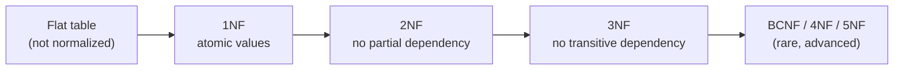
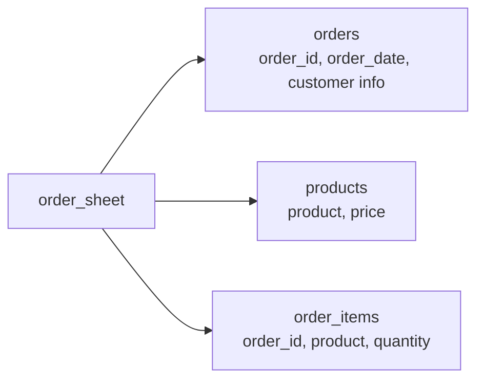
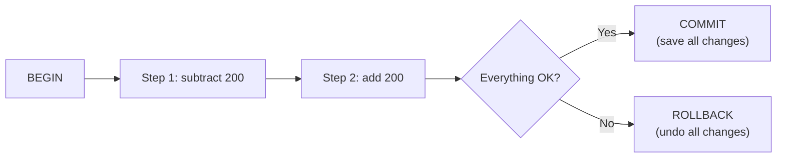
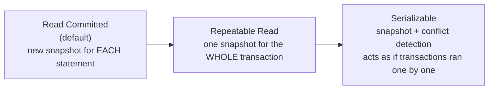
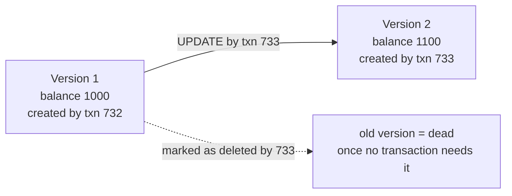
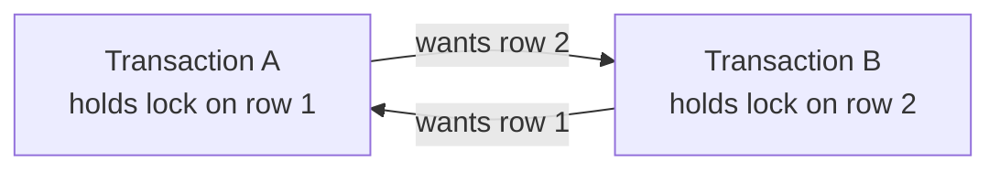
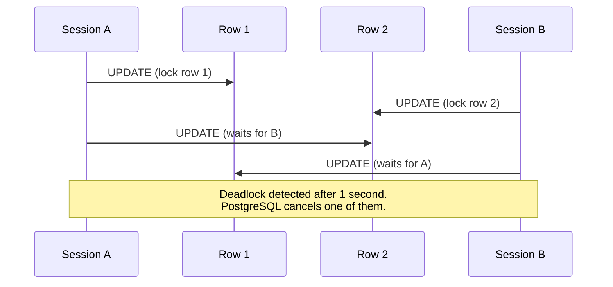

# PostgreSQL Tutorial — Phase 3: Design and Transactions (Days 7–9)

> **Who is this for?** Anyone who knows basic SQL, joins, and CTEs, and now wants to design good tables, use PostgreSQL's special data types, and keep data correct when many users work at the same time.
> **What you will build:** a normalized schema, a JSONB product catalog, and a set of two-terminal experiments that show every transaction problem (and its fix) with your own eyes.
> **How to use it:** Type every example. For Days 8 and 9 you need **two terminal windows** open at the same time. Reading about concurrency is not enough. You must see it happen.

---

## Table of Contents

- [Day 7 — Normalization and PostgreSQL-Specific Types](#day-7--normalization-and-postgresql-specific-types)
- [Day 8 — Transactions and ACID](#day-8--transactions-and-acid)
- [Day 9 — MVCC and Locking](#day-9--mvcc-and-locking)
- [Final Cheat Sheet](#final-cheat-sheet)

---

# Day 7 — Normalization and PostgreSQL-Specific Types

## 7.0 Setup for today

```sql
-- As an admin user (for example: psql -U postgres)
CREATE DATABASE design_lab;
\c design_lab
```

---

## 7.1 What is normalization?

**Normalization** is a set of rules for organizing tables so that:

- Each fact is stored **only once**.
- Changing a fact needs **only one update**.
- The data cannot become **contradictory**.

Think of a school. You do not write the teacher's phone number on every student's page. You write it **once** on the teacher's page, and students only point to the teacher.

### The three problems of bad design (anomalies)

We will use one big "flat" table to see the problems.

```sql
CREATE TABLE order_sheet (
    order_id        integer,
    order_date      date,
    customer_name   text,
    customer_email  text,
    customer_city   text,
    product_name    text,
    product_price   numeric(10,2),
    quantity        integer
);

INSERT INTO order_sheet VALUES
    (101, '2026-03-01', 'Aarav Sharma', 'aarav@example.com', 'Pune',  'Pro Laptop 14',  55999.00, 1),
    (101, '2026-03-01', 'Aarav Sharma', 'aarav@example.com', 'Pune',  'Wireless Mouse',   499.50, 2),
    (102, '2026-03-05', 'Priya Das',    'priya@example.com', 'Delhi', 'Wireless Mouse',   499.50, 1),
    (103, '2026-03-09', 'Aarav Sharma', 'aarav@example.com', 'Pune',  'USB-C Cable',      199.00, 3);
```

| order_id | order_date | customer_name | customer_email | customer_city | product_name | product_price | quantity |
|----------|------------|---------------|----------------|---------------|--------------|---------------|----------|
| 101 | 2026-03-01 | Aarav Sharma | aarav@example.com | Pune | Pro Laptop 14 | 55999.00 | 1 |
| 101 | 2026-03-01 | Aarav Sharma | aarav@example.com | Pune | Wireless Mouse | 499.50 | 2 |
| 102 | 2026-03-05 | Priya Das | priya@example.com | Delhi | Wireless Mouse | 499.50 | 1 |
| 103 | 2026-03-09 | Aarav Sharma | aarav@example.com | Pune | USB-C Cable | 199.00 | 3 |

Look at it. Aarav's name, email, and city are repeated 3 times. The Mouse price is repeated 2 times. That repetition causes trouble:

| Problem | Meaning | Example in this table |
|---------|---------|----------------------|
| **Update anomaly** | You change a fact in one row but forget the other rows, so the data disagrees. | Aarav moves to Mumbai. You must update 3 rows. If you update only 2, he lives in two cities. |
| **Insert anomaly** | You cannot store a fact without storing something unrelated. | You cannot add a new product (a Keyboard) until someone orders it, because every row needs an order. |
| **Delete anomaly** | Deleting one thing deletes other facts by accident. | If you delete order 102, you lose all information about Priya Das. |

Normalization fixes all three.

---

## 7.2 Key ideas you need first

| Word | Simple meaning | Example |
|------|----------------|---------|
| **Key (candidate key)** | A column (or columns) that identifies a row uniquely. | `order_id` + `product_name` identify a line in `order_sheet`. |
| **Primary key** | The key you choose as the main one. | `(order_id, product_id)` |
| **Composite key** | A key made of more than one column. | `(order_id, product_id)` |
| **Non-key column** | A column that is not part of the key. | `quantity` |
| **Functional dependency** | "If I know A, I can find exactly one B." Written `A → B`. | `customer_email → customer_name` |

**Functional dependency** is the heart of normalization. Examples from our sheet:

| Dependency | Meaning |
|------------|---------|
| `order_id → order_date` | An order has exactly one date. |
| `order_id → customer_email` | An order belongs to exactly one customer. |
| `customer_email → customer_name, customer_city` | A customer has one name and one city. |
| `product_name → product_price` | A product has one price. |
| `(order_id, product_name) → quantity` | A quantity belongs to a product **inside** an order. |

---

## 7.3 The normal forms (step by step)



Each form **includes** the one before it. To be in 3NF, you must also be in 2NF and 1NF.

### First Normal Form (1NF)

**Rule:** Every cell holds **one single value** (atomic), there are **no repeating groups**, and each row is unique.

**Bad (not 1NF):** many values in one cell

| order_id | customer | items |
|----------|----------|-------|
| 101 | Aarav | Pro Laptop 14 x1, Wireless Mouse x2 |

You cannot easily search for "all orders with a mouse", count items, or give each item a price.

**Bad (not 1NF):** repeating columns

| order_id | item1 | item2 | item3 |
|----------|-------|-------|-------|
| 101 | Laptop | Mouse | NULL |

What if an order has 4 items? You must change the table.

**Good (1NF):** one row per item, one value per cell. This is exactly our `order_sheet` table. Its primary key can be `(order_id, product_name)`.

> **Note:** Arrays and JSONB (shown later today) store many values in one cell. That is a **deliberate choice** for special cases. For normal business data, use separate rows.

### Second Normal Form (2NF)

**Rule:** The table is in 1NF, and **every non-key column depends on the WHOLE key**, not on only a part of it.

This only matters when the key has **more than one column**.

In `order_sheet` the key is `(order_id, product_name)`:

| Column | Depends on | Problem? |
|--------|------------|----------|
| `quantity` | the whole key `(order_id, product_name)` | OK |
| `order_date` | only `order_id` (part of the key) | **Partial dependency** |
| `customer_name`, `customer_email`, `customer_city` | only `order_id` | **Partial dependency** |
| `product_price` | only `product_name` | **Partial dependency** |

**Fix:** Move each group into its own table.



After 2NF:

**orders** (key: `order_id`)

| order_id | order_date | customer_name | customer_email | customer_city |
|----------|------------|---------------|----------------|---------------|
| 101 | 2026-03-01 | Aarav Sharma | aarav@example.com | Pune |
| 102 | 2026-03-05 | Priya Das | priya@example.com | Delhi |
| 103 | 2026-03-09 | Aarav Sharma | aarav@example.com | Pune |

**products** (key: `product_name`)

| product_name | product_price |
|--------------|---------------|
| Pro Laptop 14 | 55999.00 |
| Wireless Mouse | 499.50 |
| USB-C Cable | 199.00 |

**order_items** (key: `(order_id, product_name)`)

| order_id | product_name | quantity |
|----------|--------------|----------|
| 101 | Pro Laptop 14 | 1 |
| 101 | Wireless Mouse | 2 |
| 102 | Wireless Mouse | 1 |
| 103 | USB-C Cable | 3 |

The mouse price is now stored **once**. 

### Third Normal Form (3NF)

**Rule:** The table is in 2NF, and **no non-key column depends on another non-key column** (no *transitive* dependency).

A famous saying: *"Every non-key column must depend on the key, the whole key, and nothing but the key."*

In `orders`, the key is `order_id`. But look:

```text
order_id  →  customer_email  →  customer_name, customer_city
```

`customer_name` and `customer_city` depend on `customer_email` (a non-key column), **not directly on the order**. That is a **transitive dependency**. Aarav still appears twice (orders 101 and 103).

**Fix:** Create a `customers` table.

**customers** (key: `customer_id`)

| customer_id | full_name | email | city |
|-------------|-----------|-------|------|
| 1 | Aarav Sharma | aarav@example.com | Pune |
| 2 | Priya Das | priya@example.com | Delhi |

**orders** (key: `order_id`)

| order_id | customer_id | order_date |
|----------|-------------|------------|
| 101 | 1 | 2026-03-01 |
| 102 | 2 | 2026-03-05 |
| 103 | 1 | 2026-03-09 |

**Another everyday 3NF example:**

| emp_id | emp_name | dept_id | dept_name |
|--------|----------|---------|-----------|
| 1 | Aarav | 10 | Engineering |
| 2 | Priya | 10 | Engineering |

`dept_name` depends on `dept_id` (not on `emp_id`). Move `dept_id → dept_name` to a `departments` table.

### Summary of the first three normal forms

| Normal form | The rule in one line | What it removes |
|-------------|----------------------|-----------------|
| **1NF** | One value per cell, no repeating groups | Lists inside cells, `item1`/`item2`/`item3` columns |
| **2NF** | Depends on the **whole** key | Partial dependency (only for composite keys) |
| **3NF** | Depends on **nothing but** the key | Transitive dependency (non-key → non-key) |

### Beyond 3NF (just know the names)

| Form | Idea |
|------|------|
| **BCNF** (Boyce–Codd) | A stricter 3NF: every determinant must be a candidate key. It matters only in rare cases with overlapping keys. |
| **4NF** | Removes independent "many-to-many" facts stored in the same table. |
| **5NF** | Removes join dependencies. Very rare. |

For most business systems, **3NF is the target**.

---

## 7.4 Build the 3NF schema in PostgreSQL

```sql
CREATE SCHEMA normalized;
SET search_path TO normalized, public;

CREATE TABLE customers (
    customer_id  bigint GENERATED ALWAYS AS IDENTITY PRIMARY KEY,
    full_name    text NOT NULL,
    email        text NOT NULL UNIQUE,
    city         text
);

CREATE TABLE products (
    product_id  bigint GENERATED ALWAYS AS IDENTITY PRIMARY KEY,
    name        text          NOT NULL UNIQUE,
    price       numeric(10,2) NOT NULL CHECK (price >= 0)
);

CREATE TABLE orders (
    order_id     bigint GENERATED ALWAYS AS IDENTITY PRIMARY KEY,
    customer_id  bigint NOT NULL REFERENCES customers (customer_id),
    order_date   date   NOT NULL DEFAULT current_date
);

CREATE TABLE order_items (
    order_id    bigint        NOT NULL REFERENCES orders (order_id) ON DELETE CASCADE,
    product_id  bigint        NOT NULL REFERENCES products (product_id),
    quantity    integer       NOT NULL CHECK (quantity > 0),
    unit_price  numeric(10,2) NOT NULL,        -- price at the time of the order
    PRIMARY KEY (order_id, product_id)
);
```

### Move the data from the flat sheet

```sql
INSERT INTO customers (full_name, email, city)
SELECT DISTINCT customer_name, customer_email, customer_city
FROM public.order_sheet;

INSERT INTO products (name, price)
SELECT DISTINCT product_name, product_price
FROM public.order_sheet;

-- keep the old order numbers (the identity column needs OVERRIDING SYSTEM VALUE)
INSERT INTO orders (order_id, customer_id, order_date)
OVERRIDING SYSTEM VALUE
SELECT DISTINCT s.order_id, c.customer_id, s.order_date
FROM public.order_sheet s
JOIN customers c ON c.email = s.customer_email;

INSERT INTO order_items (order_id, product_id, quantity, unit_price)
SELECT s.order_id, p.product_id, s.quantity, s.product_price
FROM public.order_sheet s
JOIN products p ON p.name = s.product_name;
```

> **Why `unit_price` in `order_items` when `products.price` exists?** This is **not** a normalization mistake. A product's price changes over time, but an old order must keep the price the customer **really paid**. The two values mean different things (current price vs. price at purchase).

### The anomalies are gone

```sql
-- Update anomaly fixed: Aarav moves. ONE row changes.
UPDATE customers SET city = 'Mumbai' WHERE email = 'aarav@example.com';

-- Insert anomaly fixed: add a product nobody has ordered yet.
INSERT INTO products (name, price) VALUES ('Mechanical Keyboard', 3499.00);

-- Delete anomaly fixed: removing an order keeps the customer.
DELETE FROM orders WHERE order_id = 102;
SELECT full_name FROM customers;       -- Priya is still there
```

Rebuild the original flat view with joins whenever you need it:

```sql
SELECT o.order_id, o.order_date, c.full_name, c.city,
       p.name AS product, i.unit_price, i.quantity
FROM orders o
JOIN customers   c ON c.customer_id = o.customer_id
JOIN order_items i ON i.order_id    = o.order_id
JOIN products    p ON p.product_id  = i.product_id
ORDER BY o.order_id, p.name;
```

---

## 7.5 When to denormalize

**Denormalization** means **breaking the rules on purpose** to gain speed or simplicity. You store some data more than once.

> **Rule of thumb:** First normalize. Then denormalize **only** where you have measured a real problem.

### Good reasons

| Reason | Example |
|--------|---------|
| Reads are far more common than writes, and joins are slow at scale | Store `customer_name` in a big `orders_report` table |
| Reports must be fast | A daily summary table or materialized view |
| You need to keep history | Save product name and price **at the time of sale** |
| Data is flexible or comes from outside | Keep a raw JSON response next to the clean columns |
| Counting is expensive | Store `comment_count` on the post row |

### Bad reasons

| Reason | Why it is bad |
|--------|---------------|
| "Joins are slow" (without measuring) | With good indexes, PostgreSQL joins are fast. |
| "It is easier to write the insert" | You pay later with wrong data. |
| "We might need it someday" | Extra copies must be kept in sync forever. |

### Safe ways to denormalize in PostgreSQL

**1) Generated columns** (the database keeps the copy correct, PostgreSQL 12 and newer)

```sql
ALTER TABLE order_items
    ADD COLUMN line_total numeric(12,2)
    GENERATED ALWAYS AS (quantity * unit_price) STORED;

SELECT order_id, product_id, quantity, unit_price, line_total FROM order_items;
```

**2) Materialized views** (a saved query result that you refresh)

```sql
CREATE MATERIALIZED VIEW customer_spend AS
SELECT c.customer_id, c.full_name, SUM(i.quantity * i.unit_price) AS total_spend
FROM customers c
JOIN orders o      ON o.customer_id = c.customer_id
JOIN order_items i ON i.order_id    = o.order_id
GROUP BY c.customer_id, c.full_name;

SELECT * FROM customer_spend;

REFRESH MATERIALIZED VIEW customer_spend;                 -- recompute (locks readers briefly)
-- With a unique index you can refresh without blocking readers:
CREATE UNIQUE INDEX ux_customer_spend ON customer_spend (customer_id);
REFRESH MATERIALIZED VIEW CONCURRENTLY customer_spend;
```

**3) Summary tables kept by triggers or by a scheduled job**

**4) A copied column kept in sync by a trigger** (only when really needed).

### Trade-offs

| | Normalized | Denormalized |
|---|-----------|--------------|
| Data duplicated | No | Yes |
| Writes | Simple and fast | More work (update many places) |
| Reads | Need joins | Faster, fewer joins |
| Risk of wrong data | Low | **Higher** |
| Storage | Smaller | Bigger |
| Best for | Transaction systems (OLTP) | Reports, analytics, read-heavy features |

---

## 7.6 PostgreSQL-specific data types

PostgreSQL has many types that other databases do not. Today we look at five: **JSONB, arrays, ENUM, ranges, hstore**.

| Type | Stores | Typical use |
|------|--------|-------------|
| `jsonb` | JSON documents | Product attributes, settings, API data |
| `text[]`, `int[]` | A list in one column | Tags, small lists |
| `ENUM` | One value from a fixed list | Status, type |
| `int4range`, `daterange`, `tstzrange` ... | A span of values | Bookings, validity periods |
| `hstore` | Key/value pairs (text only) | Simple attributes (old style; prefer `jsonb`) |

---

## 7.7 JSONB

**JSON** is a text format for structured data:

```json
{ "brand": "Zenix", "ram_gb": 16, "colors": ["silver", "black"] }
```

PostgreSQL has two types:

| | `json` | `jsonb` |
|---|--------|---------|
| Storage | Exact text copy | Converted to a **binary** format |
| Speed to read and search | Slower (re-parsed every time) | **Faster** |
| Keeps spaces, key order, duplicate keys | Yes | No (cleans them up) |
| Can be indexed | No | **Yes (GIN)** |
| Recommended | Rarely (only to keep the exact original text) | **Almost always** |

### Create a table with JSONB

```sql
CREATE TABLE catalog (
    product_id  integer PRIMARY KEY,
    name        text          NOT NULL,
    price       numeric(10,2) NOT NULL,
    attrs       jsonb         NOT NULL DEFAULT '{}'
);

INSERT INTO catalog (product_id, name, price, attrs) VALUES
 (1, 'Pro Laptop 14',           55999.00, '{"brand":"Zenix","ram_gb":16,"storage":{"type":"SSD","size_gb":512},"colors":["silver","black"],"warranty_years":2}'),
 (2, 'Gaming Beast 17',         99999.00, '{"brand":"Zenix","ram_gb":32,"storage":{"type":"SSD","size_gb":1024},"colors":["black"],"gpu":"RTX-class"}'),
 (3, 'Wireless Mouse',            499.50, '{"brand":"Clickr","wireless":true,"colors":["black","white","red"],"battery_hours":400}'),
 (4, 'Mechanical Keyboard',      3499.00, '{"brand":"Clickr","switch":"brown","backlight":true,"colors":["black"]}'),
 (5, 'Noise-Cancel Headphones',  7999.00, '{"brand":"Sonex","wireless":true,"noise_cancelling":true,"battery_hours":30,"colors":["black","blue"]}'),
 (6, 'SQL Handbook',              650.00, '{"author":"A. Rao","pages":420,"language":"English"}');
```

Notice that a laptop has `ram_gb`, a mouse has `battery_hours`, and a book has `pages`. **Each product has different attributes.** This is where JSONB is very useful: a normal table would need hundreds of mostly empty columns (or complex tables).

### JSON value types

| Type | Example |
|------|---------|
| Object | `{"a": 1}` |
| Array | `[1, 2, 3]` |
| String | `"hello"` |
| Number | `42` |
| Boolean | `true` |
| null | `null` |

### The operators (the most important table of today)

| Operator | Name | Returns | Example | Result |
|----------|------|---------|---------|--------|
| `->` | Get by key (or array index) | **jsonb** | `attrs -> 'brand'` | `"Zenix"` (still JSON, with quotes) |
| `->>` | Get by key as **text** | **text** | `attrs ->> 'brand'` | `Zenix` |
| `#>` | Get by **path** | jsonb | `attrs #> '{storage,type}'` | `"SSD"` |
| `#>>` | Get by path as text | text | `attrs #>> '{storage,type}'` | `SSD` |
| `@>` | **Contains** (left contains right) | boolean | `attrs @> '{"brand":"Zenix"}'` | `true` / `false` |
| `<@` | Is contained by | boolean | `'{"a":1}' <@ attrs` | |
| `?` | Has this **key** (or string element) | boolean | `attrs ? 'wireless'` | |
| `?\|` | Has **any** of these keys | boolean | `attrs ?\| array['gpu','switch']` | |
| `?&` | Has **all** of these keys | boolean | `attrs ?& array['brand','wireless']` | |
| `\|\|` | Merge two jsonb values | jsonb | `attrs \|\| '{"on_sale":true}'` | |
| `-` | Remove a key (or array element) | jsonb | `attrs - 'gpu'` | |
| `#-` | Remove by path | jsonb | `attrs #- '{storage,type}'` | |

> **Memory trick:** `->` keeps the JSON type (arrow), `->>` gives text (double arrow, "flatten to text").

### Reading data

```sql
-- Get values
SELECT name,
       attrs -> 'brand'                AS brand_json,     -- "Zenix"
       attrs ->> 'brand'               AS brand_text,     -- Zenix
       attrs -> 'storage' ->> 'type'   AS storage_type,   -- SSD (chain the arrows)
       attrs #>> '{storage,size_gb}'   AS storage_size,   -- 512 (path style)
       attrs -> 'colors' ->> 0         AS first_color     -- silver (array index starts at 0)
FROM catalog
WHERE product_id = 1;
```

> **Important:** `->>` always gives **text**. To compare as a number, cast it:
>
> ```sql
> SELECT name FROM catalog WHERE (attrs ->> 'ram_gb')::int >= 16;     -- Pro Laptop 14, Gaming Beast 17
> ```
>
> Without the cast, `attrs ->> 'ram_gb' >= '16'` compares **text**, and `'8' > '16'` is true as text!

### Filtering: `@>` (contains)

```sql
-- All Zenix products
SELECT name FROM catalog WHERE attrs @> '{"brand":"Zenix"}';
-- Pro Laptop 14, Gaming Beast 17

-- Wireless products
SELECT name FROM catalog WHERE attrs @> '{"wireless":true}';
-- Wireless Mouse, Noise-Cancel Headphones

-- Match several things at once, including nested values
SELECT name FROM catalog WHERE attrs @> '{"brand":"Zenix","storage":{"type":"SSD"}}';

-- Is the color "red" in the colors array?
SELECT name FROM catalog WHERE attrs -> 'colors' ? 'red';          -- Wireless Mouse
SELECT name FROM catalog WHERE attrs @> '{"colors":["black"]}';    -- everything that comes in black
```

**`@>` rules:**
- For objects: every key/value on the right must exist on the left.
- For arrays: every element on the right must exist in the array on the left.
- It is very **index friendly** (see GIN below).

### Filtering: `?` (key exists)

```sql
SELECT name FROM catalog WHERE attrs ? 'battery_hours';              -- Wireless Mouse, Headphones
SELECT name FROM catalog WHERE attrs ?| array['gpu','switch'];       -- Gaming Beast 17, Mechanical Keyboard
SELECT name FROM catalog WHERE attrs ?& array['wireless','battery_hours'];   -- Wireless Mouse, Headphones
```

> **Careful with `?` in Java:** In JDBC, a `?` is a parameter marker. Use the function form `jsonb_exists(attrs, 'key')`, or write `??` in your driver (depends on the driver).

### JSON `null` vs SQL `NULL`

| | Meaning |
|---|---------|
| SQL `NULL` | The column has no value. |
| JSON `null` | The key exists and its value is `null`. |
| Missing key | `attrs -> 'x'` returns SQL `NULL`. |

```sql
SELECT '{"a": null}'::jsonb -> 'a';                        -- null  (JSON null)
SELECT ('{"a": null}'::jsonb -> 'a') IS NULL;              -- false (it is a JSON value)
SELECT ('{"a": null}'::jsonb ->> 'a') IS NULL;             -- true  (text form is SQL NULL)
SELECT ('{}'::jsonb -> 'a') IS NULL;                       -- true  (missing key)
```

### Changing JSONB data

```sql
-- Add or replace a key (merge)
UPDATE catalog SET attrs = attrs || '{"on_sale": true}' WHERE product_id = 3;

-- Remove a key
UPDATE catalog SET attrs = attrs - 'gpu' WHERE product_id = 2;

-- Set one value deep inside (jsonb_set)
-- jsonb_set(target, path, new_value [, create_if_missing])
UPDATE catalog
SET attrs = jsonb_set(attrs, '{storage,size_gb}', '2048')
WHERE product_id = 2;

-- Add a new nested key
UPDATE catalog
SET attrs = jsonb_set(attrs, '{dimensions}', '{"w": 30, "h": 2}', true)
WHERE product_id = 1;

-- Append to an array
UPDATE catalog
SET attrs = jsonb_set(attrs, '{colors}', (attrs -> 'colors') || '"gold"')
WHERE product_id = 1;
```

> **Remember:** JSONB values are **replaced as a whole**. Updating one key writes the entire document again. Huge documents with many updates are slow and cause bloat.

### Building JSON from table data

```sql
SELECT jsonb_build_object('id', product_id, 'name', name, 'price', price) FROM catalog;

SELECT to_jsonb(c) FROM catalog c WHERE product_id = 6;     -- whole row as JSON

-- Many rows into one JSON array
SELECT jsonb_agg(jsonb_build_object('name', name, 'price', price) ORDER BY price) FROM catalog;
```

This is great for REST APIs: build the response JSON directly in SQL.

### Turning JSON into rows

```sql
-- Expand an array into rows
SELECT name, jsonb_array_elements_text(attrs -> 'colors') AS color
FROM catalog
WHERE attrs ? 'colors';

-- Expand an object into key/value rows
SELECT key, value FROM catalog, jsonb_each(attrs) WHERE product_id = 6;

-- Count products per color
SELECT color, COUNT(*) AS products
FROM catalog, jsonb_array_elements_text(attrs -> 'colors') AS color
GROUP BY color
ORDER BY products DESC, color;
-- black 5, blue 1, red 1, silver 1, white 1
```

### Handy JSONB functions

| Function | What it does |
|----------|--------------|
| `jsonb_typeof(x)` | `object`, `array`, `string`, `number`, `boolean`, or `null` |
| `jsonb_array_length(x)` | Number of elements in an array |
| `jsonb_object_keys(x)` | The keys of an object, as rows |
| `jsonb_pretty(x)` | Nicely indented text |
| `jsonb_strip_nulls(x)` | Removes keys with `null` values |
| `jsonb_path_exists(x, path)` | Does a JSONPath match? |
| `jsonb_path_query(x, path)` | Return values matching a JSONPath |

### JSONPath (PostgreSQL 12 and newer)

A mini query language for JSON:

```sql
-- Products where battery_hours is bigger than 100
SELECT name FROM catalog
WHERE jsonb_path_exists(attrs, '$.battery_hours ? (@ > 100)');     -- Wireless Mouse

-- Same idea with the @? operator
SELECT name FROM catalog WHERE attrs @? '$.storage.size_gb ? (@ >= 1024)';

-- Get values
SELECT jsonb_path_query(attrs, '$.colors[*]') FROM catalog WHERE product_id = 3;
```

### Indexing JSONB with GIN

Without an index, every JSONB search reads the whole table. A **GIN** index makes `@>`, `?`, `?|`, `?&` fast.

```sql
-- Default operator class: supports @>, ?, ?|, ?&
CREATE INDEX idx_catalog_attrs ON catalog USING gin (attrs);

-- Smaller and faster, but supports only @> (and jsonpath @?, @@)
CREATE INDEX idx_catalog_attrs_path ON catalog USING gin (attrs jsonb_path_ops);
```

| Operator class | Supports | Size | Speed for `@>` |
|----------------|----------|------|----------------|
| `jsonb_ops` (default) | `@>`, `?`, `?\|`, `?&` | Bigger | Good |
| `jsonb_path_ops` | `@>`, `@?`, `@@` only | **Smaller** | **Faster** |

**Index one key only (an expression index with a normal B-tree):**

```sql
-- Fast equality or range on one field
CREATE INDEX idx_catalog_brand ON catalog ((attrs ->> 'brand'));
SELECT name FROM catalog WHERE attrs ->> 'brand' = 'Zenix';

-- For a number, cast inside the index and use the SAME expression in the query
CREATE INDEX idx_catalog_ram ON catalog (((attrs ->> 'ram_gb')::int));
SELECT name FROM catalog WHERE (attrs ->> 'ram_gb')::int >= 16;
```

> The query must use the **same expression** as the index. `attrs ->> 'brand'` uses the index above. `attrs -> 'brand'` does not.

### Rules for your JSONB data (constraints)

JSONB has no fixed structure. You can still protect it:

```sql
ALTER TABLE catalog
    ADD CONSTRAINT chk_attrs_is_object CHECK (jsonb_typeof(attrs) = 'object'),
    ADD CONSTRAINT chk_laptop_has_ram CHECK (
        NOT (attrs ? 'ram_gb') OR (attrs ->> 'ram_gb')::int > 0
    );
```

### When to use JSONB, and when not to

| Use JSONB for | Use normal columns for |
|---------------|------------------------|
| Attributes that **differ** between rows (laptop vs book) | Data every row has (name, price, email) |
| Data from outside systems (API responses, events) | Data you filter, join, sort, or sum all the time |
| Settings and preferences | Data with **foreign keys** or strict rules |
| Rarely queried extra details | Anything needing `NOT NULL`, `UNIQUE`, `CHECK` on each field |

| | JSONB | Normal columns |
|---|-------|----------------|
| Flexible structure | **Yes** | No (needs `ALTER TABLE`) |
| Type safety and constraints | Weak | **Strong** |
| Foreign keys | **No** | Yes |
| Statistics for the query planner | Poor | **Good** |
| Storage and speed for simple fields | Bigger, slower | **Smaller, faster** |
| Update one field | Rewrites the whole document | Rewrites the row |

> **Best pattern:** Put the important, common fields (`name`, `price`, `category_id`) in **real columns**, and only the flexible extras in one `attrs jsonb` column.

---

## 7.8 Arrays

PostgreSQL can store a **list of values in one column**. Every type has an array version: `integer[]`, `text[]`, `date[]`, and so on.

```sql
CREATE TABLE articles (
    article_id  integer PRIMARY KEY,
    title       text NOT NULL,
    tags        text[] NOT NULL DEFAULT '{}',
    scores      integer[]
);

INSERT INTO articles VALUES
    (1, 'Intro to SQL',     ARRAY['sql','beginner','database'], ARRAY[90, 85, 70]),
    (2, 'Index Deep Dive',  '{"sql","performance","index"}',    '{80,95}'),     -- text literal form
    (3, 'Spring Boot Tips', ARRAY['java','spring'],             NULL);
```

Two ways to write an array: `ARRAY['a','b']` or the text form `'{a,b}'`.

### Reading elements

**Array positions start at 1** (not 0, unlike JSON and Java).

```sql
SELECT tags[1]            AS first_tag,       -- sql
       tags[1:2]          AS first_two,       -- {sql,beginner}
       array_length(tags, 1) AS tag_count,    -- 3
       cardinality(tags)  AS total_items      -- 3
FROM articles WHERE article_id = 1;
```

### Searching arrays

| Operator | Meaning | Example |
|----------|---------|---------|
| `= ANY(array)` | Value is one of the elements | `'sql' = ANY(tags)` |
| `@>` | Left array **contains** all of right | `tags @> ARRAY['sql','index']` |
| `<@` | Left is contained by right | `ARRAY['sql'] <@ tags` |
| `&&` | The arrays **overlap** (share any element) | `tags && ARRAY['java','sql']` |
| `\|\|` | Join arrays / add an element | `tags \|\| 'new'` |

```sql
SELECT title FROM articles WHERE 'sql' = ANY(tags);                 -- articles 1, 2
SELECT title FROM articles WHERE tags @> ARRAY['sql','index'];      -- article 2 (has BOTH)
SELECT title FROM articles WHERE tags && ARRAY['java','index'];     -- articles 2, 3 (has ANY)
```

### Changing arrays

```sql
UPDATE articles SET tags = array_append(tags, 'popular')       WHERE article_id = 1;
UPDATE articles SET tags = array_remove(tags, 'beginner')      WHERE article_id = 1;
UPDATE articles SET tags = tags || ARRAY['new','hot']          WHERE article_id = 3;
UPDATE articles SET tags[1] = 'sql-basics'                     WHERE article_id = 1;
```

### Arrays and rows: `unnest` and `array_agg`

```sql
-- One row per tag
SELECT article_id, unnest(tags) AS tag FROM articles;

-- Count articles per tag
SELECT tag, COUNT(*) AS articles
FROM articles, unnest(tags) AS tag
GROUP BY tag
ORDER BY articles DESC, tag;

-- Collect rows back into an array
SELECT array_agg(title ORDER BY title) FROM articles;
```

### Index arrays with GIN

```sql
CREATE INDEX idx_articles_tags ON articles USING gin (tags);
-- speeds up: @>, <@, &&, and = ANY is NOT supported (use @> instead for indexed search)
SELECT title FROM articles WHERE tags @> ARRAY['sql'];
```

### Arrays vs a separate table (join table)

| | Array column | Join table (`article_tags`) |
|---|--------------|-----------------------------|
| Simple to write | **Yes** | More tables |
| Foreign keys to a `tags` table | **No** | Yes |
| Rename a tag everywhere | Hard (update every row) | Easy (one row) |
| Count and report per tag | OK | **Better** |
| Keeps the data normalized | No (1NF break) | **Yes** |
| Good for | Small, simple lists that belong to one row | Real relationships between entities |

> **Rule:** If the list items are **entities with their own data** (tags, users, products), use a join table. If they are **simple values** that belong to the row (a few scores, phone numbers, flags), an array is fine.

---

## 7.9 ENUM

An **enum** is a type that allows **only a fixed list of named values**.

**Syntax:**

```sql
CREATE TYPE type_name AS ENUM ('value1', 'value2', 'value3');
```

```sql
CREATE TYPE order_status AS ENUM ('pending', 'paid', 'shipped', 'delivered', 'cancelled');

CREATE TABLE shop_orders (
    order_id  integer PRIMARY KEY,
    status    order_status NOT NULL DEFAULT 'pending'
);

INSERT INTO shop_orders VALUES (1, 'paid'), (2, 'pending'), (3, 'shipped');
INSERT INTO shop_orders VALUES (4, 'lost');
-- ERROR: invalid input value for enum order_status: "lost"
```

### Enum order and comparison

Values are ordered **by the order you declared them**, not alphabetically.

```sql
SELECT * FROM shop_orders ORDER BY status;                 -- pending, paid, shipped (declaration order)
SELECT * FROM shop_orders WHERE status > 'pending';        -- paid, shipped
SELECT enum_range(NULL::order_status);                     -- {pending,paid,shipped,delivered,cancelled}
SELECT enum_range('paid'::order_status, 'delivered');      -- {paid,shipped,delivered}
```

### Changing an enum

```sql
ALTER TYPE order_status ADD VALUE 'refunded';                               -- adds at the end
ALTER TYPE order_status ADD VALUE 'packed' AFTER 'paid';                    -- choose the position
ALTER TYPE order_status ADD VALUE IF NOT EXISTS 'packed';
ALTER TYPE order_status RENAME VALUE 'cancelled' TO 'canceled';
```

> **You cannot remove a value from an enum.** The only way is to make a new type and move the data. Also, a value added inside a transaction block cannot be used until that transaction commits.

### ENUM vs CHECK vs lookup table

| | `ENUM` | `CHECK (status IN (...))` | Lookup table + foreign key |
|---|--------|----------------------------|----------------------------|
| Storage | 4 bytes | Text size | Key size |
| Add a value | `ALTER TYPE ... ADD VALUE` | Drop and recreate the constraint | `INSERT` a row |
| Remove a value | **Hard** | Easy | Easy (if unused) |
| Natural ordering | **Yes** | No | Add a sort column |
| Extra data per value (label, color) | No | No | **Yes** |
| Works well with ORMs | OK (needs mapping) | **Simple** | Needs a relation |
| Best for | Very stable lists | Short lists that may change | Lists that change or carry extra data |

> **Advice:** Use `ENUM` only for values that almost never change (like `'male'/'female'` or days of the week). For statuses that your business may change, a `CHECK` constraint or a lookup table is safer.

---

## 7.10 Range types

A **range** stores a **span** of values as one value: a start and an end.

| Range type | Over | Example |
|------------|------|---------|
| `int4range` | integer | `[1,10)` |
| `int8range` | bigint | |
| `numrange` | numeric | `[0.5, 9.9]` |
| `daterange` | date | `[2026-01-01, 2026-02-01)` |
| `tsrange` | timestamp | |
| `tstzrange` | timestamptz | **Best for time spans** |

### Bounds: `[ ]` and `( )`

| Symbol | Meaning |
|--------|---------|
| `[` or `]` | **Inclusive** (the value itself is inside) |
| `(` or `)` | **Exclusive** (the value itself is outside) |

```sql
SELECT int4range(1, 10);              -- [1,10)   default: lower inclusive, upper exclusive
SELECT int4range(1, 10, '[]');        -- [1,11)   (integers are normalized to [ ) form)
SELECT daterange('2026-01-01', '2026-02-01');       -- [2026-01-01,2026-02-01)  = all of January
SELECT '[2026-01-01, 2026-02-01)'::daterange;
SELECT numrange(0.5, 9.9, '[]');                    -- [0.5,9.9]
SELECT int4range(5, NULL);                          -- [5,)   open-ended (no upper limit)
```

> The `[start, end)` style (**end excluded**) is the best for time: January ends exactly when February starts, so ranges do not overlap or leave gaps.

### Range operators

| Operator | Meaning | Example |
|----------|---------|---------|
| `@>` | Range contains a value or another range | `'[1,10)'::int4range @> 5` |
| `<@` | Is contained by | `5 <@ '[1,10)'::int4range` |
| `&&` | The ranges **overlap** | `int4range(1,5) && int4range(4,8)` |
| `-\|-` | The ranges are **adjacent** (touch) | `int4range(1,5) -\|- int4range(5,8)` |
| `<<`, `>>` | Strictly left of / right of | |
| `*` | Intersection | `int4range(1,5) * int4range(3,8)` → `[3,5)` |
| `+` | Union (if they touch or overlap) | |
| `-` | Difference | |

```sql
SELECT daterange('2026-01-01','2026-02-01') @> date '2026-01-15';     -- true
SELECT int4range(1,5) && int4range(4,8);                              -- true
SELECT lower(int4range(3,9)), upper(int4range(3,9));                  -- 3, 9
SELECT isempty(int4range(5,5));                                       -- true
```

### The big win: no double bookings (exclusion constraint)

A **unique** constraint can say "no two rows equal". An **exclusion** constraint says "no two rows **overlap**". It needs the `btree_gist` extension to mix `=` and `&&`.

```sql
CREATE EXTENSION IF NOT EXISTS btree_gist;

CREATE TABLE room_bookings (
    booking_id  integer GENERATED ALWAYS AS IDENTITY PRIMARY KEY,
    room_no     integer   NOT NULL,
    guest       text      NOT NULL,
    stay        daterange NOT NULL,
    EXCLUDE USING gist (room_no WITH =, stay WITH &&)      -- same room AND overlapping dates = forbidden
);

INSERT INTO room_bookings (room_no, guest, stay)
VALUES (101, 'Aarav', '[2026-05-01, 2026-05-05)');          -- OK

INSERT INTO room_bookings (room_no, guest, stay)
VALUES (101, 'Priya', '[2026-05-03, 2026-05-08)');
-- ERROR: conflicting key value violates exclusion constraint "room_bookings_room_no_stay_excl"

INSERT INTO room_bookings (room_no, guest, stay)
VALUES (101, 'Priya', '[2026-05-05, 2026-05-08)');          -- OK (starts the day Aarav leaves)
INSERT INTO room_bookings (room_no, guest, stay)
VALUES (102, 'Rohan', '[2026-05-03, 2026-05-08)');          -- OK (different room)
```

This protects against double booking **inside the database**, even when two users book at the same moment. Application code alone cannot guarantee that.

### Other range uses

```sql
-- Find bookings that cover a date
SELECT guest FROM room_bookings WHERE stay @> date '2026-05-04';

-- Prices valid for a time span
CREATE TABLE price_history (
    product_id  integer,
    price       numeric(10,2),
    valid       tstzrange,
    EXCLUDE USING gist (product_id WITH =, valid WITH &&)
);

-- Index ranges for fast overlap searches
CREATE INDEX idx_bookings_stay ON room_bookings USING gist (stay);
```

PostgreSQL 14 and newer also have **multirange** types (`datemultirange`, ...) that hold several separate ranges in one value, and `range_agg()` to combine ranges.

---

## 7.11 hstore

**hstore** is an extension that stores **key/value pairs of text** in one column. It is older than JSONB.

```sql
CREATE EXTENSION IF NOT EXISTS hstore;

CREATE TABLE gadgets (
    gadget_id  integer PRIMARY KEY,
    name       text,
    specs      hstore
);

INSERT INTO gadgets VALUES
    (1, 'Phone',  'brand => Zenix, ram => 8, color => black'),
    (2, 'Tablet', '"brand" => "Sonex", "ram" => "6"');
```

### Operators

| Operator / function | Meaning | Example |
|---------------------|---------|---------|
| `->` | Get a value (as text) | `specs -> 'brand'` |
| `?` | Has this key | `specs ? 'color'` |
| `@>` | Contains these pairs | `specs @> 'brand => Zenix'` |
| `\|\|` | Merge | `specs \|\| 'ram => 12'` |
| `-` | Delete a key | `specs - 'color'` |
| `hstore_to_jsonb(x)` | Convert to JSONB | |
| `skeys(x)`, `svals(x)` | Keys / values as rows | |

```sql
SELECT name, specs -> 'brand' AS brand FROM gadgets;
SELECT name FROM gadgets WHERE specs ? 'color';                 -- Phone
SELECT name FROM gadgets WHERE specs @> 'brand => Sonex';       -- Tablet
UPDATE gadgets SET specs = specs || 'ram => 12' WHERE gadget_id = 1;
CREATE INDEX idx_gadgets_specs ON gadgets USING gin (specs);
```

### hstore vs JSONB

| | `hstore` | `jsonb` |
|---|----------|---------|
| Value types | **Text only** | Text, number, boolean, null, nested objects, arrays |
| Nesting | No | **Yes** |
| Operators and functions | Fewer | **Many (and JSONPath)** |
| Industry direction | Legacy | **Standard choice** |

> **Advice:** Use `jsonb` for new projects. Learn `hstore` only because you will see it in older systems.

---

## 7.12 More helpful types (extras)

### DOMAIN — a reusable type with rules

```sql
CREATE DOMAIN positive_money AS numeric(12,2) CHECK (VALUE >= 0);
CREATE DOMAIN email_address  AS text CHECK (VALUE ~* '^[^@\s]+@[^@\s]+\.[^@\s]+$');

CREATE TABLE payments (
    payment_id  integer PRIMARY KEY,
    amount      positive_money NOT NULL,
    payer_email email_address   NOT NULL
);
```

Write the rule **once**, use it in many tables.

### citext — case-insensitive text

```sql
CREATE EXTENSION IF NOT EXISTS citext;
CREATE TABLE app_users (email citext UNIQUE);
INSERT INTO app_users VALUES ('Aarav@Example.com');
SELECT * FROM app_users WHERE email = 'aarav@example.com';     -- found
INSERT INTO app_users VALUES ('AARAV@example.com');            -- ERROR: duplicate key
```

### Composite types, `inet`, `cidr`, `macaddr`, `tsvector`, `point`, `ltree`

| Type | Used for |
|------|----------|
| `inet`, `cidr` | IP addresses and networks (with built-in functions) |
| `tsvector`, `tsquery` | Full-text search |
| `point`, `box`, `circle` | Simple geometry (PostGIS for real maps) |
| `ltree` (extension) | Tree paths with fast queries |
| `money` | Avoid it. Use `numeric`. |

---

## 7.13 Hands-on: product attributes in JSONB

Use the `catalog` table created in section 7.7. Do these steps in order.

**Step 1 — Read.** Show each product with its brand and its storage size (if any).

```sql
SELECT name,
       attrs ->> 'brand'                     AS brand,
       attrs #>> '{storage,size_gb}'         AS storage_gb
FROM catalog
ORDER BY product_id;
```

**Result:**

| name | brand | storage_gb |
|------|-------|------------|
| Pro Laptop 14 | Zenix | 512 |
| Gaming Beast 17 | Zenix | 1024 |
| Wireless Mouse | Clickr | NULL |
| Mechanical Keyboard | Clickr | NULL |
| Noise-Cancel Headphones | Sonex | NULL |
| SQL Handbook | NULL | NULL |

**Step 2 — Filter with `@>`.** All wireless products that come in black.

```sql
SELECT name, price
FROM catalog
WHERE attrs @> '{"wireless": true, "colors": ["black"]}';
-- Wireless Mouse (499.50), Noise-Cancel Headphones (7999.00)
```

**Step 3 — Filter with a number.** Products with at least 16 GB RAM, cheapest first.

```sql
SELECT name, (attrs ->> 'ram_gb')::int AS ram_gb
FROM catalog
WHERE (attrs ->> 'ram_gb')::int >= 16
ORDER BY price;
```

**Step 4 — Check that keys exist.**

```sql
SELECT name FROM catalog WHERE NOT attrs ? 'brand';       -- SQL Handbook (a book has no brand)
```

**Step 5 — Update.** Add a discount flag and raise a laptop's RAM.

```sql
UPDATE catalog SET attrs = attrs || '{"on_sale": true}'                WHERE product_id = 3;
UPDATE catalog SET attrs = jsonb_set(attrs, '{ram_gb}', '32')          WHERE product_id = 1;
SELECT name, attrs FROM catalog WHERE product_id IN (1, 3);
```

**Step 6 — Index and prove it works.** Insert many rows, then compare.

```sql
INSERT INTO catalog (product_id, name, price, attrs)
SELECT g, 'Item ' || g, (g % 1000) + 0.99,
       jsonb_build_object('brand', 'Brand' || (g % 500), 'size', g % 50)
FROM generate_series(100, 200099) g;

ANALYZE catalog;
DROP INDEX IF EXISTS idx_catalog_attrs;       -- remove the index we made earlier, so we can compare fairly
EXPLAIN SELECT name FROM catalog WHERE attrs @> '{"brand":"Brand42"}';      -- before: Seq Scan

CREATE INDEX idx_catalog_attrs ON catalog USING gin (attrs);
EXPLAIN SELECT name FROM catalog WHERE attrs @> '{"brand":"Brand42"}';      -- after: Bitmap Index Scan
```

**Step 7 — Build a JSON API response.**

```sql
SELECT jsonb_pretty(jsonb_agg(jsonb_build_object(
           'id', product_id, 'name', name, 'brand', attrs ->> 'brand')))
FROM catalog
WHERE product_id <= 6;
```

### Hands-on checklist

- [ ] I created the 3NF schema and moved the flat data into it
- [ ] I used `->`, `->>`, `#>>`, `@>`, `?`
- [ ] I cast `->>` results before number comparisons
- [ ] I updated JSONB with `||`, `-`, and `jsonb_set`
- [ ] I added a GIN index and saw the plan change
- [ ] I tried an enum, an array, a range with an exclusion constraint, and hstore

---

## 7.14 Anti-patterns, quick reference, practice Q&A

### Anti-pattern callouts

> **Anti-pattern 1 — Storing everything in JSONB when the data is clearly relational.**
> If every row has the same fields (`name`, `email`, `price`, `customer_id`), use real columns. You lose foreign keys, constraints, good statistics, and speed when you hide normal data in JSON. A table with one `data jsonb` column is usually a design mistake.
>
> **Anti-pattern 2 — Comma-separated lists in a text column** (`'sql,java,spring'`).
> It breaks 1NF. Use an array or a join table.
>
> **Anti-pattern 3 — Repeating columns** (`phone1`, `phone2`, `phone3`).
> Use a child table or an array.
>
> **Anti-pattern 4 — Comparing `->>` results without a cast.**
> Text comparison gives wrong number results (`'9' > '10'`).
>
> **Anti-pattern 5 — Huge JSONB documents that are updated often.**
> Each update rewrites the whole value. Split hot fields into real columns.
>
> **Anti-pattern 6 — Using ENUM for values that change often.**
> You cannot remove enum values. Use a lookup table or `CHECK`.
>
> **Anti-pattern 7 — Denormalizing without measuring.**
> Copies must be kept in sync forever. Measure first.
>
> **Anti-pattern 8 — Foreign keys that point into JSONB.**
> JSONB values cannot have foreign keys. If it is a relationship, make it a column.
>
> **Anti-pattern 9 — Using `json` instead of `jsonb`.**
> `json` cannot be indexed and is slower to query.

### Quick reference

| Task | Syntax |
|------|--------|
| Get key as JSON / text | `attrs -> 'k'` / `attrs ->> 'k'` |
| Get nested value | `attrs #>> '{a,b}'` |
| Array element (0-based) | `attrs -> 'list' ->> 0` |
| Contains | `attrs @> '{"k":"v"}'` |
| Key exists | `attrs ? 'k'` |
| Merge / add key | `attrs \|\| '{"k":1}'` |
| Remove key | `attrs - 'k'` |
| Set deep value | `jsonb_set(attrs, '{a,b}', '5')` |
| JSON array to rows | `jsonb_array_elements_text(attrs -> 'list')` |
| Row to JSON | `to_jsonb(t)` |
| Rows to JSON array | `jsonb_agg(...)` |
| Index JSONB | `CREATE INDEX ... USING gin (attrs)` |
| Index one key | `CREATE INDEX ... ((attrs ->> 'k'))` |
| Array value in list | `'x' = ANY(arr)` |
| Array contains / overlaps | `arr @> ARRAY[...]` / `arr && ARRAY[...]` |
| Array to rows | `unnest(arr)` |
| Enum | `CREATE TYPE t AS ENUM ('a','b')` |
| Add enum value | `ALTER TYPE t ADD VALUE 'c' AFTER 'a'` |
| Range | `daterange('2026-01-01','2026-02-01')` |
| Overlap | `r1 && r2` |
| No overlap rule | `EXCLUDE USING gist (room WITH =, during WITH &&)` |

### Practice Q&A

**Q1. What are the three anomalies that normalization prevents?**
Update anomaly (changing a fact in only some rows), insert anomaly (cannot add a fact without unrelated data), and delete anomaly (deleting a row loses other facts).

**Q2. What is the difference between 2NF and 3NF?**
2NF removes **partial** dependencies (a column depends on only part of a composite key). 3NF removes **transitive** dependencies (a non-key column depends on another non-key column).

**Q3. A table has a single-column primary key and is in 1NF. Is it automatically in 2NF?**
Yes. Partial dependency needs a composite key. With a single-column key, there is no "part" of the key.

**Q4. Name two good reasons to denormalize.**
Faster reads for reports or heavy read workloads, and keeping history (such as the price at the time of sale).

**Q5. What is the difference between `->` and `->>`?**
`->` returns JSONB (still JSON, strings have quotes). `->>` returns plain text.

**Q6. How do you find all rows where the JSONB column contains `{"brand":"Zenix"}` using an index?**
Create a GIN index and use `attrs @> '{"brand":"Zenix"}'`.

**Q7. Why must you cast `attrs ->> 'ram_gb'` to `int` before comparing numbers?**
`->>` returns text, and text comparison is alphabetical (`'8' > '16'`).

**Q8. Array positions start at what number in PostgreSQL? And JSON array indexes?**
SQL arrays start at **1**. JSON arrays start at **0**.

**Q9. Can you remove a value from an ENUM type?**
No. You must create a new type and migrate the data.

**Q10. How do you stop two bookings for the same room from overlapping?**
An exclusion constraint: `EXCLUDE USING gist (room_no WITH =, stay WITH &&)` (needs `btree_gist`).

**Q11. Why prefer `jsonb` over `hstore`?**
`jsonb` supports many value types, nesting, more functions, JSONPath, and is the current standard. `hstore` supports only text values.

**Q12. What does the half-open range `[1, 10)` mean?**
1 is included, 10 is not. It contains 1 to 9 for integers.

---

# Day 8 — Transactions and ACID

## 8.0 Setup for today

```sql
-- As an admin user
CREATE DATABASE tx_lab;
\c tx_lab

CREATE TABLE accounts (
    id       integer PRIMARY KEY,
    owner    text NOT NULL,
    balance  numeric(10,2) NOT NULL CHECK (balance >= 0)
);

INSERT INTO accounts VALUES (1, 'Aarav', 1000.00), (2, 'Priya', 500.00);
```

> **Two terminals needed.** From section 8.8 onward you will use **two psql windows**, called **Session A** and **Session B**. Connect both to `tx_lab`:
> `psql -U postgres -d tx_lab`

---

## 8.1 What is a transaction?

A **transaction** is a group of SQL statements that must be treated as **one single unit of work**: either **all** of them succeed, or **none** of them do.

**The classic example: a bank transfer.** Aarav sends 200 to Priya.

```text
Step 1:  Aarav's balance  -200
Step 2:  Priya's balance  +200
```

What if the server crashes after Step 1 and before Step 2? Aarav loses 200 and Priya gets nothing. Money has disappeared. A transaction makes sure that either both steps happen or neither happens.



---

## 8.2 ACID — the four promises

| Letter | Name | Promise | Bank transfer example |
|--------|------|---------|-----------------------|
| **A** | **Atomicity** | All or nothing. | Both the debit and the credit happen, or neither. |
| **C** | **Consistency** | Data always follows the rules (constraints). A transaction moves the database from one valid state to another valid state. | A `CHECK (balance >= 0)` stops a transfer that would make the balance negative. The whole transaction fails. |
| **I** | **Isolation** | Transactions running at the same time do not disturb each other (to the degree you choose). | While Aarav's transfer is half-done, other users do not see the half-done state. |
| **D** | **Durability** | After `COMMIT`, the data is safe, even if the power goes off right after. | PostgreSQL writes changes to the **WAL** (write-ahead log) on disk before it says "committed". |

---

## 8.3 BEGIN, COMMIT, ROLLBACK

### Syntax

```sql
BEGIN;                    -- start a transaction  (same as START TRANSACTION)
-- ... your statements ...
COMMIT;                   -- save everything      (same as END)
-- or
ROLLBACK;                 -- undo everything      (same as ABORT)
```

### Example: the transfer

```sql
BEGIN;
UPDATE accounts SET balance = balance - 200 WHERE id = 1;
UPDATE accounts SET balance = balance + 200 WHERE id = 2;
COMMIT;

SELECT * FROM accounts ORDER BY id;
-- Aarav 800.00, Priya 700.00
```

### Example: changing your mind

```sql
BEGIN;
UPDATE accounts SET balance = balance - 200 WHERE id = 1;
SELECT balance FROM accounts WHERE id = 1;       -- you see 600.00 (inside your own transaction)
ROLLBACK;                                        -- undo
SELECT balance FROM accounts WHERE id = 1;       -- 800.00 again
```

### Autocommit: what happens without `BEGIN`

If you do **not** write `BEGIN`, PostgreSQL treats **each statement as its own tiny transaction** and commits it right away. This is called **autocommit**.

```sql
UPDATE accounts SET balance = balance - 200 WHERE id = 1;     -- committed immediately
UPDATE accounts SET balance = balance + 200 WHERE id = 2;     -- a separate transaction!
```

If something fails between these two lines, the money is lost. **For anything that needs several steps, use `BEGIN`.**

### The psql prompt tells you the state

| Prompt | Meaning |
|--------|---------|
| `tx_lab=#` | No transaction is open (autocommit) |
| `tx_lab=*#` | You are inside a transaction (the star `*`) |
| `tx_lab=!#` | The transaction has **failed** (the `!`). Only `ROLLBACK` will help. |

### An error inside a transaction cancels the whole transaction

In PostgreSQL, if **any** statement fails, the transaction becomes **aborted**. All later statements are refused until you end it.

```sql
BEGIN;
UPDATE accounts SET balance = balance - 5000 WHERE id = 1;
-- ERROR:  new row for relation "accounts" violates check constraint "accounts_balance_check"

UPDATE accounts SET balance = balance + 1 WHERE id = 2;
-- ERROR:  current transaction is aborted, commands ignored until end of transaction block

COMMIT;
-- Result: ROLLBACK   (PostgreSQL rolls back even though you said COMMIT)
```

> Some databases let you continue after an error. PostgreSQL does not (unless you use a **savepoint**, next).

### The rule of "one transaction = one business action"

Put all the steps that belong together in one transaction. Do not put unrelated work in it. Keep it short.

---

## 8.4 SAVEPOINT — a rollback point inside a transaction

A **savepoint** is a bookmark inside a transaction. You can roll back to the bookmark and keep everything before it.

### Syntax

```sql
SAVEPOINT name;                -- set a bookmark
ROLLBACK TO SAVEPOINT name;    -- undo everything since the bookmark (transaction stays open)
RELEASE SAVEPOINT name;        -- remove the bookmark (keeps the changes)
```

### Example

```sql
BEGIN;

UPDATE accounts SET balance = balance + 50 WHERE id = 1;       -- step 1 (we want to keep this)

SAVEPOINT before_risky;
UPDATE accounts SET balance = balance - 9999 WHERE id = 2;     -- fails: balance would be negative
-- ERROR: violates check constraint "accounts_balance_check"

ROLLBACK TO SAVEPOINT before_risky;                            -- the transaction is alive again!

UPDATE accounts SET balance = balance - 10 WHERE id = 2;       -- try a smaller change
COMMIT;                                                        -- steps 1 and the small change are saved
```

| Statement | What it does |
|-----------|--------------|
| `SAVEPOINT s` | Marks a point. |
| `ROLLBACK TO s` | Goes back to that point. Changes before it stay. The transaction is usable again. |
| `RELEASE s` | Forgets the point (does not undo anything). |

You can set many savepoints and nest them.

**When to use savepoints:**
- Try something that may fail, and continue if it does.
- Batch imports where bad rows are skipped.
- ORMs and frameworks use them for "nested transactions" (Spring `Propagation.NESTED`).

**psql helper:** `\set ON_ERROR_ROLLBACK interactive` makes psql create a hidden savepoint before each statement while you type, so a typo does not destroy your whole transaction.

> **Cost:** Each savepoint (more exactly, each *subtransaction*) has a small cost. Using thousands of savepoints in one transaction can slow things down.

---

## 8.5 More transaction features

### Transaction options

```sql
BEGIN ISOLATION LEVEL REPEATABLE READ;
BEGIN READ ONLY;
BEGIN ISOLATION LEVEL SERIALIZABLE READ ONLY DEFERRABLE;

-- or set options right after BEGIN:
BEGIN;
SET TRANSACTION ISOLATION LEVEL SERIALIZABLE;      -- must be before the first query
```

| Option | Meaning |
|--------|---------|
| `ISOLATION LEVEL ...` | How isolated the transaction is (see Section 8.7). |
| `READ ONLY` | The transaction cannot change data. Safer for reports. |
| `DEFERRABLE` | (Only with `SERIALIZABLE READ ONLY`) May wait at the start so it can never fail with a serialization error. |

**Change the default for everyone:**

```sql
SHOW default_transaction_isolation;            -- read committed
ALTER DATABASE tx_lab SET default_transaction_isolation = 'repeatable read';   -- for new connections
```

### Time inside a transaction

```sql
BEGIN;
SELECT now(), clock_timestamp();
SELECT pg_sleep(2);
SELECT now(), clock_timestamp();       -- now() is the SAME, clock_timestamp() moved forward
COMMIT;
```

| Function | Meaning |
|----------|---------|
| `now()` / `current_timestamp` | The time the transaction **started**. Same value in the whole transaction. |
| `statement_timestamp()` | Time the current statement started. |
| `clock_timestamp()` | The real current time. Changes on every call. |

### Safety timeouts

```sql
SET statement_timeout = '5s';                         -- cancel any statement running longer than 5 seconds
SET lock_timeout = '2s';                              -- give up waiting for a lock after 2 seconds
SET idle_in_transaction_session_timeout = '30s';      -- kill sessions that sit in an open transaction doing nothing
```

Use these in applications. They protect the database from forgotten open transactions.

### DDL is transactional

```sql
BEGIN;
CREATE TABLE temp_demo (id int);
ALTER TABLE accounts ADD COLUMN note text;
ROLLBACK;                       -- both changes are undone
```

### What cannot run inside a transaction block

| Command | Reason |
|---------|--------|
| `CREATE DATABASE`, `DROP DATABASE` | Affect the whole server |
| `VACUUM` | Needs its own transactions |
| `CREATE INDEX CONCURRENTLY` | Uses several transactions |
| `ALTER SYSTEM` | Writes a config file |

### Useful transaction information

```sql
SELECT pg_current_xact_id();           -- the number of your transaction (assigned on first write)
SELECT txid_current();                 -- older name
SELECT * FROM pg_stat_activity WHERE state = 'idle in transaction';    -- find forgotten open transactions
```

---

## 8.6 Concurrency problems (what can go wrong)

When many transactions run **at the same time** on the same data, strange things can happen. Here are the names you must know.

| Problem | What happens | Example |
|---------|--------------|---------|
| **Dirty read** | You read data that another transaction has **not committed** yet (and may roll back). | B sees a balance that A changed but later rolled back. |
| **Non-repeatable read** | You read the **same row twice** in one transaction and get **different values**, because someone committed a change in between. | A reads balance 500, B changes it to 999 and commits, A reads again: 999. |
| **Phantom read** | You run the **same query twice** and the **set of rows** is different, because someone inserted or deleted rows in between. | A counts 2 accounts, B inserts a third and commits, A counts again: 3. |
| **Lost update** | Two transactions read the same value, both calculate a new value, and the last write **overwrites** the first. One change disappears. | Both read 100. A writes 150, B writes 130. Final value 130. A's +50 is lost. |
| **Write skew** (serialization anomaly) | Two transactions read the same data, then each update **different rows**, and the combined result breaks a rule that each one checked. | Two doctors both see "2 on call" and both go off call. Now nobody is on call. |

---

## 8.7 Isolation levels

The **isolation level** decides **which of these problems are allowed**. A higher level protects more but may cause more waiting or more errors.

### The SQL standard says

| Isolation level | Dirty read | Non-repeatable read | Phantom read |
|-----------------|------------|---------------------|--------------|
| Read Uncommitted | Possible | Possible | Possible |
| Read Committed | Not possible | Possible | Possible |
| Repeatable Read | Not possible | Not possible | Possible |
| Serializable | Not possible | Not possible | Not possible |

### What PostgreSQL really does

PostgreSQL uses **snapshots** (see Day 9) and is **stronger** than the standard in two places:

| PostgreSQL level | Dirty read | Non-repeatable read | Phantom read | Write skew / serialization anomaly |
|------------------|------------|---------------------|--------------|-------------------------------------|
| **Read Uncommitted** (works like Read Committed) | **Not possible** | Possible | Possible | Possible |
| **Read Committed** (**default**) | Not possible | Possible | Possible | Possible |
| **Repeatable Read** | Not possible | Not possible | **Not possible** (stronger than standard) | **Possible** |
| **Serializable** | Not possible | Not possible | Not possible | **Not possible** |

Key facts:
- **PostgreSQL never allows dirty reads.** `READ UNCOMMITTED` is accepted but behaves exactly like `READ COMMITTED`.
- PostgreSQL's `REPEATABLE READ` also stops phantom reads (it is *snapshot isolation*).
- Only `SERIALIZABLE` stops write skew.



### Level 1: Read Committed (the default)

- **Every statement** sees all data committed **before that statement started**.
- Two `SELECT`s in one transaction can return different data (non-repeatable and phantom reads are possible).
- If an `UPDATE` finds a row that another transaction is changing, it **waits** for it, and then re-checks the row with the new value.
- Fast, few errors. Good for most web applications.

### Level 2: Repeatable Read

- The transaction takes **one snapshot at its first query** and uses it for the whole transaction.
- You always see the same data, no matter what others commit.
- If you try to update a row that was changed (and committed) by someone else **after** your snapshot, PostgreSQL stops you with:

  ```text
  ERROR:  could not serialize access due to concurrent update
  ```

  Your application must **retry** the whole transaction.
- Good for reports and for logic that must see consistent data.

### Level 3: Serializable

- Same snapshot as Repeatable Read, **plus** PostgreSQL watches for dangerous read/write patterns (called **SSI**, Serializable Snapshot Isolation).
- If a pattern could give a result that no one-by-one order could produce, one transaction is stopped with:

  ```text
  ERROR:  could not serialize access due to read/write dependencies among transactions
  ```

- The result is **as if** transactions had run one after another.
- Your application **must be ready to retry**.
- Does not use extra locks that block others. It uses lightweight tracking, so it is cheaper than it sounds, but it can cause more retries.

### Comparison

| | Read Committed | Repeatable Read | Serializable |
|---|----------------|-----------------|--------------|
| Snapshot taken | Per statement | Per transaction | Per transaction |
| Sees others' new commits during my transaction | **Yes** | No | No |
| Errors to handle | Rare (deadlocks) | Serialization failures | **More** serialization failures |
| Retry logic needed | Rarely | **Yes** | **Yes** |
| Stops write skew | No | No | **Yes** |
| Typical use | Most OLTP apps | Reports, multi-query consistency | Money-critical rules that span rows |

---

## 8.8 Hands-on: reproduce every anomaly with two psql sessions

**How to read the tables:** Do the steps **in the order of the "Step" column**. Each step says which session (A or B) runs it.

**Reset before each experiment:**

```sql
UPDATE accounts SET balance = 500 WHERE id = 2;
DELETE FROM accounts WHERE id > 2;
```

### Experiment 1 — Dirty read (it does NOT happen)

| Step | Session | SQL |
|------|---------|-----|
| 1 | A | `BEGIN;` |
| 2 | A | `UPDATE accounts SET balance = 0 WHERE id = 1;` |
| 3 | B | `BEGIN TRANSACTION ISOLATION LEVEL READ UNCOMMITTED;` |
| 4 | B | `SELECT balance FROM accounts WHERE id = 1;` |
| 5 | A | `ROLLBACK;` |
| 6 | B | `COMMIT;` |

**Result in step 4:** B still sees the **old committed balance**, not `0`. Even though B asked for `READ UNCOMMITTED`, PostgreSQL does not show uncommitted data. (If you run `SHOW transaction_isolation;` it says `read uncommitted`, but the behavior is Read Committed.)

**Lesson:** PostgreSQL has no dirty reads.

### Experiment 2 — Non-repeatable read (Read Committed)

| Step | Session | SQL | What you see |
|------|---------|-----|--------------|
| 1 | A | `BEGIN;` | |
| 2 | A | `SELECT balance FROM accounts WHERE id = 2;` | **500.00** |
| 3 | B | `UPDATE accounts SET balance = 999 WHERE id = 2;` | (autocommit, so it is committed now) |
| 4 | A | `SELECT balance FROM accounts WHERE id = 2;` | **999.00** (changed!) |
| 5 | A | `COMMIT;` | |

**Lesson:** In Read Committed, the same `SELECT` in one transaction gave two different answers. That is a **non-repeatable read**.

### Experiment 3 — Phantom read (Read Committed)

| Step | Session | SQL | What you see |
|------|---------|-----|--------------|
| 1 | A | `BEGIN;` | |
| 2 | A | `SELECT count(*) FROM accounts;` | **2** |
| 3 | B | `INSERT INTO accounts VALUES (3, 'Rohan', 50);` | (committed) |
| 4 | A | `SELECT count(*) FROM accounts;` | **3** (a phantom row!) |
| 5 | A | `COMMIT;` | |

### Experiment 4 — Repeatable Read stops both

Reset the data first (`balance = 500` for id 2, and delete id 3). Then:

| Step | Session | SQL | What you see |
|------|---------|-----|--------------|
| 1 | A | `BEGIN ISOLATION LEVEL REPEATABLE READ;` | |
| 2 | A | `SELECT balance FROM accounts WHERE id = 2;` | 500.00 |
| 3 | A | `SELECT count(*) FROM accounts;` | 2 |
| 4 | B | `UPDATE accounts SET balance = 999 WHERE id = 2;` | |
| 5 | B | `INSERT INTO accounts VALUES (3, 'Rohan', 50);` | |
| 6 | A | `SELECT balance FROM accounts WHERE id = 2;` | **500.00** (same!) |
| 7 | A | `SELECT count(*) FROM accounts;` | **2** (same!) |
| 8 | A | `COMMIT;` | |
| 9 | A | `SELECT balance FROM accounts WHERE id = 2;` | 999.00 (new transaction, new snapshot) |

**Lesson:** Inside one Repeatable Read transaction, the world looks frozen at the moment of your first query.

### Experiment 5 — Repeatable Read and a concurrent update (serialization failure)

Reset (`balance = 500` for id 2). Then:

| Step | Session | SQL | What you see |
|------|---------|-----|--------------|
| 1 | A | `BEGIN ISOLATION LEVEL REPEATABLE READ;` | |
| 2 | A | `SELECT balance FROM accounts WHERE id = 2;` | 500.00 |
| 3 | B | `UPDATE accounts SET balance = balance + 1 WHERE id = 2;` | (committed) |
| 4 | A | `UPDATE accounts SET balance = balance - 10 WHERE id = 2;` | **ERROR: could not serialize access due to concurrent update** |
| 5 | A | `ROLLBACK;` | |
| 6 | A | *(retry the whole transaction from step 1)* | works this time |

**Lesson:** PostgreSQL refuses to let A overwrite a change it never saw. The application must retry.

### Experiment 6 — Lost update, and how to fix it

**The bad pattern: read in the app, calculate, write back.**

Reset: `UPDATE accounts SET balance = 100 WHERE id = 1;`

| Step | Session | SQL | Notes |
|------|---------|-----|-------|
| 1 | A | `BEGIN;` | |
| 2 | A | `SELECT balance FROM accounts WHERE id = 1;` | sees **100** |
| 3 | B | `BEGIN;` | |
| 4 | B | `SELECT balance FROM accounts WHERE id = 1;` | sees **100** |
| 5 | A | `UPDATE accounts SET balance = 150 WHERE id = 1;` | the app calculated 100 + 50 |
| 6 | A | `COMMIT;` | |
| 7 | B | `UPDATE accounts SET balance = 130 WHERE id = 1;` | the app calculated 100 + 30 |
| 8 | B | `COMMIT;` | |

**Final balance: 130.** The +50 from A is **lost**. It should have been 180.

**Fix 1 — Let the database do the math (best and simplest):**

```sql
UPDATE accounts SET balance = balance + 50 WHERE id = 1;     -- A
UPDATE accounts SET balance = balance + 30 WHERE id = 1;     -- B waits for A, then adds to the new value
-- Final: 180
```

The second `UPDATE` waits for the first to commit, then re-reads the row and applies `+ 30` to the **new** value.

**Fix 2 — Lock the row when you read it (`SELECT ... FOR UPDATE`):**

```sql
BEGIN;
SELECT balance FROM accounts WHERE id = 1 FOR UPDATE;       -- B must wait here until A commits
-- calculate in the application
UPDATE accounts SET balance = 130 WHERE id = 1;
COMMIT;
```

**Fix 3 — Use a higher isolation level (`REPEATABLE READ`):** the second writer gets "could not serialize access", and the app retries.

**Fix 4 — Optimistic locking with a version column** (this is what JPA `@Version` does):

```sql
ALTER TABLE accounts ADD COLUMN version integer NOT NULL DEFAULT 0;

UPDATE accounts
SET balance = 150, version = version + 1
WHERE id = 1 AND version = 0;          -- "0" is the version I read
-- If it says UPDATE 0, someone else changed the row first: reload and retry.
```

### Experiment 7 — Write skew, and how Serializable fixes it

**Rule of the hospital:** at least one doctor must always be on call.

```sql
CREATE TABLE doctors (name text PRIMARY KEY, on_call boolean NOT NULL);
INSERT INTO doctors VALUES ('Asha', true), ('Bela', true);
```

Each doctor's request first checks "are at least 2 doctors on call?" and only then goes off call.

**With Repeatable Read — the bug happens:**

| Step | Session | SQL | What you see |
|------|---------|-----|--------------|
| 1 | A | `BEGIN ISOLATION LEVEL REPEATABLE READ;` | |
| 2 | A | `SELECT count(*) FROM doctors WHERE on_call;` | 2 (OK, safe to leave) |
| 3 | B | `BEGIN ISOLATION LEVEL REPEATABLE READ;` | |
| 4 | B | `SELECT count(*) FROM doctors WHERE on_call;` | 2 (OK, safe to leave) |
| 5 | A | `UPDATE doctors SET on_call = false WHERE name = 'Asha';` | |
| 6 | B | `UPDATE doctors SET on_call = false WHERE name = 'Bela';` | (different row, no conflict) |
| 7 | A | `COMMIT;` | |
| 8 | B | `COMMIT;` | |

**Result:** both doctors are off call. The rule is broken, and PostgreSQL did not complain. Each transaction followed the rule when it looked; together they broke it.

**With Serializable — PostgreSQL protects you.** Reset (`UPDATE doctors SET on_call = true;`) and repeat with `BEGIN ISOLATION LEVEL SERIALIZABLE;` in both sessions.

One of the transactions fails:

```text
ERROR:  could not serialize access due to read/write dependencies among transactions
DETAIL:  Reason code: Canceled on identification as a pivot, during write.
HINT:  The transaction might succeed if retried.
```

Only one doctor goes off call. The failed transaction should be retried (it will now see only 1 doctor on call and refuse).

**Other fixes for write skew (without Serializable):** lock the rows you checked (`SELECT ... FROM doctors WHERE on_call FOR UPDATE`), or put the rule in a constraint or trigger.

### Summary of the experiments

| # | Problem | Level where it happens | Fix |
|---|---------|------------------------|-----|
| 1 | Dirty read | Never in PostgreSQL | |
| 2 | Non-repeatable read | Read Committed | Repeatable Read |
| 3 | Phantom read | Read Committed | Repeatable Read |
| 5 | Concurrent update error | Repeatable Read / Serializable | Retry |
| 6 | Lost update | Read Committed (read-modify-write in app) | `col = col + x`, `FOR UPDATE`, version column, Repeatable Read |
| 7 | Write skew | Read Committed, Repeatable Read | Serializable (or explicit locks) |

---

## 8.9 Retrying failed transactions

With Repeatable Read, Serializable, and deadlocks (Day 9), PostgreSQL **cancels** a transaction instead of letting data break. The right reaction is to **run the whole transaction again**.

| SQLSTATE | Meaning | Retry? |
|----------|---------|--------|
| `40001` | `serialization_failure` | **Yes** |
| `40P01` | `deadlock_detected` | **Yes** |
| `23505` | `unique_violation` | Depends (maybe a real duplicate) |
| `23503` | `foreign_key_violation` | No (a real data problem) |
| `23514` | `check_violation` | No (a real data problem) |
| `57014` | `query_canceled` (timeout) | Maybe |

**Retry pattern (pseudo-code):**

```text
repeat up to 3 times:
    try:
        BEGIN (at the chosen isolation level)
        ... do all the work ...
        COMMIT
        stop (success)
    on error with SQLSTATE 40001 or 40P01:
        ROLLBACK
        wait a short random time (for example 10 to 100 ms)
        continue (try again)
    on any other error:
        ROLLBACK
        raise the error
```

**Important rules for retries:**
- Retry the **whole transaction**, not just the failed statement.
- The transaction must be **safe to run again** (no emails or payments sent in the middle).
- Use a small random wait, and a maximum number of tries.

**In Spring Boot (Java):** set the level with `@Transactional(isolation = Isolation.SERIALIZABLE)`, and retry with Spring Retry (`@Retryable` on a method that is **outside** the transactional method, so each retry gets a new transaction).

---

## 8.10 Choosing the right isolation level

| Situation | Choose |
|-----------|--------|
| Normal web app, simple reads and writes | **Read Committed** (default) |
| Counters, balances | Read Committed with `SET col = col + x` or `FOR UPDATE` |
| A report that runs several queries and must see consistent numbers | **Repeatable Read** (often with `READ ONLY`) |
| Rules across many rows (on-call, seat limits, "sum must not exceed X") | **Serializable** (with retry), or explicit row locks |
| Long analytics export | `REPEATABLE READ READ ONLY` |

> **Tip:** Start with Read Committed. Raise the level only for specific transactions that need it. Do not set everything to Serializable "to be safe". You will pay with retries and slower throughput.

---

## 8.11 Transactions in Java and Spring (a short note)

| Topic | Fact |
|-------|------|
| JDBC | Autocommit is **on** by default. Call `connection.setAutoCommit(false)`, then `commit()` or `rollback()`. |
| Spring `@Transactional` | Opens a transaction around the method. |
| Rollback rules | By default Spring rolls back only on **runtime (unchecked) exceptions**. For checked exceptions, use `rollbackFor = Exception.class`. |
| Self-invocation | A `@Transactional` method called from another method **in the same class** does **not** start a transaction (the proxy is skipped). |
| Read-only | `@Transactional(readOnly = true)` can send `SET TRANSACTION READ ONLY` and lets the ORM skip dirty checks. |
| Swallowed exceptions | If you catch a database exception inside a transaction and keep going, the transaction is already **aborted**. Later statements will fail. |

---

## 8.12 Anti-patterns, quick reference, practice Q&A

### Anti-pattern callouts

> **Anti-pattern 1 — Keeping a transaction open while calling an external API (or sending email, or waiting for a user).**
> The transaction holds its locks and its snapshot the whole time. Other users wait on those locks, and `VACUUM` cannot clean dead rows that your old snapshot might still need, so tables bloat. A slow or broken API can freeze your whole system.
> **Fix:** Do the database work in a short transaction. Call the external service **before** or **after**. If you must coordinate, save a "pending" row, commit, call the API, then update the row in a second short transaction (the *outbox pattern*).
>
> **Anti-pattern 2 — Forgetting `COMMIT`** (a session left "idle in transaction").
> Use `idle_in_transaction_session_timeout` and watch `pg_stat_activity`.
>
> **Anti-pattern 3 — Read-modify-write in the application** (`SELECT`, calculate in code, `UPDATE`).
> It causes lost updates. Use `SET col = col + x`, `FOR UPDATE`, or a version column.
>
> **Anti-pattern 4 — Using Serializable (or Repeatable Read) without retry logic.**
> You will see random `40001` errors in production.
>
> **Anti-pattern 5 — Huge transactions** (millions of rows in one go).
> They hold locks for a long time and create a lot of WAL. Process in batches.
>
> **Anti-pattern 6 — Relying on autocommit for multi-step changes.**
> Use `BEGIN ... COMMIT`.
>
> **Anti-pattern 7 — Catching an error inside a transaction and continuing without a savepoint.**
> The transaction is already aborted.
>
> **Anti-pattern 8 — Assuming `READ UNCOMMITTED` gives faster, dirty reads in PostgreSQL.**
> It does not. It is the same as Read Committed.
>
> **Anti-pattern 9 — Using sequences or `now()` as proof of order across transactions.**
> A sequence value may be given to a transaction that commits later than another. `now()` is the *start* time of the transaction.

### Quick reference

| Task | Syntax |
|------|--------|
| Start / save / undo | `BEGIN;` / `COMMIT;` / `ROLLBACK;` |
| Bookmark | `SAVEPOINT s;` `ROLLBACK TO s;` `RELEASE s;` |
| Set isolation | `BEGIN ISOLATION LEVEL REPEATABLE READ;` |
| Read-only transaction | `BEGIN READ ONLY;` |
| Show level | `SHOW transaction_isolation;` |
| Default level | `SHOW default_transaction_isolation;` |
| Safe counter | `UPDATE t SET n = n + 1 WHERE id = 1;` |
| Lock a row | `SELECT ... FROM t WHERE id = 1 FOR UPDATE;` |
| Find idle transactions | `SELECT * FROM pg_stat_activity WHERE state = 'idle in transaction';` |
| Timeouts | `SET statement_timeout`, `lock_timeout`, `idle_in_transaction_session_timeout` |
| Retry on | SQLSTATE `40001` and `40P01` |

### Practice Q&A

**Q1. What does ACID stand for?**
Atomicity (all or nothing), Consistency (rules are always kept), Isolation (transactions do not disturb each other), Durability (committed data survives a crash).

**Q2. What happens in PostgreSQL if one statement fails inside a transaction?**
The whole transaction is aborted. Later statements fail with "current transaction is aborted" until you `ROLLBACK` (or `ROLLBACK TO` a savepoint).

**Q3. What is the default isolation level in PostgreSQL?**
Read Committed.

**Q4. Does PostgreSQL allow dirty reads?**
No. `READ UNCOMMITTED` behaves like `READ COMMITTED`.

**Q5. What is the difference between a non-repeatable read and a phantom read?**
Non-repeatable read: the **same row** has a different value when read again. Phantom read: the **set of rows** matching a query changes (rows appear or disappear).

**Q6. Which phenomena does PostgreSQL's Repeatable Read still allow?**
Write skew (serialization anomalies). It prevents dirty reads, non-repeatable reads, and phantom reads.

**Q7. What error does a Serializable transaction get on a dangerous conflict, and what should the app do?**
SQLSTATE `40001` ("could not serialize access ..."). Roll back and retry the whole transaction.

**Q8. How do you avoid a lost update without raising the isolation level?**
Update with an expression (`balance = balance + 50`), lock the row with `SELECT ... FOR UPDATE`, or use a version column (optimistic locking).

**Q9. What is the difference between `now()` and `clock_timestamp()`?**
`now()` is the time the transaction started and does not change inside it. `clock_timestamp()` is the real current time and changes every call.

**Q10. Why is keeping a transaction open while calling an external API dangerous?**
It holds locks and an old snapshot for the whole wait, so other transactions block and `VACUUM` cannot clean up. A slow API can stall the database.

**Q11. What does `ROLLBACK TO SAVEPOINT` do?**
It undoes everything since the savepoint and keeps the transaction open, with the work before the savepoint intact.

**Q12. Can you roll back a `CREATE TABLE` in PostgreSQL?**
Yes. DDL is transactional.

---

# Day 9 — MVCC and Locking

## 9.0 Setup for today

Use the same `tx_lab` database and `accounts` table from Day 8. Reset the data:

```sql
\c tx_lab
UPDATE accounts SET balance = 1000 WHERE id = 1;
UPDATE accounts SET balance = 500  WHERE id = 2;
DELETE FROM accounts WHERE id > 2;
```

You need **two psql windows** (Session A and Session B) again.

---

## 9.1 MVCC — how PostgreSQL lets many users work together

**MVCC** means **Multi-Version Concurrency Control**.

### The idea in simple words

When you change a row, PostgreSQL does **not** overwrite it. It creates a **new version** of the row and keeps the old version for a while. Each transaction sees the version that was correct **at the time of its snapshot**.

**Result:**

> **Readers never block writers, and writers never block readers.**

Think of a library with a book that people edit. Instead of erasing the old page, the librarian adds a new page and marks the old one "old". People who started reading earlier keep reading the old page. New readers get the new page. Nobody waits.



### Hidden columns: `xmin`, `xmax`, `ctid`

Every row has hidden system columns. You can see them if you ask.

| Column | Meaning |
|--------|---------|
| `xmin` | The ID of the transaction that **created** this row version |
| `xmax` | The ID of the transaction that **deleted or updated** this version (0 = still current) |
| `ctid` | The physical address of the version: `(page number, position in page)` |

```sql
SELECT ctid, xmin, xmax, * FROM accounts ORDER BY id;
```

| ctid | xmin | xmax | id | owner | balance |
|------|------|------|----|-------|---------|
| (0,1) | 732 | 0 | 1 | Aarav | 1000.00 |
| (0,2) | 732 | 0 | 2 | Priya | 500.00 |

Now update Aarav and look again:

```sql
UPDATE accounts SET balance = balance + 100 WHERE id = 1;
SELECT ctid, xmin, xmax, * FROM accounts ORDER BY id;
```

| ctid | xmin | xmax | id | owner | balance |
|------|------|------|----|-------|---------|
| **(0,3)** | **733** | 0 | 1 | Aarav | **1100.00** |
| (0,2) | 732 | 0 | 2 | Priya | 500.00 |

The `ctid` changed from `(0,1)` to `(0,3)`, and `xmin` is the new transaction. The **old version** at `(0,1)` is still on disk (as a dead row), but you cannot see it. (Your transaction numbers will be different.)

### What each command does to row versions

| Command | What happens physically |
|---------|-------------------------|
| `INSERT` | Adds a new row version with `xmin` = your transaction |
| `UPDATE` | Marks the old version dead (`xmax` = your transaction) **and** adds a new version |
| `DELETE` | Marks the version dead (`xmax` = your transaction). Nothing is removed yet. |
| `ROLLBACK` | The versions your transaction made stay on disk but are invisible forever (dead) |
| `COMMIT` | The new versions become visible to later snapshots |

### Snapshots and visibility

A **snapshot** is a note of "which transactions had committed when I looked". For each row version, PostgreSQL asks:

1. Was the transaction in `xmin` committed **and** visible to my snapshot? If not, the version is invisible (not yet born).
2. Is `xmax` empty, or was the transaction in `xmax` not committed or not visible to my snapshot? If yes, the version is still alive for me.

That is how two transactions see different data at the same time **without locking**.

| Isolation level | Snapshot taken |
|-----------------|----------------|
| Read Committed | At the start of **each statement** |
| Repeatable Read, Serializable | At the **first statement** of the transaction |

### The price of MVCC: dead rows and bloat

Old versions pile up. They take space. **`VACUUM`** finds dead versions that no transaction can need any more and marks their space as **reusable**.

We can see this with real numbers (a table of 50,000 rows, each row about 100 bytes of text):

```sql
CREATE TABLE big AS SELECT g AS id, repeat('x', 100) AS pad FROM generate_series(1, 50000) g;
SELECT pg_size_pretty(pg_relation_size('big'));         -- 7168 kB

UPDATE big SET pad = repeat('y', 100);                  -- every row gets a new version
SELECT pg_size_pretty(pg_relation_size('big'));         -- 14 MB  (double!)

SELECT n_live_tup, n_dead_tup FROM pg_stat_user_tables WHERE relname = 'big';
-- 50000 live, 50000 dead

VACUUM big;
SELECT pg_size_pretty(pg_relation_size('big'));         -- 14 MB  (same size, but the dead space is reusable)

UPDATE big SET pad = repeat('z', 100);                  -- new versions reuse the freed space
SELECT pg_size_pretty(pg_relation_size('big'));         -- 14 MB  (did not grow again)

VACUUM FULL big;                                        -- rewrites the table into a new file
SELECT pg_size_pretty(pg_relation_size('big'));         -- about 7 MB (shrunk)
```

| Command | Does what | Returns space to the operating system? | Locks |
|---------|-----------|----------------------------------------|-------|
| `VACUUM` | Marks dead space reusable inside the table | Usually **no** (only empty pages at the end) | Light (does not block reads and writes) |
| `VACUUM FULL` | Rewrites the whole table | **Yes** | **Blocks everything** (ACCESS EXCLUSIVE lock) |
| Autovacuum | Runs `VACUUM` and `ANALYZE` automatically in the background | Same as `VACUUM` | Light |

(You will study VACUUM and autovacuum tuning on Day 12. Today, just understand **why** it must exist.)

### What stops VACUUM from cleaning?

A dead row version can only be removed if **no running transaction can still need it**. A transaction that stays open for a long time holds an **old snapshot**, so every version created after it started must be kept.

```text
Old open transaction (started at 10:00)  ──►  VACUUM must keep all versions created after 10:00
```

That is why a forgotten open transaction makes tables **bloat** (grow). It is one of the most common production problems.

```sql
-- Find long-running transactions
SELECT pid, state, now() - xact_start AS age, left(query, 60) AS query
FROM pg_stat_activity
WHERE xact_start IS NOT NULL
ORDER BY xact_start;
```

### MVCC extras

| Topic | Short explanation |
|-------|-------------------|
| **HOT updates** | If an update changes no indexed column and there is room on the same page, PostgreSQL makes the new version on the same page without touching indexes. Faster and creates less bloat. A lower `fillfactor` (like 80) leaves room for HOT updates. |
| **Transaction ID wraparound** | Transaction IDs are 32-bit numbers. Old rows must be "frozen" by VACUUM before the counter wraps around. Autovacuum does this. Never turn it off. |
| **Index entries** | Indexes also point to dead versions until VACUUM cleans them. |
| **Counts are slow** | `count(*)` must check visibility of every row, so it reads the table. There is no stored "row count". |

---

## 9.2 Locks: the big picture

MVCC removes most waiting, but **writers still wait for other writers on the same row**, and some commands need the whole table. PostgreSQL has locks for that.

| Level | Protects | Taken by |
|-------|----------|----------|
| **Table-level locks** | The whole table | Almost every command (usually a weak lock) |
| **Row-level locks** | One row | `UPDATE`, `DELETE`, `SELECT ... FOR UPDATE` |
| **Advisory locks** | A number you choose | Your application |

### Table-level lock modes

Every command takes a table lock automatically. From weakest to strongest:

| Mode | Taken by | Notes |
|------|----------|-------|
| `ACCESS SHARE` | `SELECT` | Only conflicts with `ACCESS EXCLUSIVE` |
| `ROW SHARE` | `SELECT ... FOR UPDATE / SHARE` | |
| `ROW EXCLUSIVE` | `INSERT`, `UPDATE`, `DELETE` | |
| `SHARE UPDATE EXCLUSIVE` | `VACUUM`, `ANALYZE`, `CREATE INDEX CONCURRENTLY`, some `ALTER TABLE` | Does not block reads and writes. Only one at a time. |
| `SHARE` | `CREATE INDEX` (not concurrent) | Blocks writes, allows reads |
| `SHARE ROW EXCLUSIVE` | `CREATE TRIGGER`, some `ALTER TABLE` | |
| `EXCLUSIVE` | `REFRESH MATERIALIZED VIEW CONCURRENTLY` | Blocks everything except plain reads |
| `ACCESS EXCLUSIVE` | `DROP TABLE`, `TRUNCATE`, `VACUUM FULL`, `REINDEX`, most `ALTER TABLE` forms, `LOCK TABLE` (default) | **Blocks everything, even `SELECT`** |

**Which modes conflict (cannot be held together by two different transactions):**

| Mode | Conflicts with |
|------|----------------|
| `ACCESS SHARE` | `ACCESS EXCLUSIVE` |
| `ROW SHARE` | `EXCLUSIVE`, `ACCESS EXCLUSIVE` |
| `ROW EXCLUSIVE` | `SHARE`, `SHARE ROW EXCLUSIVE`, `EXCLUSIVE`, `ACCESS EXCLUSIVE` |
| `SHARE UPDATE EXCLUSIVE` | itself, `SHARE`, `SHARE ROW EXCLUSIVE`, `EXCLUSIVE`, `ACCESS EXCLUSIVE` |
| `SHARE` | `ROW EXCLUSIVE`, `SHARE UPDATE EXCLUSIVE`, `SHARE ROW EXCLUSIVE`, `EXCLUSIVE`, `ACCESS EXCLUSIVE` |
| `SHARE ROW EXCLUSIVE` | `ROW EXCLUSIVE`, `SHARE UPDATE EXCLUSIVE`, `SHARE`, itself, `EXCLUSIVE`, `ACCESS EXCLUSIVE` |
| `EXCLUSIVE` | everything except `ACCESS SHARE` |
| `ACCESS EXCLUSIVE` | **everything** |

**What this means in daily life:**
- Many `INSERT`, `UPDATE`, `DELETE`, and `SELECT` commands run together on one table. Their table locks do **not** conflict.
- A normal `CREATE INDEX` blocks writes. Use `CREATE INDEX CONCURRENTLY` on busy tables.
- Most `ALTER TABLE` commands need `ACCESS EXCLUSIVE`, so they wait for every running query on the table, and **everyone who arrives after them waits too** (see the next warning).

> **The lock queue problem:** If an `ALTER TABLE` is waiting for an old long query, new `SELECT`s queue **behind** it. A small migration can freeze a busy table. **Always set `lock_timeout` before DDL on a busy table:**
>
> ```sql
> SET lock_timeout = '3s';
> ALTER TABLE accounts ADD COLUMN note text;     -- gives up after 3 seconds instead of blocking everyone
> ```

### Taking a table lock yourself

**Syntax:**

```sql
LOCK TABLE table_name IN lock_mode MODE [NOWAIT];
```

```sql
BEGIN;
LOCK TABLE accounts IN SHARE MODE;       -- others can read but not write
-- ... do a consistent bulk operation ...
COMMIT;                                  -- locks are released at COMMIT or ROLLBACK
```

Locks are released **only at the end of the transaction**. You cannot release them earlier.

### See your table locks

```sql
BEGIN;
UPDATE accounts SET balance = balance WHERE id = 1;
SELECT mode FROM pg_locks WHERE relation = 'accounts'::regclass AND pid = pg_backend_pid();
-- RowExclusiveLock
COMMIT;
```

---

## 9.3 Row-level locks

### Automatic row locks

`UPDATE` and `DELETE` lock the rows they change. If another transaction wants to change the **same row**, it **waits** until the first one commits or rolls back.

| Situation | Result |
|-----------|--------|
| A updates row 1, B updates **row 2** | No waiting |
| A updates row 1, B updates **row 1** | B **waits** for A |
| A updates row 1, B **selects** row 1 | B is **not blocked** (reads the old version) |

### Explicit row locks: `SELECT ... FOR ...`

**Syntax:**

```sql
SELECT columns
FROM table
WHERE condition
[ ORDER BY ... ]
[ LIMIT n ]
FOR { UPDATE | NO KEY UPDATE | SHARE | KEY SHARE }
    [ OF table_name [, ...] ]
    [ NOWAIT | SKIP LOCKED ];
```

| Lock | Meaning | Use it when |
|------|---------|-------------|
| `FOR UPDATE` | "I will change or delete this row. Nobody else may lock or change it." | You read a row and then update it (the strongest lock) |
| `FOR NO KEY UPDATE` | Like `FOR UPDATE`, but does not block other transactions that only need to reference the row with a foreign key. | You update non-key columns |
| `FOR SHARE` | "Nobody may change or delete this row while I look at it, but others may also read-lock it." | You need the row to stay unchanged until you commit |
| `FOR KEY SHARE` | The weakest. Only blocks deleting the row or changing its key. | Used by foreign key checks automatically |

**Which row locks conflict:**

| | `FOR KEY SHARE` | `FOR SHARE` | `FOR NO KEY UPDATE` | `FOR UPDATE` |
|---|:---:|:---:|:---:|:---:|
| **`FOR KEY SHARE`** | OK | OK | OK | **conflict** |
| **`FOR SHARE`** | OK | OK | **conflict** | **conflict** |
| **`FOR NO KEY UPDATE`** | OK | **conflict** | **conflict** | **conflict** |
| **`FOR UPDATE`** | **conflict** | **conflict** | **conflict** | **conflict** |

A plain `UPDATE` that does not change key columns takes `FOR NO KEY UPDATE`. A plain `INSERT` into a child table takes `FOR KEY SHARE` on the parent row. So updating a parent's name does **not** block inserting its children.

### Example: lock a row, then update

```sql
BEGIN;
SELECT balance FROM accounts WHERE id = 1 FOR UPDATE;     -- locks row 1
-- the application checks the balance and decides
UPDATE accounts SET balance = balance - 100 WHERE id = 1;
COMMIT;                                                   -- lock released
```

This is **pessimistic locking**: "lock first, then change".

### What other sessions experience (try it)

| Step | Session | SQL | Result |
|------|---------|-----|--------|
| 1 | A | `BEGIN;` | |
| 2 | A | `SELECT * FROM accounts WHERE id = 1 FOR UPDATE;` | A holds the lock |
| 3 | B | `SELECT balance FROM accounts WHERE id = 1;` | **Works immediately** (plain reads are not blocked) |
| 4 | B | `UPDATE accounts SET balance = balance + 1 WHERE id = 1;` | **Waits...** |
| 5 | B | `SELECT * FROM accounts WHERE id = 1 FOR SHARE;` (another window) | **Waits...** |
| 6 | A | `COMMIT;` | B's waiting statements now continue |

To avoid waiting forever, B can set a timeout first:

```sql
SET lock_timeout = '1s';
UPDATE accounts SET balance = balance + 1 WHERE id = 1;
-- ERROR:  canceling statement due to lock timeout
```

### Important details

- `FOR UPDATE` works with `ORDER BY` and `LIMIT`, but be careful: with `LIMIT`, rows are locked **as they are returned**.
- With joins, `FOR UPDATE OF accounts` locks only rows of the named table.
- You cannot use `FOR UPDATE` with `GROUP BY`, `DISTINCT`, or aggregate functions.
- Row locks are written into the row itself (not kept in memory), so locking millions of rows does not use up lock memory. But locking rows **writes to disk**, so `SELECT ... FOR UPDATE` on many rows is not free.

---

## 9.4 NOWAIT and SKIP LOCKED

By default, a statement that meets a locked row **waits**. Two options change that.

| Option | Behavior | Use for |
|--------|----------|---------|
| *(default)* | Wait until the lock is free | Normal transactions |
| `NOWAIT` | **Fail immediately** with an error if any row is locked | "Do it now or tell me it is busy" |
| `SKIP LOCKED` | **Skip** the locked rows and return only the free ones | Job queues and work distribution |

### NOWAIT

```sql
SELECT * FROM accounts WHERE id = 1 FOR UPDATE NOWAIT;
-- ERROR:  could not obtain lock on row in relation "accounts"
```

### SKIP LOCKED: a job queue

**Problem:** Many workers want to take jobs from one table. Each job must go to **one** worker only, and workers should not wait for each other.

```sql
CREATE TABLE jobs (
    id      integer PRIMARY KEY,
    status  text NOT NULL DEFAULT 'NEW'
);
INSERT INTO jobs SELECT g FROM generate_series(1, 5) g;
```

**Try it with two sessions:**

| Step | Session | SQL | Result |
|------|---------|-----|--------|
| 1 | A | `BEGIN;` | |
| 2 | A | `SELECT id FROM jobs WHERE status = 'NEW' ORDER BY id LIMIT 2 FOR UPDATE SKIP LOCKED;` | gets **1, 2** |
| 3 | B | `BEGIN;` | |
| 4 | B | `SELECT id FROM jobs WHERE status = 'NEW' ORDER BY id LIMIT 2 FOR UPDATE SKIP LOCKED;` | gets **3, 4** (skips the locked 1 and 2, no waiting) |
| 5 | A, B | `COMMIT;` | |

**The best queue pattern: claim jobs in one statement**

```sql
WITH next_jobs AS (
    SELECT id
    FROM jobs
    WHERE status = 'NEW'
    ORDER BY id
    LIMIT 2
    FOR UPDATE SKIP LOCKED
)
UPDATE jobs
SET status = 'RUNNING'
FROM next_jobs
WHERE jobs.id = next_jobs.id
RETURNING jobs.id, jobs.status;
```

Each worker claims a different set of jobs and marks them `RUNNING` at once.

> **Warning:** `SKIP LOCKED` gives an **inconsistent view** of the table on purpose. Use it for queues and work distribution, not for reports.

---

## 9.5 Advisory locks

An **advisory lock** is a lock on **a number you choose**, not on a row or table. PostgreSQL does not know what the number means. It only makes sure that **two sessions cannot hold the same number at the same time**. Your application decides what the number stands for.

**Good for:**
- "Only one instance of this scheduled job may run at a time."
- Locking something that is not a row (a file, a customer's import, an external resource).
- Preventing two app servers from running the same migration.

### Functions

| Function | Meaning |
|----------|---------|
| `pg_advisory_lock(key)` | Take the lock. **Waits** if someone else has it. Held until you unlock **or the session ends**. |
| `pg_try_advisory_lock(key)` | Try to take it. Returns `true` or `false` immediately (no waiting). |
| `pg_advisory_unlock(key)` | Release it. |
| `pg_advisory_unlock_all()` | Release all your session-level advisory locks. |
| `pg_advisory_xact_lock(key)` | Lock **until the end of the current transaction** (released automatically). |
| `pg_try_advisory_xact_lock(key)` | The try version, transaction level. |
| `pg_advisory_lock_shared(key)` | Shared version (many holders allowed, but not together with an exclusive holder). |

`key` is a `bigint`, or two `integer` values: `pg_advisory_lock(1, 42)`.

```sql
-- Session A
SELECT pg_try_advisory_lock(42);          -- true  (A got it)

-- Session B
SELECT pg_try_advisory_lock(42);          -- false (A holds it)

-- Session A
SELECT pg_advisory_unlock(42);            -- true

-- Session B
SELECT pg_try_advisory_lock(42);          -- true now
```

### Turn a name into a key

```sql
SELECT pg_try_advisory_lock(hashtext('nightly-report'));        -- hashtext returns an integer
```

### Session-level vs transaction-level

| | Session level (`pg_advisory_lock`) | Transaction level (`pg_advisory_xact_lock`) |
|---|------------------------------------|---------------------------------------------|
| Released | When you call unlock, or when the connection closes | **Automatically at COMMIT or ROLLBACK** |
| Risk | Easy to forget the unlock | Very safe |
| Works with connection pools in transaction mode (like PgBouncer) | **No** (the lock stays on a connection that may be reused by someone else) | **Yes** |
| Recommended | Special cases | **Default choice** |

```sql
BEGIN;
SELECT pg_try_advisory_xact_lock(7);       -- true
-- ... do the work that must not run twice ...
COMMIT;                                    -- the advisory lock is released automatically
```

> Locks are counted: if you take the same session-level lock twice, you must unlock it twice.

### See advisory locks

```sql
SELECT pid, classid, objid, mode, granted FROM pg_locks WHERE locktype = 'advisory';
```

---

## 9.6 Who is blocking whom?

When your application "hangs", find out who waits and who is the blocker.

### Find blocked sessions

```sql
SELECT pid,
       pg_blocking_pids(pid) AS blocked_by,
       wait_event_type,
       wait_event,
       state,
       now() - query_start AS waiting_for,
       left(query, 60) AS query
FROM pg_stat_activity
WHERE cardinality(pg_blocking_pids(pid)) > 0;
```

**Example output:**

| pid | blocked_by | wait_event_type | wait_event | state | query |
|-----|-----------|-----------------|------------|-------|-------|
| 170 | {165} | Lock | transactionid | active | UPDATE accounts SET balance=balance+1 WHERE id=2 |

Session 170 waits for session 165. `wait_event = transactionid` means "waiting for another transaction to finish" (the usual row-lock wait).

### See what the blocker is doing

```sql
SELECT pid, state, xact_start, now() - xact_start AS txn_age, query
FROM pg_stat_activity
WHERE pid = 165;
```

If the blocker's state is **`idle in transaction`**, someone opened a transaction and forgot it (or is waiting for an external call). That is the classic cause.

### Waiting locks

```sql
SELECT locktype, relation::regclass, mode, granted, pid
FROM pg_locks
WHERE NOT granted;
```

### Stop a session

```sql
SELECT pg_cancel_backend(165);       -- cancels the running query (gentle)
SELECT pg_terminate_backend(165);    -- closes the whole connection (strong, rolls back its transaction)
```

### Settings that help

| Setting | What it does |
|---------|--------------|
| `lock_timeout` | A statement waiting for a lock gives up after this time |
| `statement_timeout` | Any statement running longer than this is cancelled |
| `idle_in_transaction_session_timeout` | Closes sessions that stay idle inside a transaction |
| `deadlock_timeout` | How long to wait before checking for a deadlock (default 1 second) |
| `log_lock_waits = on` | Writes a log line when a session waits for a lock longer than `deadlock_timeout` |

---

## 9.7 Deadlocks

A **deadlock** happens when two (or more) transactions each hold a lock the other one needs. Each waits for the other forever.



Real-life picture: two cars meet on a narrow bridge, each waiting for the other to back up.

### How PostgreSQL handles it

1. A transaction waits for a lock.
2. After `deadlock_timeout` (1 second by default), PostgreSQL checks if there is a **cycle** of waiting.
3. If yes, it **cancels one transaction** (rolls it back) with an error. The other one continues.

```text
ERROR:  deadlock detected
DETAIL:  Process 223 waits for ShareLock on transaction 755; blocked by process 220.
Process 220 waits for ShareLock on transaction 756; blocked by process 223.
HINT:  See server log for query details.
CONTEXT:  while updating tuple (0,17) in relation "accounts"
```

- SQLSTATE: `40P01`.
- Your application must **retry** the cancelled transaction (see Day 8).
- The **server log** shows the exact statements of every process in the cycle. Look there first.

### Common causes

| Cause | Example |
|-------|---------|
| **Different lock order** | Transaction 1 updates account 1 then 2. Transaction 2 updates account 2 then 1. |
| Long transactions | More time to meet other transactions |
| Updating many rows in different orders | Two batch jobs update the same rows in different orders |
| Foreign keys | Inserting child rows and updating parents in opposite order |
| Explicit table locks | `LOCK TABLE a` then `b` in one transaction, `b` then `a` in another |
| Missing indexes | Slow updates keep locks longer |

---

## 9.8 Hands-on: create a deadlock on purpose, then fix it

### Part 1 — Make the deadlock

Reset: `UPDATE accounts SET balance = 1000 WHERE id = 1; UPDATE accounts SET balance = 500 WHERE id = 2;`

Think of two transfers at the same time: **A** sends 10 from account 1 to account 2. **B** sends 20 from account 2 to account 1.

| Step | Session | SQL | What happens |
|------|---------|-----|--------------|
| 1 | A | `BEGIN;` | |
| 2 | A | `UPDATE accounts SET balance = balance - 10 WHERE id = 1;` | A locks **row 1** |
| 3 | B | `BEGIN;` | |
| 4 | B | `UPDATE accounts SET balance = balance - 20 WHERE id = 2;` | B locks **row 2** |
| 5 | A | `UPDATE accounts SET balance = balance + 10 WHERE id = 2;` | A **waits** for B (row 2) |
| 6 | B | `UPDATE accounts SET balance = balance + 20 WHERE id = 1;` | B wants row 1, held by A. **Deadlock!** |
| 7 | | *(about 1 second later)* | One session gets `ERROR: deadlock detected`. The other continues. |
| 8 | A or B | `ROLLBACK;` (the failed one) / `COMMIT;` (the other) | |

**While A waits (before step 6)**, open a third window and run the blocking query from Section 9.6. You will see A blocked by B.



### Part 2 — Fix it

**Fix 1: Always take locks in the same order (the main rule).**

If every transaction touches **row 1 first, then row 2** (for example, always the smaller `id` first), a deadlock is impossible. The second transaction just waits, and then continues.

| Step | Session | SQL | What happens |
|------|---------|-----|--------------|
| 1 | A | `BEGIN;` | |
| 2 | A | `UPDATE accounts SET balance = balance - 10 WHERE id = 1;` | A locks row 1 |
| 3 | B | `BEGIN;` | |
| 4 | B | `UPDATE accounts SET balance = balance + 20 WHERE id = 1;` | B **waits** (row 1 is first for B too) |
| 5 | A | `UPDATE accounts SET balance = balance + 10 WHERE id = 2;` | A locks row 2 (nobody else has it) |
| 6 | A | `COMMIT;` | Locks released |
| 7 | B | *(its step 4 now finishes)* `UPDATE accounts SET balance = balance - 20 WHERE id = 2;` | |
| 8 | B | `COMMIT;` | Both succeed. No deadlock. |

**Fix 2: Lock all the rows you need first, in a fixed order, then change them.**

```sql
BEGIN;
SELECT id FROM accounts WHERE id IN (1, 2) ORDER BY id FOR UPDATE;     -- locks row 1, then row 2, always in this order
UPDATE accounts SET balance = balance - 10 WHERE id = 1;
UPDATE accounts SET balance = balance + 10 WHERE id = 2;
COMMIT;
```

**Put it in a reusable procedure** (works no matter in which direction the money moves):

```sql
CREATE OR REPLACE PROCEDURE transfer(p_from integer, p_to integer, p_amount numeric)
LANGUAGE plpgsql
AS $$
BEGIN
    -- lock both rows in id order, whichever is the sender
    PERFORM 1 FROM accounts WHERE id IN (p_from, p_to) ORDER BY id FOR UPDATE;

    UPDATE accounts SET balance = balance - p_amount WHERE id = p_from;
    UPDATE accounts SET balance = balance + p_amount WHERE id = p_to;
END;
$$;

CALL transfer(1, 2, 100);      -- 1 sends 100 to 2
CALL transfer(2, 1, 50);       -- 2 sends 50 to 1  (same lock order, so no deadlock)
```

Run `CALL transfer(1,2,10)` and `CALL transfer(2,1,5)` from many sessions at once. No deadlocks happen, and the final balances are correct.

**Fix 3: Make the change a single statement.**

```sql
UPDATE accounts
SET balance = balance + CASE id WHEN 1 THEN -10 WHEN 2 THEN 10 END
WHERE id IN (1, 2);
```

**Fix 4: Retry on `40P01`** (always add this as a safety net).

**Fix 5: Keep transactions short** (fewer chances to collide), and use `lock_timeout` so waits do not last forever.

### Deadlock fix checklist

| Fix | Effect |
|-----|--------|
| Same lock order everywhere | Removes the cause |
| Lock rows up front with `ORDER BY id FOR UPDATE` | Makes the order explicit |
| Fewer and shorter transactions | Fewer collisions |
| Retry on `40P01` | Handles the rare remaining cases |
| Update in batches sorted by key | Batch jobs do not cross each other |
| `lock_timeout` | Prevents long waits |

---

## 9.9 Optimistic and pessimistic locking (with JPA)

| | Pessimistic locking | Optimistic locking |
|---|---------------------|--------------------|
| Idea | "Lock the row now, so nobody else can change it" | "Do not lock. At save time, check if somebody changed it. If yes, fail." |
| SQL | `SELECT ... FOR UPDATE` | `UPDATE ... WHERE id = ? AND version = ?` |
| Waiting | Others **wait** | Nobody waits; a conflict becomes an **error** |
| Best when | Conflicts are **common**, or a failure is expensive | Conflicts are **rare** (most web forms) |
| Locks held while the user thinks? | Would be a disaster, never do it | **Fine**, no locks are held |
| JPA | `@Lock(LockModeType.PESSIMISTIC_WRITE)` | `@Version` field |

```java
// Optimistic: add a version field to the entity
@Entity
class Account {
    @Id Long id;
    BigDecimal balance;
    @Version Integer version;       // Hibernate adds "AND version = ?" to every update
}

// Pessimistic: Spring Data repository
@Lock(LockModeType.PESSIMISTIC_WRITE)          // becomes SELECT ... FOR UPDATE
@Query("select a from Account a where a.id = :id")
Optional<Account> findForUpdate(@Param("id") Long id);

// SKIP LOCKED / timeout hints
@QueryHints(@QueryHint(name = "jakarta.persistence.lock.timeout", value = "-2"))   // -2 = SKIP LOCKED
```

| JPA lock mode | PostgreSQL SQL |
|---------------|----------------|
| `PESSIMISTIC_WRITE` | `FOR UPDATE` |
| `PESSIMISTIC_READ` | `FOR SHARE` |
| lock timeout `0` | `NOWAIT` |
| lock timeout `-2` | `SKIP LOCKED` |

---

## 9.10 Anti-patterns, quick reference, practice Q&A

### Anti-pattern callouts

> **Anti-pattern 1 — Keeping a transaction open while calling an external API.**
> The transaction holds its row locks and an old snapshot during the whole call. Other transactions wait on those locks, `VACUUM` cannot remove dead rows that the old snapshot might need, and the table bloats. If the API hangs, your database "hangs" too. Keep transactions short: do the external call **outside** the transaction.
>
> **Anti-pattern 2 — Locking rows in a different order in different code paths.**
> It causes deadlocks. Pick one order (for example, ascending `id`) and use it everywhere.
>
> **Anti-pattern 3 — Waiting for user input inside a transaction** ("Are you sure? [Y/N]").
> Locks stay open for minutes. Use optimistic locking (a version column) for user-facing edits.
>
> **Anti-pattern 4 — Running `ALTER TABLE` on a busy table without `lock_timeout`.**
> It waits for an `ACCESS EXCLUSIVE` lock, and everyone queues behind it.
>
> **Anti-pattern 5 — Using `SELECT ... FOR UPDATE` on large result sets "just to be safe".**
> It writes to many rows and blocks others. Lock only the rows you will change.
>
> **Anti-pattern 6 — Using `LOCK TABLE` for normal work.**
> Row locks are almost always enough.
>
> **Anti-pattern 7 — Session-level advisory locks with a transaction-mode connection pool.**
> The lock stays on a connection that other clients reuse. Use `pg_advisory_xact_lock`.
>
> **Anti-pattern 8 — Disabling autovacuum "to save resources".**
> Dead rows pile up, tables bloat, and in the end transaction ID wraparound can stop the database.
>
> **Anti-pattern 9 — Killing blockers with `pg_terminate_backend` without finding the cause.**
> The same blocker will come back. Find out why the transaction stays open.
>
> **Anti-pattern 10 — Ignoring deadlock errors.**
> Treat `40P01` as a normal event: retry the transaction, and fix the lock order.

### Quick reference

| Task | Syntax |
|------|--------|
| See hidden columns | `SELECT ctid, xmin, xmax, * FROM t;` |
| Lock a row for update | `SELECT ... WHERE ... FOR UPDATE;` |
| Fail instead of waiting | `... FOR UPDATE NOWAIT;` |
| Skip locked rows (queue) | `... FOR UPDATE SKIP LOCKED;` |
| Lock a table | `LOCK TABLE t IN SHARE MODE;` |
| Try an advisory lock | `SELECT pg_try_advisory_xact_lock(key);` |
| Who blocks whom | `SELECT pid, pg_blocking_pids(pid) FROM pg_stat_activity WHERE cardinality(pg_blocking_pids(pid)) > 0;` |
| Find open old transactions | `SELECT pid, state, now() - xact_start FROM pg_stat_activity WHERE xact_start IS NOT NULL;` |
| Cancel a query | `SELECT pg_cancel_backend(pid);` |
| Close a connection | `SELECT pg_terminate_backend(pid);` |
| Give up on lock waits | `SET lock_timeout = '3s';` |
| Log lock waits | `log_lock_waits = on` |
| Reclaim space | `VACUUM t;` (or `VACUUM FULL t;` with a full lock) |

### Practice Q&A

**Q1. What does MVCC mean, and what is its main benefit?**
Multi-Version Concurrency Control. Each change makes a new row version, and each transaction sees the version that matches its snapshot. Readers do not block writers and writers do not block readers.

**Q2. What do `xmin` and `xmax` tell you?**
`xmin` is the transaction that created the row version. `xmax` is the transaction that deleted or replaced it (0 if the version is still current).

**Q3. What does `UPDATE` do physically in PostgreSQL?**
It marks the old row version as dead and writes a new row version. The old version stays until `VACUUM` removes it.

**Q4. Why can one forgotten open transaction cause table bloat?**
Its old snapshot means `VACUUM` must keep every row version that the transaction might still need, so dead rows cannot be cleaned.

**Q5. What is the difference between `VACUUM` and `VACUUM FULL`?**
`VACUUM` marks dead space reusable without blocking normal work (usually the file size stays the same). `VACUUM FULL` rewrites the table to shrink it, but takes an `ACCESS EXCLUSIVE` lock that blocks everything.

**Q6. Does a plain `SELECT` wait for a transaction that holds `FOR UPDATE` on the same row?**
No. A plain `SELECT` reads the old committed version. Only other writers, or other `FOR UPDATE` / `FOR SHARE` requests, wait.

**Q7. What is `SKIP LOCKED` used for?**
Job queues: each worker takes rows that are not locked by other workers, with no waiting and no duplicate work.

**Q8. What is an advisory lock?**
A lock on a number chosen by the application, not tied to any row or table. It is used to coordinate things like "only one instance of this job may run".

**Q9. What is a deadlock, and what is the best way to prevent it?**
Two transactions each hold a lock the other needs. Prevent it by always locking rows in the same order (for example, ascending `id`). Also retry when you get SQLSTATE `40P01`.

**Q10. How does PostgreSQL deal with a deadlock?**
After `deadlock_timeout` (1 second) it detects the cycle and cancels one of the transactions with `ERROR: deadlock detected`. The others continue.

**Q11. How do you find out which session is blocking another?**
`pg_blocking_pids(pid)` with `pg_stat_activity`, or look at `pg_locks WHERE NOT granted`.

**Q12. When would you choose optimistic locking over pessimistic locking?**
When conflicts are rare and you do not want to hold locks while users think (for example, web forms). Use a `version` column and check it in the `UPDATE ... WHERE version = ?`.

---

# Final Cheat Sheet

### Day 7 — Design and types

```sql
-- Normal forms: 1NF atomic cells, 2NF whole key, 3NF nothing but the key
attrs ->> 'brand'                    -- text
attrs @> '{"brand":"Zenix"}'         -- contains (GIN friendly)
attrs ? 'wireless'                   -- key exists
jsonb_set(attrs, '{ram_gb}', '32')   -- update deep value
CREATE INDEX ON t USING gin (attrs);
tags @> ARRAY['sql']                 -- array contains
CREATE TYPE status AS ENUM ('new','paid');
EXCLUDE USING gist (room WITH =, stay WITH &&)   -- no overlapping ranges
```

### Day 8 — Transactions

```sql
BEGIN ISOLATION LEVEL REPEATABLE READ;
SAVEPOINT s;  ROLLBACK TO s;  RELEASE s;
COMMIT;  -- or ROLLBACK;
UPDATE accounts SET balance = balance - 10 WHERE id = 1;     -- safe counter
```

| Level | Stops | Retry needed? |
|-------|-------|---------------|
| Read Committed | dirty reads | rarely |
| Repeatable Read | + non-repeatable and phantom reads | yes (`40001`) |
| Serializable | + write skew | yes (`40001`) |

### Day 9 — MVCC and locks

```sql
SELECT ... FOR UPDATE [NOWAIT | SKIP LOCKED];
SELECT pg_try_advisory_xact_lock(42);
SELECT pid, pg_blocking_pids(pid) FROM pg_stat_activity WHERE cardinality(pg_blocking_pids(pid)) > 0;
SET lock_timeout = '3s';
```

### The 12 golden rules of Phase 3

1. Normalize to 3NF first. Denormalize only after you measure a problem.
2. Use real columns for common fields. Use JSONB only for flexible extras.
3. Always cast `->>` results before comparing numbers.
4. Index JSONB and arrays with GIN, and use `@>` so the index can help.
5. Use ENUM only for values that almost never change.
6. Use range types with exclusion constraints to stop overlaps.
7. Use `BEGIN ... COMMIT` for every multi-step change.
8. Never keep a transaction open while calling an external service or waiting for a user.
9. Let the database do the math (`balance = balance + x`) instead of read-modify-write in the app.
10. Retry on `40001` and `40P01`.
11. Lock rows in the same order everywhere, and set `lock_timeout` before DDL.
12. Watch `pg_stat_activity` for `idle in transaction` sessions. They cause blocking and bloat.

---

**End of Phase 3.** Next steps: indexes, query planning with `EXPLAIN`, VACUUM and partitioning (Phase 4).